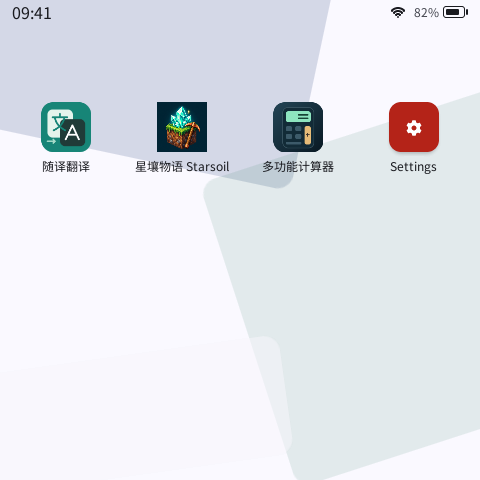
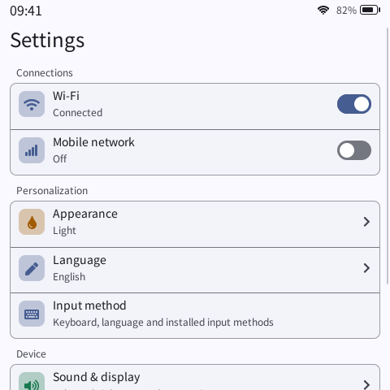

# PXA Workspace

[简体中文](README.md) · [Documentation](https://pxa.doit.am/docs/) · [Downloads](https://pxa.doit.am/docs/downloads/)

An ESP32 firmware workspace for PXA. Connect displays, touch, buttons, audio and storage to a common application system, then run PXA apps across board profiles and install or update them independently of firmware.

- **Board integration**: per-board drivers, configuration, partitions and dependencies behind a common build command.
- **App development**: a desktop simulator for UI and interaction, plus PXADB for device installation, logs and file transfer.
- **Product delivery**: board-specific system resources and factory presets, with app updates that do not require rebuilding firmware.

## Preview

| System desktop | System settings |
| :---: | :---: |
|  |  |

Captured from the real desktop simulator. Desktop apps are installed separately; device capabilities depend on the board implementation.

## Choose your starting point

| Your goal | Start here |
| --- | --- |
| Create an app | [DevKit quick start](https://pxa.doit.am/docs/first-app/); no firmware build required |
| Run or modify existing apps | [pxa-apps](https://github.com/SmartArduino/pxa-apps) |
| Modify firmware, connect hardware or customize a product | Continue below |
| Change the runtime, system UI or SDK | [pxa-system](https://github.com/SmartArduino/pxa-system) |

## Build firmware

```sh
git clone --recurse-submodules https://github.com/SmartArduino/pxa-workspace.git
cd pxa-workspace
```

Prepare the ESP-IDF environment required by your board guide, then build from the repository root. For example:

```sh
tools/firmware.sh doit-gamekit-2 build
```

Each board uses its own `build/firmware/<board>/`. Follow its guide for first installation, system fonts, serial settings and subsequent firmware updates.

### Board guides

| Board ID | Device and display | Guide |
| --- | --- | --- |
| `doit-gamekit-2` | ESP32-S31, 320×240, touch and controller buttons | [GameKit V2.0](firmware/boards/doit-gamekit-2/README.md) |
| `esp-mosaico` | ESP32-S31, 480×480, touch and sensors | [ESP-Mosaico](firmware/boards/esp-mosaico/README.md) |
| `doit-esp32s31-devkit` | ESP32-S31, 480×854 RGB display | [DOIT S31 DevKit](firmware/boards/doit-esp32s31-devkit/README.md) |
| `espp4-a` | ESP32-P4, 480×854 DSI display | [ESPP4-A](firmware/boards/espp4-a/README.md) |
| `sensecap-watcher` | ESP32-S3, 412×412 round display and rotary control | [SenseCAP Watcher](firmware/boards/sensecap-watcher/README.md) |
| `pai-touch` | ESP32-S3, 296×240, touch and audio | [Pai Touch](firmware/boards/pai-touch/README.md) |
| `epdiy-v7` | ESP32-S3, custom 40-pin e-paper wiring | [EPDiy V7 scope](firmware/boards/epdiy-v7/README.md) |

See [firmware/boards](firmware/boards/) for additional integrations. `doit-gamekit` and `doit-gamekit-1` are no longer maintained or included in new firmware releases; historical sources remain available.

## Develop apps with the simulator and a device

Clone the app repository into the workspace's local directory and start in the simulator:

```sh
git clone https://github.com/SmartArduino/pxa-apps.git local/pxa-apps
tools/dev.sh sim pixel-dungeon --source-root local/pxa-apps
```

With PXA firmware already running on your device, install and launch an app directly:

```sh
tools/dev.sh device --board doit-gamekit-2 pixel-dungeon --port /dev/ttyACM0
```

Use your actual serial port. Add `--watch` to rebuild and restart after changes. Run `tools/pxadb-gui.sh` for the desktop device manager; see [PXADB GUI](tools/pxadb-gui/README.md).

## Repository layout

```text
firmware/          ESP-IDF product, board drivers and system integration
simulator/         Desktop display and input profiles
factory/           Board-specific factory presets
extensions/        Product extension services
tools/             Firmware, app, simulator and device tools
deps/pxa-system/   Pinned system submodule
local/             Local app checkout, overrides and generated output
```

## Further reading

- [Workspace layout and workflow](docs/workspace-layout.md)
- [App packaging, installation and factory delivery](docs/pxa-app-delivery.md)
- [Simulator and display profiles](simulator/README.md)
- [New board template](templates/board/README.md) · [Existing firmware adapter](templates/legacy-board-adapter/README.md)
- [Cross-platform tools](tools/portable/README.en.md) · [Native Windows builds](tools/portable/windows/README.md)

For bugs or suggestions, use the [issue templates](https://github.com/SmartArduino/pxa-workspace/issues/new/choose) in Chinese or English. Include your board, firmware version and reproduction steps.
