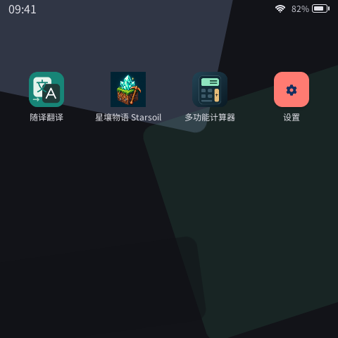
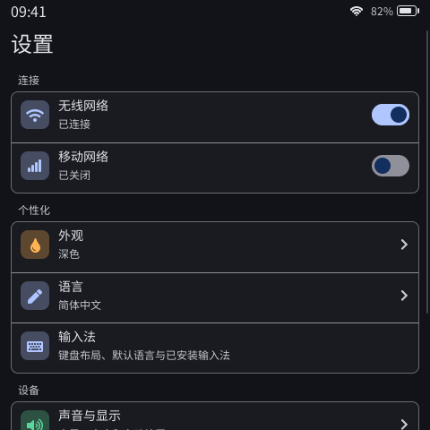

# PXA Workspace

[English](README.en.md) · [开发文档](https://pxa.doit.am/docs/) · [下载](https://pxa.doit.am/docs/downloads/)

面向 ESP32 设备的 PXA 固件工作区。把显示、触摸、按键、音频和存储接入统一的应用系统，让同一份 PXA 应用在不同板型上运行，并独立于固件安装和更新。

- **板级集成**：每块板子维护自己的驱动、配置、分区和依赖，使用统一命令构建。
- **应用开发**：桌面模拟器调试界面与交互，PXADB 连接真机安装应用、查看日志和传输文件。
- **产品交付**：按板型管理系统资源与出厂预置，日常应用迭代无需重新构建固件。

## 界面预览

| 系统桌面 | 系统设置 |
| :---: | :---: |
|  |  |

以上为真实桌面模拟器画面；桌面应用需单独安装，设备可用功能取决于板级实现。

## 选择开发入口

| 你的目标 | 从这里开始 |
| --- | --- |
| 开发一个应用 | [DevKit 入门](https://pxa.doit.am/docs/first-app/)，无需先构建固件 |
| 运行或修改现有应用 | [pxa-apps](https://github.com/SmartArduino/pxa-apps) |
| 修改固件、接入硬件或定制产品 | 继续阅读本页 |
| 修改运行库、系统界面或 SDK | [pxa-system](https://github.com/SmartArduino/pxa-system) |

## 开始构建

```sh
git clone --recurse-submodules https://github.com/SmartArduino/pxa-workspace.git
cd pxa-workspace
```

按下表的板级说明准备对应 ESP-IDF 环境，然后在仓库根目录构建，例如：

```sh
tools/firmware.sh doit-gamekit-2 build
```

每块板子使用独立的 `build/firmware/<board>/`。首次安装、系统字体初始化、串口参数和日常固件更新，均按对应板级说明执行。

### 板型入口

| Board ID | 设备与显示 | 接入说明 |
| --- | --- | --- |
| `doit-gamekit-2` | ESP32-S31，320×240，触摸与手柄按键 | [GameKit V2.0](firmware/boards/doit-gamekit-2/README.md) |
| `esp-mosaico` | ESP32-S31，480×480，触摸与传感器 | [ESP-Mosaico](firmware/boards/esp-mosaico/README.md) |
| `doit-esp32s31-devkit` | ESP32-S31，480×854 RGB 屏 | [DOIT S31 DevKit](firmware/boards/doit-esp32s31-devkit/README.md) |
| `espp4-a` | ESP32-P4，480×854 DSI 屏 | [ESPP4-A](firmware/boards/espp4-a/README.md) |
| `sensecap-watcher` | ESP32-S3，412×412 圆屏与旋钮 | [SenseCAP Watcher](firmware/boards/sensecap-watcher/README.md) |
| `pai-touch` | ESP32-S3，296×240，触摸与音频 | [Pai Touch](firmware/boards/pai-touch/README.zh-CN.md) |
| `epdiy-v7` | ESP32-S3，定制 40-pin 墨水屏接线 | [EPDiy V7 适配范围](firmware/boards/epdiy-v7/README.md) |

更多板级实现见 [firmware/boards](firmware/boards/)。`doit-gamekit`、`doit-gamekit-1` 已停止维护和新固件发布，保留历史源码。

## 应用与真机联调

将应用仓库放在工作区的本地目录，从模拟器开始：

```sh
git clone https://github.com/SmartArduino/pxa-apps.git local/pxa-apps
tools/dev.sh sim pixel-dungeon --source-root local/pxa-apps
```

设备已运行 PXA 固件时，可直接安装并启动应用：

```sh
tools/dev.sh device --board doit-gamekit-2 pixel-dungeon --port /dev/ttyACM0
```

串口名按实际设备修改。使用 `--watch` 开启保存后重新构建和运行。桌面管理工具入口为 `tools/pxadb-gui.sh`，操作见 [PXADB GUI](tools/pxadb-gui/README.md)。

## 工作区结构

```text
firmware/          ESP-IDF 产品工程、板级驱动与系统接入
simulator/         桌面显示与输入配置
factory/           板级出厂预置
extensions/        产品扩展服务
tools/             固件、应用、模拟器与设备工具
deps/pxa-system/   固定版本的系统子模块
local/             本机应用仓库、覆盖配置与生成产物
```

## 继续阅读

- [工作区结构与日常流程](docs/zh-CN/workspace-layout.md)
- [应用打包、安装与出厂交付](docs/zh-CN/pxa-app-delivery.md)
- [模拟器与显示配置](simulator/README.md)
- [新板接入模板](templates/board/README.zh-CN.md) · [已有固件适配](templates/legacy-board-adapter/README.zh-CN.md)
- [跨平台工具](tools/portable/README.md) · [Windows 原生构建](tools/portable/windows/README.md)

遇到问题或有改进建议，请使用 [Issue 模板](https://github.com/SmartArduino/pxa-workspace/issues/new/choose)，选择中文或英文，并提供板型、固件版本和复现步骤。
