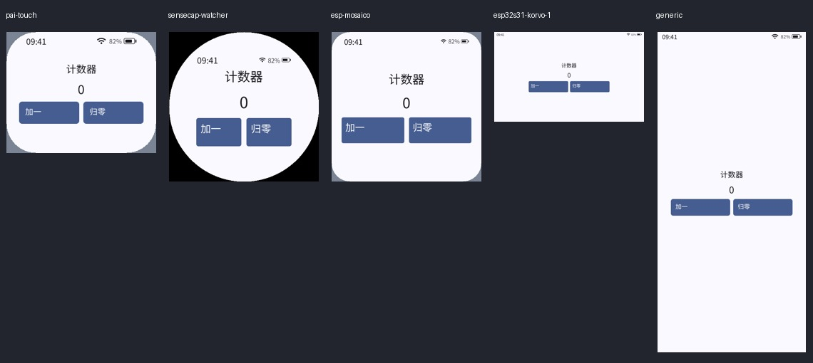
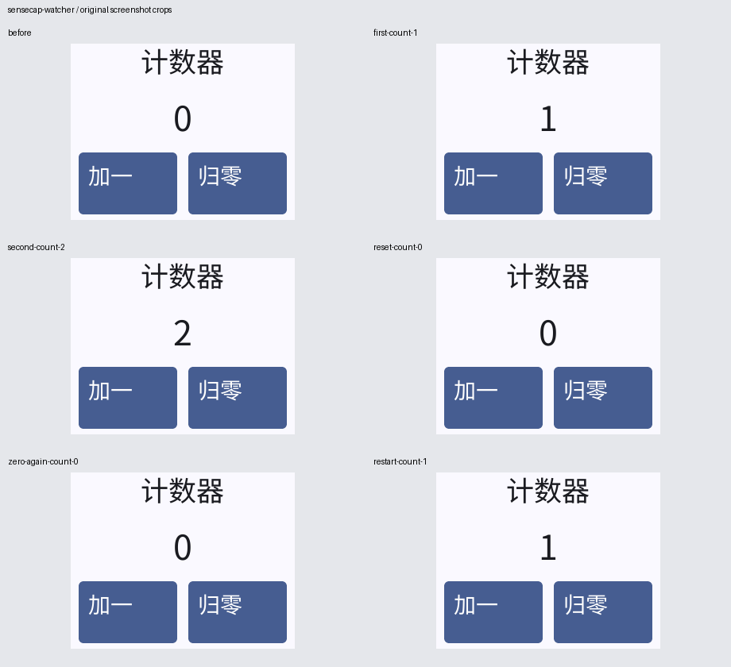
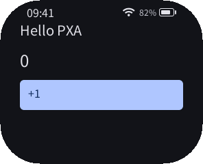
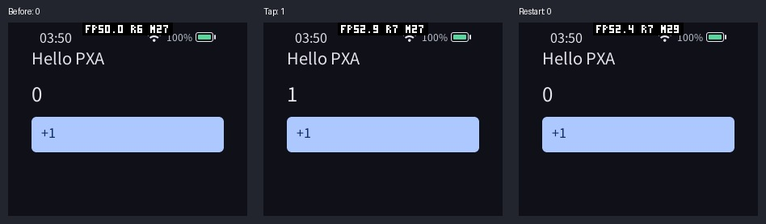

# PXA AI 开发套件 0.1.0：实际开发与验收

日期：2026-10-14。套件配合未修改的独立 DevKit 0.3.0 / Core 2 / C++26 使用。它提供四个可选技能、两个项目内 Codex 角色和自动验证脚本；普通用户与 CI 也能直接运行脚本，无需 AI 服务或 Python 第三方依赖。

入口：[官网教程](https://pxa.doit.am/docs/ai-development/)、[签名发行包](https://github.com/SmartArduino/pxa-system/releases/tag/ai-kit-v0.1.0)、[技能源码](https://github.com/SmartArduino/pxa-system/tree/main/ai)。AI 套件使用独立版本号，不替换已发布的 DevKit 0.3.0 附件或签名清单；后续完整 DevKit 的打包流程会携带 `ai/`。

已发布 `ai-kit-v0.1.0`，四个公开附件下载后与本地字节一致，签名和摘要再次通过。归档 19,517 byte，SHA-256 为 `6478e1b58d190a71569247b2a282a0f81ec648c9769aa1fa22e67bda4b3e5d21`。说明中文在前、英文在后；原 DevKit 标签及附件不变，Latest 仍为 v0.3.0。官网已原子部署提交 `2b203be`，24 个静态页面及 21 项搜索条目检查通过。

## 用户得到的能力

| 能力 | 采用原因与收益 | 开销与验证 |
| --- | --- | --- |
| `pxa-app-dev` | 查真实 C++26 SDK，再实现 UI、游戏与服务；减少凭空猜接口 | 按需加载指引与参考，不增加 Guest 代码；独立 AI 成功实现中文计数器 |
| `pxa-debug` | 统一离线构建、真实 Guest、身份确认、输入、日志和截图 | Python 标准库；五种屏幕实际运行，失败会留下证据 |
| `pxa-device-test` | 先确认 CPU/Core/设备，再安装与操作；明确清理和数据边界 | pai-touch 真机安装、点击、重启、截图和移除测试包通过 |
| `pxa-release` | 串联签名包、发布者证明、公钥登记与发布准备 | 沿用用户授权与已有 CLI；发行签名和下载后的完整性另行核对 |
| `pxa_developer`、`pxa_tester` | 将实现和独立验收职责分开，允许用户显式委派 | 继承用户模型及权限；Codex CLI 0.162.1 实际加载自定义 tester 并执行只读验收 |
| 项目安装器 | 可选加载、预览、重复安装、可控更新和卸载 | 不改全局配置、`AGENTS.md` 或权限；冲突先检查，用户修改保留，写入失败回滚 |

加载配置不会自动启用并行任务。全自动开发指用户指定范围内的实现、构建、运行、检查和修复；发布、设备写入仍遵循用户已给出的授权。

## 首次开发试用

为避免作者自己熟悉套件导致结论偏差，让一个独立 AI 仅根据套件与 DevKit 编写中文计数器，要求“加一”“归零”、不同 DPI、安全区及实际交互。它使用隔离项目和 XDG 目录，没有修改套件、DevKit、其他项目或设备。

首次读指引到实现、五屏运行、输入、视觉复核及主体报告约 **8 分 14 秒**；首次应用构建 12.68 秒。应用一次实现即构建与操作成功，使用 `Environment`、`SafeArea`、语义字体、dp 和状态绑定。可复现源码和输入脚本保存在 [示例](examples/ai-counter/main.cpp) 中。

| 屏幕配置 | 分辨率 / DPI | 初始验证耗时 | 交互验证耗时 | 实际画面与操作 |
| --- | --- | --- | --- | --- |
| pai-touch | 296×240 / 160，圆角 | 18.495s | 8.644s | 中文完整，0→1→2→0→0→1 |
| sensecap-watcher | 412×412 / 284，圆形 | 3.916s | 8.845s | 按钮处于安全区域，相同计数序列 |
| esp-mosaico | 480×480 / 305，圆角 | 4.017s | 8.959s | 高 DPI 字体、按钮正常，相同计数序列 |
| esp32s31-korvo-1 | 800×480 / 216 | 3.888s | 9.373s | 内容居中，相同计数序列 |
| generic | 390×844 / 160 | 3.873s | 9.185s | 竖屏布局完整，相同计数序列 |

耗时包含构建检查、启动、命令、截图和清理。首次另需 15.11 秒 debug 构建，交互每次显式等待 250ms；这些数字**不是 FPS 或触摸响应延迟**。独立试用共注入 25 次 tap，保留 30 张交互原图并实际逐状态检查；初始适配另有五张原图。





归零和重复归零与初始图逐像素相同，第一次与归零后再次加一图相同；0、1、2 的差异仅位于数字区域。这是实际看图后的佐证，并没有用像素差异冒充 OCR。

## 试用发现并修复的问题

1. **旧 DevKit 在退出后遗留 control socket。** 验证脚本改用本次运行独有的短路径临时 IPC 目录，避免干扰其他调试会话，也避免 Unix socket 路径过长。独立试用更新技能后再次操作小屏，实际观察到 bridge 与 native 进程继承私有目录；完成后目录和所属进程均不存在。该回归 9.088 秒，六状态截图再次正确。修复后作者还重新运行全部五屏。
2. **旧 DevKit 忽略 profile 的深色主题。** 修复 SDK CLI 的 `profile_options()`，为深色配置转发 `--dark`。单元检查覆盖深色和浅色参数；实际调用修复后的参数构造函数，将参数传给已发行 native 模拟器，确认显示深色。旧 DevKit 0.3.0 下载附件保持原样，因此上面的独立试用仍是旧发行包的浅色截图，不能称为新版完整 DevKit 测试。
3. **快速解锁命令成功，屏幕却仍锁定。** 真机首次快速 swipe 的截图实际为锁屏，拒绝把该轮计为应用交互通过。按设备时序使用较慢 swipe 并确认解锁画面后，重新执行安装、点击、重启。设备技能已补充“命令成功不代表已解锁”的检查。



## 安装、失败与 agent 验证

- 11 个针对性检查通过：选择性安装、重复安装、dry-run、agent 继承配置、冲突无部分安装、编辑保护、显式更新、卸载保留无关文件、拒绝软链接与恶意 receipt、写入失败回滚、输入场景边界、主题转发。
- 原有 CLI 的六个单元检查通过；四个技能的格式检查通过。
- 项目名带空格时完整安装、构建、五屏运行正常；实际 tap 和 swipe 使用本次输出的精确模拟器选择器。
- 实际制造 C++ 构建错误，助手返回失败，`result.json.runtime_passed=false`，保留编译日志；越界坐标在启动 Guest 和创建证据目录之前拒绝。
- Codex CLI 0.162.1 实际委派自定义 `pxa_tester`，没有退回通用 worker。它收到角色指令，读取四个技能并核对 14 个安装文件摘要，也正确判断宽 296 时 `x=296` 越界。此项是角色加载与只读检查，实际运行由前述试用完成。
- 当前机器的全局配置使 `--strict-config` 拒绝旧字段；`--ephemeral` 的自定义角色尝试出现缺失 parent rollout。使用正常 Codex 任务后通过，未修改用户全局配置。教程不依赖这两个选项。
- 使用可信发行公钥验证归档清单签名；候选归档重复构建字节相同，解压安装及篡改文件拒绝通过。正式附件在干净提交后构建，再做发布后下载验证。

## pai-touch 真机与内存边界

设备 `/dev/ttyACM2`，2,000,000 baud，Core 2；使用独立 Hello 测试身份。实际截图确认初始 0、点击后 1、停止并重新启动后 0。没有更新固件或修改显示、音频、电源设置；测试前后 PXA 包列表均为空。旧设备固件在卸载后暂留快捷方式，结束时重启设备并实际确认系统主页仅含“设置”，没有本次测试应用。



| 整机查询快照，单位 byte | 测试前 | 确认应用运行时 | 测试包移除后 |
| --- | --- | --- | --- |
| SRAM free | 55,447 | 55,447 | 55,447 |
| PSRAM free | 6,579,296 | 6,579,696 | 6,579,680 |
| SRAM 历史最低 free | 17,824 | 17,824 | 17,824 |
| PSRAM 历史最低 free | 6,138,260 | 6,073,068 | 6,073,068 |

这组接口返回的是**整机快照和启动以来的历史最低值**，不能推导本次应用线性内存、初始化峰值或逐帧临时内存；三次快照均在最终清理重启之前。查询期间没有预算拒绝或分配失败。模拟器的 ESP 堆查询不支持，助手如实记录 unavailable。

AI 技能、角色和验证脚本均没有进入设备固件或应用包，设备上无 AI 常驻进程，新增 SRAM、PSRAM、Guest 线性内存、帧/深度缓冲、命令队列占用均为 0；这是部署结构的结果，不是对游戏内存优化的测量。桌面需要 Python 和构建/截图文件；实际上下文与模型成本由用户选用的 AI 工具决定。

## 复现

安装并验证 DevKit 与 AI 签名包，令 DevKit `bin` 位于 PATH；在工作区根目录执行：

```sh
cp -r docs/examples/ai-counter /tmp/pxa-ai-counter-test
python3 /path/to/pxa-ai-kit-0.1.0/install.py install \
  --project /tmp/pxa-ai-counter-test --agents
python3 /tmp/pxa-ai-counter-test/.agents/skills/pxa-debug/scripts/verify_app.py \
  /tmp/pxa-ai-counter-test --pxa /path/to/devkit/bin/pxa \
  --output /tmp/pxa-ai-counter-evidence --headless --online \
  --scenario /tmp/pxa-ai-counter-test/scenario.json
```

临时项目和证据目录须不存在；第一次需要锁定工具时用 `--online`，依赖已经缓存后用默认离线模式。检查五屏的 `before.png` 和场景截图，预期 0→1→2→0→0→1。项目构建缓存、锁和存档按正常 CLI 行为保留；需要干净状态时另建独立项目。

维护者检查：

```sh
cd deps/pxa-system
PYTHONDONTWRITEBYTECODE=1 python3 -m unittest discover \
  -s tools/release -p test_ai_kit.py -v
PYTHONPATH=tools python3 -m unittest pxa_tools.test_tools -v
```

原始日志与独立试用报告保存在本机 `local/ai-kit-20261014/`，摘要见 [机器记录](ai-kit-validation-20261014.json)。公开证据不包含开发私钥、设备数据或 AI 账户凭据。

## 限制

脚本不自动识别任意布局、猜触摸坐标、理解画面或测量物理延迟；AI 需要检查截图并维护适用的输入场景。深色完整 DevKit、其他板卡真机、长时间游戏帧率、音频和真实运行峰值不属于本轮证据。四个指引可覆盖更多任务，但没有把计数器成功外推成所有游戏与发布服务都已端到端验证。
