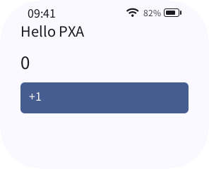
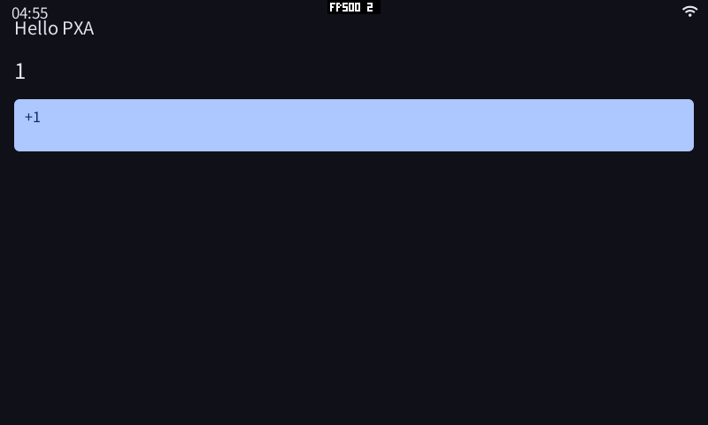
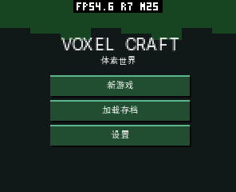
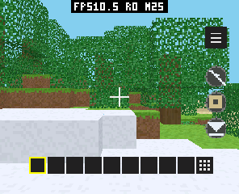
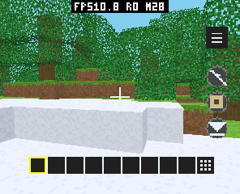

# 应用商店与跨平台开发配套验证 · 2026-10-14

本轮将 pxa-apps 的全部 21 个应用更新到生产商店，发布 84 个当前分目标包及 21 份中文介绍、分类和实际运行截图；提供 Windows/macOS 可用的容器构建与宿主机串口调试配套，并保留完整原生 DevKit 的平台边界。

## 可取得的发行

- [DevKit 0.3.0](https://github.com/SmartArduino/pxa-system/releases/tag/v0.3.0)：已有不可变 tag、附件和签名清单保持不变。
- [跨平台配套 0.1.0](https://github.com/SmartArduino/pxa-workspace/releases/tag/host-tools-v0.1.0)：预构建 amd64 DevKit 容器、宿主机 PXADB、包装器、签名验证器、双语文档。5 个公开附件全部回读并核对长度和 SHA-256，清单签名验证通过。
- [AI 开发调试配套 0.1.0](https://github.com/SmartArduino/pxa-system/releases/tag/ai-kit-v0.1.0)：4 个可选 skill、2 个继承权限的 Codex 角色及插件/安装器；独立开发试用和真机验证见[专门报告](ai-kit-validation-20261014.zh-CN.md)。
- [已部署跨平台教程](https://pxa.doit.am/docs/cross-platform/)与[生产商店](https://app.doit.am/)。

Release 均为中文在前、英文在后。原 DevKit 仅追加配套链接说明，没有重新打包旧版本。工具与文档实现提交 `7a88e5b`，Docker 载入名称说明补充于 `f1e9572`；官网对应部署提交 `ba6c054`。

## 应用发布

四种当前 Host profile 分别为 `esp32-s3-pxa-0.3.0`、`esp32-s31-pxa-0.3.0`、`linux-x86_64-pxa-0.3.0`、`portable-wasm-pxa-0.3.0`。每种目录均返回 21 个当前应用。对全部 84 个附件取得正式票据、下载并核对本地签名包的长度与 SHA-256；更新 Store 0.8.5 后再次检查了当前目录。

生产库由 16 应用 / 39 release / 83 artifact 变为 22 / 61 / 171；额外一个非本轮应用、旧版本及旧 profile 保留。重复运行发布器得到 21 个 SKIP，没有重复 release；数据库备份保留在服务器维护备份目录。应用版本、大小、摘要及截图来源见 [pxa-apps 发布报告](https://github.com/SmartArduino/pxa-apps/blob/main/docs/store/20261014/README.zh-CN.md)。

发布器先完成签名、发布者、版本序号、Core/架构与全部图片路径预检，然后写入数据库。新 Core 2 包不再被硬编码到 Core 0.1 profile。中文描述与截图通过可选 listings 导入，相同图片按摘要幂等复用；不依赖运行时抓取其他网站截图。

## 跨平台路线与实测

| 场景 | 已验证 | 边界 |
|---|---|---|
| Linux x86_64 原生 DevKit | 使用固定 0.3.0 编译本轮 84 个包 | glibc ≥ 2.39 |
| Linux Podman 载入发行 Docker archive | 载入后运行原发行包装器，PXA 0.3.0；离线初始化含空格路径项目，构建 S3/S31/x86_64，运行真实 Guest 截图 | 无界面 SDL dummy |
| 本机 PXADB + 容器产物 | Korvo-1 安装容器生成的 Hello，显示 0、触摸后显示 1，卸载并保留原 3 个应用；pai-touch 商店链路及截图/输入；Watcher INFO | 三台实机端口由本次枚举确认 |
| Windows/macOS 宿主机 | 移除 Windows 不存在的 os.getuid 依赖，宿主机串口发现分支与参数检查通过；提供 COM、/dev/cu.* 命令 | 没有 Windows/macOS 实际主机与 USB 驱动测试 |
| Apple Silicon / ARM Windows | 明确使用 linux/amd64 仿真 | 未实测速度，未发行完整 ARM 原生 DevKit |

容器只负责编译、签名、打包与无界面模拟器；USB 始终留在宿主机，由 Python PXADB 使用 COM 或 /dev/cu.*。不要求 USB/IP，不把设备权限带进构建容器。包装器拒绝 `run --device` 并给出本机调试指引；路径作为 argv 传递，含空格路径可用，逗号绑定挂载歧义提前拒绝。开发身份、缓存和增量目录持久保留，不随一次容器退出丢失。

发行 archive 由 Podman 导出，名称为 `localhost/pxa-devkit:0.3.0-linux-amd64`。**Docker 用户载入后必须添加包装器的默认名称**：

```sh
docker load --input pxa-devkit-container-0.3.0-linux-amd64.tar.gz
docker tag localhost/pxa-devkit:0.3.0-linux-amd64 pxa-devkit:0.3.0-linux-amd64
```

Podman 用户换为 `podman load/tag` 并给包装器加 `--engine podman`。这只增加名称，不复制镜像层。发现该名称差异后，已更新双语源文档、官网和 GitHub Release 正文；0.1.0 归档内原 README 尚未包含此补充，按最新 Release/官网执行。已验证原包装器经该步骤输出 PXA 0.3.0，没有覆盖已发布附件。

容器归档 304,720,319 B，SHA-256 `8acc1c1cb30cfbb32cb05775cb552d5ee868c4c77ccd86bba12c3418750fd789`；宿主机工具 28,989 B，SHA-256 `7dea8eb3277a733a44a392ce5e7b21fce1fbce51e57f1a5b8f22b40191530770`。签名清单记录来源 DevKit 摘要 `7915b83a512064520b8c84bc17b88a6bb0c9b8a4050a43f7fdd19ce9ae4ce1d6` 与镜像 ID。公开回读通过 GitHub public release asset API；服务器到 github.com 浏览器下载域名曾超时，没有据此宣称所有网络路径均畅通。






## 本轮真机发现与修复

Store 长中文描述曾在 120 字节缓冲尾部留下半个 UTF-8 码点，Host 拒绝整次 UI 更新。`bb7ef75` 改为逐码点写入并保留有效前缀，校验原始编码、\u、代理对和剩余输入。最终 Store 0.8.5 / sequence 13 的四目标包已发布；pai-touch 可正常浏览中文目录和详情。

pai-touch 原本没有 PXA 预置应用。普通安装的 pxa-store 无法调用安装服务，这是此次测试时的 built-in 权限规则。此次通过受保护 factory root 预置已验证 Store，保持普通 Guest 的权限限制；未把权限规则放宽到仅凭 App ID 授权。当时 managed overlay 不保留 built-in 身份，Store 自身走 factory 更新流程。

2026-10-16 后续变更：按用户要求，安装服务向运行中的已安装、已启用签名应用开放，
不再限定预置位置、发布者或商城名称。普通安装和更新的商城可调用；每次安装、更新和
离线包安装仍需系统原生弹窗确认，不能静默安装。旧固件仍有本节描述的限制，需要更新
Host，单独更新商城包不能解除限制。详见 pxa-apps/store/docs/install-access-20261016。

预置操作还发现 `FSUNLOCK` 后仍不能创建缺失的 `system/pxa` 父目录。`93a619c` 仅允许显式解锁后 mkdir 这两个受保护父目录（PXA/fonts）；文件上传、删除和替换仍使用严格子路径策略。输入邮箱及路径策略 ASan/UBSan 检查通过，没有新增运行时缓存。

实际安装后按“打开”还发现结果弹窗调用了底层运行时启动，缺少系统页面实例，屏幕停在桌面。`aae70e2` 改用现有 `pxa_host_request_launch`，通过系统任务管理器安排页面和前台生命周期；未增加 ABI 或复制第二套启动逻辑。

修复构建完成后仅刷写 pai-touch 的应用分区 `0x10000`，保留引导程序、分区表、NVS 和数据分区。刷写前完整应用分区备份 7,274,496 B 保留在本地验证目录，SHA-256 `64342df687fbd8f07f5376062d4de175ee41e6fef7cd2ef80b842672f7f1b7bb`；最终修复镜像 3,391,712 B，esptool 验证写入摘要成功。

## 实机下载、安装、启动与清理

pai-touch 使用 factory 预置的生产 Store 0.8.5，真实完成游戏绘制基准 0.4.1 与体素世界 0.12.4 的目录浏览、详情、下载、Host 验证预览、确认安装与已安装版本核对。安装权限规则未绕过，预览后用户确认才写入安装状态。

启动修复后重走绘制基准的下载/确认安装链路，从系统“安装成功”弹窗直接点打开，实际出现绘制画面，生命周期日志记录 `foreground=1`，基准日志开始报告可见/渲染帧。体素世界显示标题、取得音频权限后进入新游戏，右侧滑动改变视角。两项均以实际画面确认，不以 active 标志替代显示验证。








pai-touch 最终仅保留本轮新增 Store 0.8.5（builtin）和体素世界 0.12.4。测试调试副本与绘制基准已卸载，所有应用退出，受保护 FS 恢复锁定，回到系统锁屏；原设置未调整。Korvo-1 的容器 Hello 已卸载，原 jump-jump-3d / maze-evil / voxel-craft 三个应用及数据保留，回到系统界面；Watcher 未写入固件或应用。

复现时在同类 Core 2 设备预置受信任 Store，打开“应用”中游戏绘制基准的详情，安装并确认预览，在成功弹窗点打开；再在“游戏”中对体素世界执行同样步骤，授权音频后点新游戏并在右侧滑动。后端票据会过期，复现必须重新从当前商店请求，不能重放历史票据。

## 验证数量与限制

- 84 个应用目标构建通过；21 张介绍截图实际检查。
- 71 项 PXADB 单元检查、3 项容器参数检查、13 项后端发布/商城相关检查通过。
- Store UTF-8、票据及 PXADB 输入/路径策略原生检查通过，相关内存访问检查使用 ASan/UBSan。
- 官网 22 篇指南、25 个 HTML 页面本地链接/资源/锚点检查通过；实际部署后检查公开教程及商店健康端点。
- 界面截图覆盖启动菜单及本轮商店链路；没有声称完整通关 21 个游戏、全平台 USB 或所有屏幕配置实测。
- 本轮没有性能基线或全系统内存峰值对比，不据截图 FPS 或提交帧率宣称游戏加速。UTF-8 修复保持原缓冲和网络预算，无新增堆分配；正确的前台应用管理复用系统已有生命周期。

机器可读构建、下载与发行回读记录见[验证清单](apps-platforms-validation-20261014.json)。
