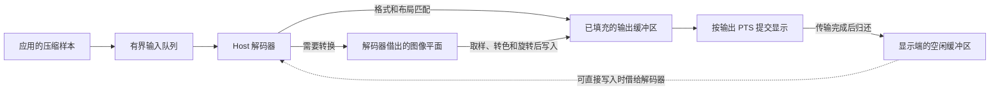

# PXA 视频解码直达 Surface 的设计草案

**提案。** 扩展 Video 和 Surface，让本地播放器、流媒体应用和摄像头预览共用 Host 的解码显示路径。应用负责取流、解复用、选择轨道和 UI。Host 负责压缩样本入队、解码、按时呈现及缓冲区回收。板级差异由 Host 处理。

## 先确定输出，再解码

绑定时，应用提供自己拥有的解码器、目标 Surface、显示区域、画面适配方式和时钟来源。Host 根据视频可见尺寸、面板扫描方向、像素格式、行跨度、内存对齐及是否需要合成，确定谁提供输出缓冲区。稳定播放期间复用该配置。旋屏、分辨率变化、遮挡或切换前台时重新判断。

| Host 选用的路径 | 像素从哪里来，到哪里去 |
|---|---|
| 格式、布局和可见区域匹配 | 显示端借出一个可写缓冲区，解码器直接写入。显示队列交接缓冲区引用与输出 PTS。Mosaico 的原生程序已用这条数据路径把 RGB565 BE 视频居中送到面板窗口。 |
| 要缩放、旋转或换色 | 显示端提供最终目标缓冲区。候选实现一是从解码器的 YUV 平面直接缩放、转色、旋转到目标。候选实现二是复用乐鑫优化过的 packed RGB565 输出，再一次取样写到目标。比较总耗时，包括 YUV 重排、缓存同步和等待硬件。 |
| 有弹幕、HUD 或系统 UI | 复用 Surface 的可见区域和 alpha 图层。有可读底图且板级支持时，仅在重叠区域混合透明像素。需要重建背景时使用已有合成器。弹幕移走或暂停时能重绘上一帧。系统提示、锁屏和截图服从现有 Surface 的呈现规则。 |

GameKit 2 播放 640×360 视频时，逻辑画面是 320×180，上下各留 30 像素。一个 320×240 RGB565 面板输出缓冲区占 150 KiB。采用 YUV 直接变换时，只计算目标区域需要的 RGB 像素，可省去 450 KiB 的全尺寸 RGB565 暂存。若采用 packed 输出，仍能把后续缩放、旋转和线序变换合为一次目标写入。每块缓冲区首次使用或布局变化时初始化黑边。从其他画面切回时重新填充受影响区域。面板支持窗口传输时可进一步只传视频矩形，同时保留可供截图和系统合成使用的完整显示内容。

## 应用只提交样本

以下是拟议的语义。操作码和结构布局在协议实现时分配。

| 操作 | 约定 |
|---|---|
| 查询和绑定 | 查询是否支持解码器输出到 Surface、输入封装以及队列上限。绑定只接受同一前台组件拥有的句柄。同一个 Surface 同时只有一个像素生产者。绑定失败原子返回，应用可继续使用现有解码读回接口。 |
| 提交样本 | 一次可提交一个或一批样本。描述符给出数据区间、PTS、时长和标志，应用按解码顺序排列。先校验描述符和偏移范围，再按队列容量接收完整样本前缀，返回已接收个数。零空间时返回 `WOULD_BLOCK`。就绪通知在从不可写变成可写时唤醒应用。 |
| 输入缓冲 | 首版由 Host 持有有界压缩包池。对 MP4 长度前缀格式，在复制进池的同一遍生成 Annex-B，并完成边界检查和解码器要求的尾部填充。调用返回后应用即可复用已提交的内存。未来若有受 Host 管理的只读媒体数据句柄，可直接引用其样本范围。 |
| 播放控制 | 暂停、速率或定位可分别更新时钟或冲刷队列。正常结束先排空解码器的重排帧，再等最后一个输出完成。提供合并的进度、背压、结束和错误通知，普通播放无需应用逐帧轮询。 |

绑定模式使用独立的能力位，与原有帧信息查询、像素读回和 GuestMapped Surface 路径共存。同一解码器在空闲时选择一种输出模式。旧模式继续遵守每次解码使上次输出失效的契约。Host 内部借用的图像携带像素平面、跨度、色彩参数、有效区域、输出 PTS 和释放操作，底层指针仅在借用期间有效。

应用可以先创建一个由 Host 填充的 Surface，继续通过原有图层接口设置位置和叠层。绑定成功后才按选中的路径分配像素存储。直出支持借用板级缓冲区，跳过 GuestMapped 双缓冲和解码器专用 RGB 暂存的重复分配。解码调用暂时没有输出或输出延迟重排帧时，立即归还未占用的目标槽，并以实际输出 PTS 标记已完成的帧。切换合成方式时在帧边界交接，同一个输出引用只释放一次。

## 流水线、时钟和生命周期

- **解码与显示并行。** 每路 H.264 按解码顺序运行一个解码器，保留库内已有的双核并行。解码下一帧可与上一帧的像素变换或 LCD DMA 重叠。初始复用板级双缓冲，按内存配额、可用 DMA 槽和实测等待决定是否增加第三块。分别限制压缩队列的字节数、样本数及待显示帧数。解码线程等待可用资源时释放锁。
- **显示权由 Surface 持有。** 解码器写完后移交只读引用。变换任务完成读源后释放源图，LCD 完成 DMA 后归还扫描缓冲。乐鑫 YUV 接口返回有效 release token 时允许跨任务持有平面。没有 token 时，在下一次解码前完成取样或复制。截图或重绘需要保留当前图时，按后端能力借用最新完成帧或保留合成底图。
- **音频决定播放进度。** 有音频时，将首个有效音频 PTS 与输出设备播放位置关联，根据实际播出的采样数推进媒体时钟，并计入重采样和播放速度。只能报告已提交位置的设备，应扣除仍在软件和 DMA 队列中的样本，标记为估算值。有硬件完成信号时用它校正。无音频时用单调时钟。AAC 可复用现有异步 Audio 接口，其他编码按能力选原生解码或向同一 Audio 服务提交 PCM。GameKit 2 需接通自己的输出后端并验证此时钟。
- **按输出时间戳选择画面。** 压缩包按解码顺序进入，按解码器返回的展示 PTS 调度输出。在接近显示期限时才送入 Surface 的最新帧队列，避免未来帧替换当前应播帧。参考帧仍需解码。结果已过期时，YUV 路径可在转色前释放，packed 路径可跳过后续缩放和刷屏。解码严重落后时，应用可从下一可独立解码的位置重新供包。摄像头预览可选择只显示最新帧的策略。
- **暂停、定位和关闭。** 暂停冻结媒体时钟并保留最后可重绘画面。定位、换轨和关键格式变化更新代次，清理积压并重新建立时钟。迟到的旧回调仅释放原引用。后台、Surface 销毁及解码器关闭时撤销绑定，等待已提交硬件操作的完成信号再归还内存。切换到可信系统画面后，旧代次的帧不能重新提交。

## 当前实现

Billy 创建由 Host 持有 RGB565 缓冲区的 Surface，并将视频矩形绑定到解码会话。应用可以用 `PREFERRED_SIZE` 查询保持比例的硬件缩放尺寸。P4 和使用平面输出的 S31 可按 1/16 步进，让 PPA 同时缩放和转色，将结果写入居中的视频矩形。S31 在片源至少为 640×360 像素且目标面积至多为源面积三分之一时使用这条路径。Host 将 YUV420 平面重排为 PPA 原生输入格式，并在硬件资源不足或尺寸不匹配时使用 CPU 转换。黑边按绑定和缓冲区初始化。

ESPP4-A 和 GameKit 2 的生产者可将重排后的 YUV420 随 Surface 读租约交给显示端，随后解码器即可释放源图。生产者通过 `pxa_surface_region_fill_t` 声明本帧完整覆盖的视频矩形及其黑色边缘。原生载荷能放入当前 RGB565 槽时直接复用该槽，较大的载荷使用按 Surface 所有者配额分配的独立缓冲。视频直出时，PPA 将这份载荷一次转色、缩放并旋转到板级物理帧缓冲区。

HUD、暂停预览和其他逻辑 RGB 读取共用一块按需分配的 RGB565 缓冲。读租约有效期间，原生画面和 RGB 输出各有独立地址。同一帧可重复读取缓存。连续直出后，Surface 归还读回缓冲。生产者切回 RGB 时按本帧视频矩形恢复黑边，普通局部更新仍能读取原槽的逻辑像素。

应用在前一帧准备好后按 PTS 提交。支持 `PREPARE_AND_QUEUE` 的后端可以在填充当前 Surface 时启动下一包解码。后端分别持有当前参考图像和下一解码任务所需的内存，准备失败或遇到背压时应用仍可重试原包。旧 Host 支持分开的准备和排队调用。显示端取得替换帧的读租约后，生产者可以重用上一块已释放的缓冲区。

当前视频输入队列深度为一。批量接收压缩包、Host 音频主时钟以及将 LCD 扫描缓冲区直接借给解码器仍属于下述后续设计。

## 实现顺序和验收

1. **先打通绑定和计量。** 在 libpxa 增加能力协商、绑定和有界样本提交，在 ESP Host 接到 Surface 的呈现和释放回调。第一版沿用现有 RGB565 和合成后端，先验证功能等价、旧包兼容、背压、暂停、定位、后台和错误恢复。
2. **替换像素热路径。** 先用 Mosaico 原生测试程序支持的尺寸验证直接输出。GameKit 2 对同一码流比较 packed RGB565 融合取样、YUV 平面融合取样和可用的 PPA 转换。ESPP4-A 按芯片版本及已验证的像素实现接入。各板保留可正确合成 HUD、弹幕和系统 UI 的路径。
3. **隔离其余等待。** 在相同显示路径上分别启用异步音频和批量压缩输入，记录各自收益。只在网络到应用的复制仍占主要预算时扩展通用的只读媒体缓冲接口。

**建议的首轮性能目标**是在同板同片、同帧段、同策略的缓存回放中，有效 LCD 完成帧率达到原生基线的 90% 以上，P95 帧间隔在原生的 1.1 倍以内。原生对照应共用同一像素后端、内存配置、解码模式、音频输出、画面区域及显示策略。比较真实在线播放时单列下载等待和缓冲停顿，并核对跳帧比例、媒体推进速度和音频欠载。同一帧的 UI 重绘只算一次有效视频帧。

覆盖 360p、480p、横竖画面、无叠层、弹幕滚动及系统叠层切换。记录解码调用耗时、任务实际运行与等待、像素变换和 YUV 重排耗时、Surface 等待、DMA 完成、P95/P99 帧间隔、音画偏差、峰值内部 RAM/PSRAM 及固件分区余量。并行阶段分别计时。用固定帧检查颜色范围、字节序、方向、黑边和截图，并验证定位后无旧帧、退出后内存回到基线。目标值用于检验设计，性能结论以匹配负载的实机结果为准。

现有接口和实现可参阅 [Video 协议](../../deps/pxa-system/spec/draft/video.md)、[Surface 的显示与图层规则](../../deps/pxa-system/spec/draft/surface.md)、[ESP 编解码实现](../../firmware/components/pxa_video_codecs/README.md) 和 [Mosaico 原生播放对照程序](../../firmware/components/pxa_video_codecs/tests/online-bench/README.md)。
