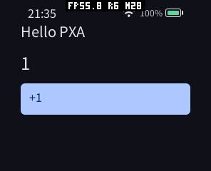
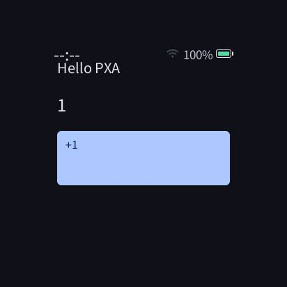
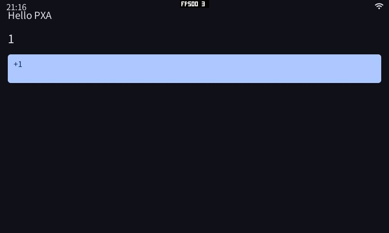
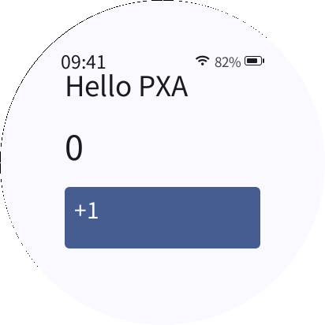

# PXA DevKit 0.3.0：实现与验证报告

本轮交付独立、可搬移的 C++26 开发包、统一 `pxa` 命令、可验证的在线/离线分发、商城发布接口和官网教程。发行版本为 **0.3.0**，Guest Core ABI 为 **2.0**。这次没有修改游戏的几何、光栅化或音频热路径，不将构建提速解释为游戏 FPS 提升。

## 设计与实现

| 原因 | 实现及收益 | 内存与验证 |
| --- | --- | --- |
| App 开发依赖完整固件工作区和宿主工具安装 | DevKit 打包 C++ SDK、WASI SDK 34、固定 WAMR/LLVM、Python/CMake/Ninja、PXADB、原生模拟器、字体与屏幕 Profile；`pxa init/build/run` 可在仓库之外使用 | 桌面依赖使用私有相对 RPATH，避免影响 CMake 启动的系统 shell；不增加设备默认缓存。无 Python、CMake、编译器且无网络的 Ubuntu 24.04 中通过 |
| 多目标和重复打包浪费构建工作 | 一次 Wasm 编译，按内容缓存 AOT、资源和签包；有界并行编译；`pxa.lock` 锁定 SDK 内容、工具摘要与目标配方 | 不引入 Guest 分配；多目标、重复构建和搬移目录验证通过 |
| 热重载失败时先停止当前应用 | 先构建，再替换；构建失败保留正在运行的应用，安装失败恢复原运行状态 | 开发工具测试覆盖失败分支；默认模拟器无额外调试桥进程，`--debug` 才开启 |
| 下载和版本更新缺少统一约束 | 同一组组件支持在线和离线安装；验证清单签名、大小与 SHA-256；限制解压、路径和链接；原子安装、明确版本不可覆盖 | 安装流式读写；签名篡改、目录逃逸、重复文件、离线访问与资源缓存检查通过 |
| 包编码整文件读取造成高峰值 | 按 4096 字节流式编码，增量摘要，回填长度 | 同一输入前后编码字节与摘要完全相同；Python 分配峰值见下表 |
| 商城把发行版本或单一目标当作兼容依据 | 新增不可变 `*-pxa-0.3.0` Host 配置；按 Core、服务/特性以及每个组件的 AOT/Wasm 目标判断；保留历史配置 | 数据迁移与兼容边界回归通过，不重签发布者的包 |
| 自动上传复用网页登录不便 | 应用范围上传令牌，数据库仅保存摘要，支持到期、撤销和账号认证失效；`pxa publish` 先本地验包，再上传 | HTTPS 流式传输；服务端仍执行原有签名、配额、递增序列、审核和审计规则 |
| Watcher 连续截图返回旧缓存 | 每次截图请求读取新的已完成帧，正常显示不增加拷贝 | 复用已有截图缓冲；真实计数变化和三次重启截图通过 |

目标配方保持 `-O3`。ESP32-S31 的 AOT `size-level=3` 是其既有代码模型约束，不改成 `-Os`。C++26 语言模式与必要特性由编译检查保证；WASI SDK 当前未提供的 `std::inplace_vector`、`std::function_ref` 继续使用 SDK 已有替代能力，不假定语言模式等于所有标准库特性已齐备。

## 可重复的桌面测量

环境：固定 Ubuntu 24.04 镜像 `sha256:534baea6a22c03a63003dbc8dbe78fe34bc0d7e595d9a9dc9834884ff530eb55`，Linux x86_64、glibc 2.39，DevKit 只读挂载，项目与用户数据单独挂载；无网络、无源码仓库挂载、无系统 Python/CMake/Clang。

| 同一 Hello 项目与工作负载 | 实测 |
| --- | ---: |
| 首次构建 simulator、ESP32-S3、ESP32-S31 三目标包 | 23.33 s |
| 输入不变，重复构建同一三目标包 | 0.91 s |
| SDK 与项目分别搬移后重建 | 17.07 s |
| 搬移后缓存命中，模拟器启动前的构建阶段 | 0.99 s |

搬移后 `pxa.lock` 内容摘要保持相同；本地 CMake 缓存按新绝对路径重新生成。上述是候选包的实测值，最终包再次执行安装、三目标构建与真实 Guest 运行检查。首次和缓存命中属于不同缓存状态，不代表编译器本身快了 25 倍，也不是 C/C++ 游戏性能对比。

流式编码比较使用同一 8 MiB 输入和 Python `tracemalloc`，不是进程 RSS：

| 编码 | 修改前 Python 峰值 | 修改后 Python 峰值 | 输出大小 |
| --- | ---: | ---: | ---: |
| store | 17,074,600 B | 140,623 B | 8,396,816 B |
| LZ4 | 17,615,606 B | 632,509 B | 583,696 B |

两种编码的前后输出 SHA-256 分别完全相同。设备解包协议和缓冲大小没有因该优化改变。

## 真机验证与内存

按设备实际 INFO、芯片和面板确认连接，当前串口与最初提供的名称对应关系不同：

| 实际设备 | 串口/波特率 | 面板 | Flash |
| --- | --- | --- | --- |
| pai-touch | `/dev/ttyACM2` / 2,000,000 | 296×240 | 16 MiB |
| SenseCAP Watcher | `/dev/ttyACM1` / 2,000,000 | 412×412 | 32 MiB |
| ESP32-S31 Korvo-1 | `/dev/ttyUSB0` / 2,000,000 | 800×480 | 16 MiB |

三台设备均备份原应用分区后，仅更新 0x10000 的应用固件；保留引导、分区表、NVS、文件系统和已有应用数据。验证 C++ Hello 的安装、启动、实际点击计数 0→1、前后台切换、停止和连续三次重启。独立 DevKit 根据 INFO 自动选择 S3/S31 构建目标并执行真机安装。Watcher 使用 UART0 调试配置，其 Wi-Fi 缓冲恢复为仓库中既有的静态 RX=4、动态 TX=6，未修改设备持久设置。

以下是同一新固件中、Host 已热启动后的独立测量窗口：空闲基线 → `MEMORY START` → 启动 Hello → 点击 → `MEMORY STOP`。窗口不包含截图分配。单位为字节：

| 设备 | 空闲 SRAM 剩余 | 运行 SRAM 剩余 | 窗口最小 SRAM 剩余 | 空闲 PSRAM 剩余 | 运行 PSRAM 剩余 | 窗口最小 PSRAM 剩余 |
| --- | ---: | ---: | ---: | ---: | ---: | ---: |
| pai-touch | 56,727 | 55,535 | 52,151 | 6,994,828 | 6,580,604 | 6,327,136 |
| Korvo-1 | 111,275 | 97,583 | 97,547 | 12,490,880 | 12,140,756 | 9,781,148 |
| Watcher | 35,026 | 31,146 | 18,446 | 6,253,376 | 5,838,472 | 5,050,656 |

相对各自空闲基线，本窗口真实额外峰值为 pai-touch **4,576 B SRAM / 667,692 B PSRAM**，Korvo **13,728 B / 2,709,732 B**，Watcher **16,580 B / 1,202,720 B**。这些数包含 Host UI、AOT 装载、任务栈和 Guest，不能全算作 Guest 线性内存。

对应启动以来历史最小剩余值分别为 pai-touch 17,824 / 6,140,212 B、Korvo 6,376 / 9,779,740 B、Watcher 7,766 / 4,778,656 B；它们包含首次初始化及之前操作，不能代替本次运行峰值。旧固件与新固件的 heap 能力统计口径不完全相同，本报告不据此声称整机 RAM 前后减少。

停止并等待异步回收后，PXA 资源预算回到原基线，拒绝分配和分配失败计数均为 0。Hello 的 Wasm 初始内存为 2 页、上限 16 页（1 MiB）；上限不是实际占用。该 UI 应用没有 GameRender 帧缓冲、深度缓冲或绘制命令队列分配，不能用其数据估算 3D 游戏内存。本次工具链改动没有增加设备默认热路径缓存或分配。

实际设备与模拟器截图：









## 检查范围

| 检查 | 结果 |
| --- | --- |
| 原生/模拟器 CTest：Core、SDK 音频/国际化/声明式 UI/服务安全、队列背压、IPC、实际 Guest、六种屏幕 Profile | 96/96 通过 |
| DevKit Python：编码/缓存/签名/离线/安全解压等 | 6/6 通过 |
| 工作区开发循环、调试桥、PXADB | 分别 14/14、17/17、69/69 通过 |
| 商城：兼容、发布令牌、签包上传和现有工作流 | 18/18 通过 |
| C++ 商城客户端票据回归 | 原生 C++26 `-Werror` 通过 |
| 现有 C++ 商城 App 使用独立 DevKit 构建、国际化与图像资源生成、三 CPU 目标、本地签名验包和实际圆屏 Guest | 通过 |
| 空白环境、只读 DevKit、无网络、带空格路径、搬移项目与 SDK、离线组件安装和重复安装 | 通过 |
| 可选 PXADB 调试桥：实时所有者查询、停止/运行、输入和截图 | 通过 |
| 官网 HTML/索引检查 | 22 个 HTML、19 个搜索条目通过；移动布局菜单和 DevKit 搜索 DOM 检查通过 |

商城部署前备份数据库、上传目录、代码、旧容器镜像与 nginx 配置。升级到迁移 `0006_app_upload_tokens` 后仍有 **16 个应用、39 个发布、83 个制品、4 个用户**，保留全部旧 Host 配置，并新增四个 Core 2 配置。线上新配置查询和旧目录查询返回 200；没有令牌的上传返回 401，未向生产库创建测试发布。

## 复现入口与发行物

完整包包含工具，不需要构建 LLVM。普通开发者：

```sh
export PATH=/path/to/pxa-devkit-0.3.0-linux-x86_64/bin:$PATH
pxa init hello
pxa build hello --offline --target simulator,esp32s3,esp32s31
pxa run hello --profile sensecap-watcher --duration-ms 1800 --screenshot hello.png
pxa publish hello/dist/pxa-hello.pxa --check-only
pxa run hello --device /dev/ttyACM2 --baud 2000000
# 按需开启实时调试桥
pxa run hello --debug
# 在线安装；离线时添加 --manifest /path/to/distribution.json --offline
pxa sdk install 0.3.0
```

维护者使用 `python3 tools/release.py --signing-key /outside/checkout/distribution.pem --backend /path/to/app_store_backend`。正式包要求已提交的干净源代码，构建环境和 WAMR/LLVM 固定；分发私钥只在最后组装/签名阶段只读挂载。发行清单记录源码提交、SDK 内容摘要、组件大小和摘要、工具版本。私钥和上传令牌不随包发布。

- [DevKit Release](https://github.com/SmartArduino/pxa-system/releases/tag/v0.3.0)
- [工作区 Release](https://github.com/SmartArduino/pxa-workspace/releases/tag/v0.3.0)
- [官网安装与教程](https://pxa.doit.am/docs/setup/)
- [签名分发清单](https://pxa.doit.am/downloads/0.3.0/distribution.json)

## 已知限制与待验证项

- 本轮预编译包仅验证 Linux x86_64 / glibc ≥ 2.39；Windows、macOS、ARM Linux 不在本次支持范围。
- Core ABI 2 与旧 Core 不兼容。保留历史应用和 Host 配置不等于旧二进制可在新 Host 运行；发布者须重新编译测试。固件更新只写应用分区，不自动改写旧应用。
- Korvo 的 2 Mbaud 原始 RGB 截图传输仍有丢块/CRC 重试问题，本次使用 JPEG 验证真实画面；未宣称原始 RGB 通路通过。
- 官网进行了结构检查和移动端 DOM 交互检查；浏览器截图接口超时，未将其记录为视觉截图验收通过。
- 未新增游戏 FPS 或触摸到显示/声音延迟对比；本轮收益是开发、打包和分发效率。3D 游戏性能仍需固定场景、相同画质和实际显示帧的专门测量。
- 固件应用分区备份、私有签名身份、原始测试日志存放在忽略的本地目录，不进入公开 Git 或 Release。
