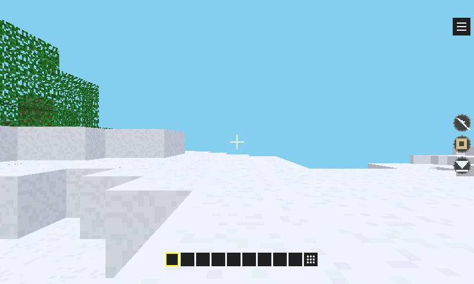
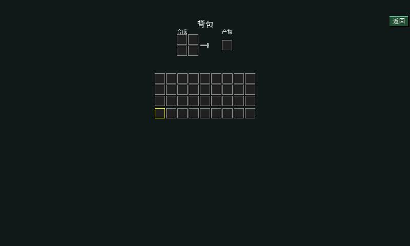

# ESP32-S31-Korvo-1 游戏与板级验证（2026-10-13）

本轮在 `/dev/ttyUSB0`、2,000,000 baud 的 Korvo-1 上更新应用分区并实际运行游戏。
原有 C++ Work、应用数据和系统设置保留；额外安装 Maze Evil、Voxel Craft、Jump Jump 3D。
Voxel 的固定场景测试包在对比后换回正常游戏包。未擦除或重写 `pxa_data`。
保留原包不等于旧二进制仍兼容：设备原有 C++ Work 1.0.0 的 manifest 要求 Core 1.0，
当前工作区已经是 Core 2，真机启动会在 activation-plan 阶段拒绝。原包和数据未替换或删除；
需用当前 SDK 重新构建匹配身份的包。此兼容性变化来自此前 ABI 更新，本轮没有新增 Guest ABI。
记录见 `korvo-20261013/original-app-smoke.json`。

## 测量方法和结论范围

- 屏幕为 800×480 RGB565，CPU 320 MHz，16 MB Flash、16 MB PSRAM。
- 固件基线是本轮按当前工作区构建的版本，不把设备原有 `21af704-dirty` 当作可比基线。
- `tools/measure-device-gameplay.py` 每个场景重新启动应用，预热后采样 4 秒，截图放在采样窗口外。
  读取设备时钟下不同帧的面板完成事件间隔；不以 Guest 提交 FPS 或串口命令往返时间代替显示 FPS。
- `idle` 固定画面，`turn` 在屏幕右侧重复滑动，`walk` 在左侧行走，`charge` 按住 450 ms 后松开。
  注入使用 `INPUT SYNC`，每次测试后停止应用并取消触点。
- 自动锁屏会暂停显示；权限对话框也会改变被测画面。脚本先解锁，检查应用仍在运行，要求有实际显示样本，
  并拒绝采样溢出和中途分辨率变化。音频权限在正式采样前授予。
- 固定 Voxel 使用相同签名包、种子 `0x5ae1`、相机 `(32.5, 12.0469, 32.5)`、视距 24、
  原生 800×480、相同透视纹理和深度路径。`VOXEL_BENCH_DISTANCE=24` 冻结物理更新，
  因而该包只用于固定画面与转向的性能对比；正常游戏包另测行走。
- 两轮短窗口只能说明本轮可重复结果，不能替代长时间、所有地图的性能保证。

## 按证据保留的改动

| 改动 | 原因、收益 | 内存变化 | 验证 |
|---|---|---|---|
| 带深度纹理扫描线专用内核 | 将像素循环与多边形/透视设置分开，减少 32 位 CPU 寄存器溢出；一次验证深度端点，避免每像素重复钳制 | 不增加缓存、队列或工作区 | 真机固定场景；随机差分测试；ASan/UBSan；已有光栅回归 |
| ESP32-S31 性能构建只对 `raster.c` 使用 O3 | 实测与专用内核组合更快；Guest 仍使用原有 O3；未将此编译策略扩展到未经真机比较的 S3 | 光栅优化阶段 Host 固件 Flash 增加约 10 KiB；Guest AOT 和线性内存不变 | O2、仅 O3、O3 加专用内核分别测量 |
| Korvo 小扫描线内核放入 IRAM | 整合固件的 mapped-code 结果发生回退；把 314 B 内循环移入内部指令内存后更快。通过 IDF linker fragment 实现，便携 Core 无 ESP 依赖；其他板默认关闭 | IRAM 有约 384 B 的有效 heap 容量代价，包含代码及对齐；加上其他静态增量后仍低于基线整机 SRAM 占用 | 最终同包冷启动/两轮固定与转向；对应 map 和 heap-local |
| Korvo 可选 ARGB 缓冲延迟分配 | 稀疏 HUD 和纯 RGB 游戏不必在开机时支付整屏 ARGB 缓冲 | 稳定 PSRAM 节省 1,536,000 B；首次需要密集 alpha 合成才分配原有容量 | 真机 heap-local、重复启动；原有 CPU 回退保留 |
| Korvo 显示时间戳及帧关联修正 | 使用已有 RGB 回调时间，并携带该帧的 raster-ready 时间；避免把下一帧绘制计入上一帧显示延迟 | 仅少量时间戳字段，不增加帧缓冲；整机内存仍下降 | 32 位计时回绕、释放 lease 后完成、重复完成回归；真机 |
| Korvo 静态页面完成收集 | 单帧菜单没有下一帧唤醒，完成状态和截图可能长期停留在旧页；仅切换在途时收集完成事件，新帧检查只在通知时执行 | 无新任务或缓冲 | 真机标题、暂停、继续和背包截图；整合版固定场景复测 |
| 系统手势区与 Voxel 控件 | 隐藏手势条仍有透明输入区，Host 未报告时会接走背包点击；补充区域报告，控件避让，保持 3D 全屏分辨率 | 不增加缓冲或容器 | 真机背包打开/返回、暂停/继续；原生安全区回归 |
| Korvo 音频 DMA 对齐和设备节奏 | 240 帧 DMA 与 320 样本 Host 帧不匹配；改为三个 320 帧块，设备背压控制节奏，检查实际写入字节数 | 移除未使用 RX DMA；TX 环由 90 ms 容量降为 60 ms；实际整机 heap 另附 | 原生 3/6 描述符抖动测试；真机音乐和 DMA 完成计数 |
| Watcher DPI、完成事件 | 412 像素、标称 1.45 英寸圆屏配置 284 DPI；SPI DMA 完成后才计显示完成 | 单槽带元数据队列不超过原双槽队列；静态大小断言 | ESP-IDF 5.5.4 构建、模拟器；无 Watcher 真机数据 |
| Watcher 截图修正 | 部分刷新使用区域宽度作为源 stride；截图请求触发完整刷新并用代际标记隔离晚到 DMA | 复用已有 snapshot、队列及字段间隙 | 编译和代码检查；需真机确认 SPI/截图时序 |
| Pixel Dungeon 窄标题按钮 | 高 DPI 圆屏上图标、中文标签重叠；窄按钮改为上下排列并使用紧凑标签 | 不增加缓存或动态容器 | 三种实际屏幕参数及小圆屏截图；双语原生渲染回归 |
| 公共 IME C 头文件补 `stdbool.h` | IDF 6 的 C23 隐藏了 C11/C17 下未声明 `bool` 的问题 | 无运行开销 | C11 头文件检查、Watcher 编译 |
| PXADB 串口上传恢复 | 2 Mbaud 上传出现 `invalid_file_chunk`；现在在原重试上限内缩小分块并重新确认上传状态，同时输出恢复次数和分块长度 | 无设备常驻内存增长 | 损坏分块/偏移恢复、存储错误立即失败测试；早期 256 B 上传成功，最后恢复正常包使用 128 B 成功 |

## 固定 Voxel 前后对比

该对比包含独立光栅优化阶段和最终完整固件；两轮均值如下，画面、命令长度与覆盖像素相同。
正常游戏另测，不混入固定场景收益。

| 组合 | 固定画面显示 FPS | 转向显示 FPS | 固定画面 Host 光栅 ms | 转向 Host 光栅 ms |
|---|---:|---:|---:|---:|
| 基线 O2 | 8.88 | 8.27 | 85.69 | 90.69 |
| 仅改 O3，未拆内核（不采用） | 8.26 | 7.62 | 92.43 | 98.66 |
| O3 加专用内核（采用） | **9.34** | **8.91** | **80.66** | **84.53** |
| O2 加专用内核（不采用） | 8.59 | 8.19 | 88.04 | 91.30 |
| 完整固件、完成事件专用轮询、mapped 内核（不采用） | 8.79 | 8.20 | 85.92 | 91.19 |
| **完整固件、小内核 IRAM（最终采用）** | **9.04** | **8.51** | **82.86** | **88.27** |

固定画面 FPS 增加约 5.2%，转向增加约 7.7%；对应光栅时间分别减少约 5.9% 和 6.8%。
这些是独立光栅优化阶段的收益。**完整最终固件**相比最初基线，两轮固定画面/转向 FPS 均值
分别增加约 **1.7%/2.9%**，Host 光栅时间分别减少约 **3.3%/2.7%**。
只将这组完整固件结果作为本轮最终收益，不把阶段最优数字作为最终结果。
未降低分辨率、视距、纹理精度、透明孔洞或深度精度。固定画面 JPEG SHA256 前后一致：
`d078a53084f80377241454528ff9c822c4928640de2af1494c59e3dd20b7b994`。
随机差分覆盖深度 0/1/65535/超范围、正负 UV 步长、透明纹理、守卫像素及深度缓冲。

独立光栅优化阶段的应用日志显示，几何约 12.5–13.0 ms，编码约 4.4–4.6 ms，HUD 约 0.9–1.0 ms；
最终完整固件示例约 13.5/4.8/1.0 ms。前者 `submit_us` 约 83–88 ms，最终示例约 93–96 ms，
**包含高优先级 Host 光栅任务抢占**，不能与 Host 光栅时间相加，
也不能解释为 ABI 分发或内存复制花了 80 ms。固定包冻结物理，因此其 `update_us=0` 不代表正常游戏没有更新开销。
Host 两核分行处理接近均衡（示例约 79.3/78.4 ms），排队均值约 1.1 ms，
Korvo 整屏 PPA 合成/复制仍约 9 ms。当前主要瓶颈依然是全分辨率 Host 光栅化。

整合测试也记录了未采用的回退：静态菜单完成轮询若同时检查旧 Surface，会争用同步光栅路径。
该中间固件的固定画面/转向均值为 8.67/8.15 FPS，不能用前面的孤立光栅收益代替最终固件收益。
原始窗口见 `korvo-20261013/voxel-fixed-completion-regression.json`；最终方案已将超时轮询与新帧检查分开。
该修正降低无效检查和 Guest 阶段争用，但未单独恢复整体 FPS，因此继续测量并保留了小内核 IRAM 方案。
这证实了该配置上的放置方案有收益；尚不能凭这些窗口断言具体指令缓存失效率或推广到其他 CPU。

## 为什么 Korvo 的 Voxel FPS 低于 pai-touch

| 项目 | pai-touch | Korvo-1 |
|---|---:|---:|
| CPU | ESP32-S3，240 MHz | ESP32-S31，320 MHz |
| 原生游戏分辨率 | 296×240 | 800×480 |
| 每帧像素数 | 71,040 | 384,000（约 5.41 倍） |
| 双 RGB565 Surface 加 R16 深度 | 426,240 B | 2,304,000 B |
| 正常游戏静止显示 FPS | 10.36 | 9.31 |
| 正常游戏转向显示 FPS | 11.30 | 7.76 |
| 正常游戏静止 / 转向 Host 光栅 | 44.05 / 50.28 ms | 81.12 / 102.90 ms |

pai-touch 数字来自此前 [2026-10-11 正常游戏报告](../../local/pxa-apps/voxel-craft/docs/performance/gameplay-device-20261011.zh-CN.md)，
不是本轮重新测试。两边随机地图、朝向、屏幕宽高比及自动视距不同；pai-touch 报告中视距会从 32 降到
24/18/12，部分窗口还降到无光照档。因此该表只能解释当前体验差距，不能据此量化 CPU、语言或同负载性能比。
原先约 13.2 FPS 的 pai-touch 固定场景也使用不同相机和命令量，不能与本轮 Korvo 固定场景直接比较。

已确认的主要成本是 CPU 执行的带深度纹理光栅，Korvo 两核已有分行处理，未发现只用单核的问题。
PPA 目前用于显示合成/复制，不能抵消 3D 像素循环的计算量。Korvo CPU 主频仅比 pai-touch 高约三分之一，
而原生像素量高约 5.4 倍；重复绘制、深度读写和纹理访存也会增加。Korvo 约 9 ms 的整屏合成/复制是次要成本。
ABI 同步借用命令、mailbox=0；Guest 提交耗时包含光栅任务抢占，没有证据把它归因为昂贵 ABI 分发或整包复制。

RGB 连续扫描、PPA 与光栅对 PSRAM 带宽的竞争，以及两种 CPU/AOT 的指令效率差异，是待验证假设；
本轮未采集带宽/缓存硬件计数器，不能把它们称为已证实的差距来源。
后续优先做相同地图/相机/视距、相同内部 3D 分辨率的对比，再决定是否增加独立 3D 分辨率档位、
保持原生 HUD，并优化遮挡削减和显示复制。低分辨率 3D 会降低远处细节，需单独截图和实测；本轮没有引入该画质取舍。

## 延迟含义

最终完整固件上的正常游戏验证（每种操作本轮最后复测一次；前面的固定 Voxel 另有两轮）：

| 游戏/场景 | 实际显示 FPS | Host 光栅 ms | 采样到 Guest 均值 ms | 采样到关联显示均值/P95 ms |
|---|---:|---:|---:|---:|
| Maze Evil 静止 | 30.30 | Guest 软件绘制 | — | — |
| Maze Evil 转向 | 30.30 | Guest 软件绘制 | 4.86 | 42.00 / 60.00 |
| Maze Evil 行走 | 30.47 | Guest 软件绘制 | 5.08 | 41.56 / 62.00 |
| Jump Jump 3D 静止 | 39.11 | 14.82 | — | — |
| Jump Jump 3D 蓄力/跳跃窗口 | 26.05 | 27.33 | 8.40 | 59.61 / 88.00 |
| Voxel Craft 静止 | 9.31 | 81.12 | — | — |
| Voxel Craft 转向 | 7.76 | 102.90 | 9.43 | 150.71 / 167.02 |
| Voxel Craft 行走 | 7.76 | 101.54 | 11.52 | 148.72 / 163.34 |

正常 Voxel 默认会生成地图并调节视距，三个重新启动的窗口不保证相同世界和负载；
这组结果说明本轮实际玩法表现，不用它对基线或 C/C++ 语言作百分比比较。
Jump 最后复测比本轮两次较早整合验证略低，但仍接近基线 38.78/25.62 FPS；
Maze 基线约 30.3 FPS，保持相同水平。均为本次短窗口结果。

`PERF INPUT` 分别统计注入采样到 Guest 回调分发、关联的提交、面板完成事件。
同一个输入采样可能关联多个回调或帧，因此计数不是不同物理触摸次数，也不能将不同分母的阶段均值相减。
P95 来自设备直方图，超过其范围时落入末档，报告会接近最大值。

基线 Korvo 直出路径在处理下一帧时才收集上帧完成，原代码用了收集时刻，
使 Voxel/Jump 的“可见延迟”多算了下一次绘制。修正后数值更准确，**这部分下降不是体验优化收益**。
同时修正了释放 Surface lease 后使用下一帧 raster-ready 时间的问题。
最终延迟见 `korvo-20261013/measurements.json`；未测触控控制器物理扫描、LCD 特定像素发光或扬声器声学响应。

音频 DMA 日志的 `first_pcm_to_dma_us` 是本次启动首段非零 PCM 写入到该块 DMA 完成的间隔，
包含硬件排队和整个块的播放时间，不含 Guest 发起音效前的调度或首次资源加载。
它不能当作“点击到听见”的完整延迟。三个 20 ms DMA 块保留抗调度抖动空间；未用缩短缓冲但明显丢音的方案追求更小数字。

## 内存核对

每次使用 `MEMORY START/STOP` 重置本窗口最小空闲值，分别记录首次加载窗口和稳态窗口。
窗口结束后普通 `MEMORY` 的历史最低值不能当作本轮峰值。SRAM 和 PSRAM 各自的峰值不一定发生在同一时刻。

同条件重启后的固定 Voxel 对比（光栅优化、音频优化前）：

| 项目 | 基线 | 光栅优化后 |
|---|---:|---:|
| SRAM 首次加载窗口最高占用 | 584,612 B | 584,372 B |
| PSRAM 首次加载窗口最高占用 | 10,419,816 B | 10,419,340 B |
| PSRAM 稳态占用 | 8,031,256 B | 6,488,904 B |
| PSRAM 稳态窗口最高占用 | 8,032,348 B | 6,494,948 B |

首次加载峰值主要由 AOT/资源装载决定，移除开机 ARGB 缓冲显著降低稳定占用，但不会等额降低该峰值。
原先未重启的热启动记录有不同历史和堆布局，不与这里的冷启动峰值混比。
最终音频改动后的整机 SRAM/PSRAM 记录在机器报告中。

正常包最后一轮的静止窗口（SRAM 列为动态 heap 占用；另计上述静态容量差值）：

| 游戏 | SRAM 稳态 / 窗口峰值 B | PSRAM 稳态 / 窗口峰值 B | 本次启动窗口 SRAM / PSRAM 峰值 B |
|---|---:|---:|---:|
| Maze Evil | 586,384 / 586,384 | 3,913,492 / 3,913,640 | 590,484 / 7,812,684 |
| Jump Jump 3D | 603,708 / 603,708 | 6,214,584 / 6,214,652 | 608,068 / 10,009,444 |
| Voxel Craft | 586,296 / 586,296 | 6,576,024 / 6,576,084 | 590,912 / 8,158,120 |

这些启动窗口包含本次包加载、新游戏、预热，尚有前一个应用留下的可复用系统资源；
不混称为三个设备重启后的冷启动。严格冷启动前后核对使用下面相同固定 Voxel 包。

完整最终固件的同包首次冷启动窗口：SRAM heap 最高占用 576,244 B，PSRAM 10,419,568 B；
稳态 SRAM heap 572,324 B、PSRAM 6,492,276 B，稳态窗口各自峰值 572,324/6,492,332 B。
最终可用 SRAM heap 总量 662,995 B，基线 663,539 B，差值 544 B 包含静态字段、IRAM 和对齐，
不能遗漏这部分再宣称全部 SRAM 节省。计入它后，冷启动峰值和稳态占用仍分别低约 7.6/7.4 KiB；
PSRAM 首次加载峰值基本持平，稳态低约 1.46 MiB。两轮全部窗口仍记录在 `voxel-fixed-iram.json`，
这里的冷启动比较取双方重启后的首个相同场景，避免混入不同加载顺序。

最终标题→游戏→暂停→继续→背包→长按挖掘的整段功能窗口，还包含 JPEG 截图服务：
SRAM heap 峰值 621,212 B，PSRAM 峰值 8,933,236 B。它与上述纯游戏采样窗口的工作负载不同，
见 `korvo-20261013/voxel-functional-adopted.json`，不将额外截图成本算作游戏稳态，
也不在缺少同条件基线时宣称此功能窗口的峰值下降。

- Korvo 面板原有三个 RGB565 缓冲共 2,304,000 B，不增加数量。
- 固定 Voxel 两个 RGB565 Surface 缓冲共 1,536,000 B，R16 深度缓冲 768,000 B，均不变。
- 诊断 probe 2,112 B，仅测量时分配；命令缓冲 49,152 B、固定包命令长度 29,688 B，Host mailbox 为 0 B。
- 固定 Voxel Guest 线性内存 393,216 B 不变。固定包 AOT 文件 666,156 B 不变，
  不能把它的文件长度直接作为实际代码映射 RAM 大小。
- WAMR 的 `artifact=0` 表示适配层释放了源文件缓存，不表示执行代码不占空间。
  WAMR 动态分配、Guest 线性内存、映射和 heap 可能重叠，不能直接相加；当前接口没有独立的全部代码映射峰值计数。
  此项保持相同 AOT 包并纳入整机 heap 峰值，不虚报精确映射量。

## 其他板和回归

Mosaico 480×480、305 DPI、圆角 58、安全边距 12；Watcher 412×412、284 DPI、圆形半径 206、安全边距 60。
Watcher 的 284 DPI 是按圆屏标称直径 1.45 英寸计算的配置值，规格来源为
[Seeed 硬件说明](https://wiki.seeedstudio.com/watcher_hardware_overview/)，并非本轮物理尺寸测量。
四个游戏在这两种配置和 Korvo 配置下共 12 个模拟器启动/后台暂停/恢复/停止检查通过。
模拟器画面与功能证据不作为 ESP32 FPS、DMA、PPA 或物理输入延迟证据。

Korvo 和 Mosaico 使用本机 ESP-IDF main（6.2 工具环境）；Watcher 使用 ESP-IDF 5.5.4，
使用独立构建目录保留原目录。三个固件均可构建，未向未连接的设备烧录。
保留已有第三方 LVGL 配置弃用提示及 WAMR FreeRTOS 接口弃用警告。

回归包括 libpxa 35 项 ASan/UBSan（含光栅和扫描线差分）、C++ 游戏 7 项 ASan/UBSan、ESP Host ASan/UBSan、
DMA 时钟抖动与短写失败路径、显示安全区和时间回绕、开发工具 13 项、PXADB 68 项。
自动化结果和必要截图保存在本目录的 `korvo-20261013/`；完整串口日志、本轮所有固件和初始备份在
`local/korvo-validation-20261013/`。
最终功能截图与数据使用最终 IRAM 固件，见 `voxel-functional-adopted.json`；
早期树林截图另保留为 `voxel-forest.jpg`，其元数据仍在 `voxel-functional.json`，不混称为最终固件截图。
`validation.json` 记录回归日志摘要/哈希及最终固件构建结果；`provenance.json` 记录本轮相关源码的文件哈希。




## 复现

固件仅更新应用分区，保留已安装应用和数据：

```sh
source /home/lucinhu/esp/esp-idf/esp-idf-main/export.sh
tools/firmware.sh esp32s31-korvo-1 build
tools/firmware.sh esp32s31-korvo-1 app-flash --port /dev/ttyUSB0 --baud 2000000
```

固定场景包与基准（测试后重新安装正常包）：

```sh
PXA_APP_DEFINES=VOXEL_BENCH_DISTANCE=24,VOXEL_PROFILE=1,VOXEL_VALIDATE=1 \
  tools/app.sh build voxel-craft --board esp32s31-korvo-1 --aot-only --output local/korvo-fixed
PXADB_UART_UPLOAD_CHUNK=128 python3 tools/pxadb/pxadb.py package install \
  local/korvo-fixed/pxa-voxel-craft.pxa --port /dev/ttyUSB0 --baud 2000000 --yes
PXADB_BAUD=2000000 python3 tools/measure-device-gameplay.py \
  --port /dev/ttyUSB0 --app pxa-voxel-craft --package local/korvo-fixed/pxa-voxel-craft.pxa \
  --output local/korvo-fixed-results --repeat 2 --warmup 20 --scenes idle turn
```

正常包用相同工具构建，不设置 `PXA_APP_DEFINES`；本轮控件修正后的 Voxel 正常游戏加 `--start 400 111 --warmup 8 --scenes idle turn walk`。
Jump 使用 `--scenes idle charge`；Maze 使用 `--scenes idle turn walk`。
构建不同板请顺序执行：它们共享 `firmware/managed_components`。
旧的构建缓存不能强行换 IDF 大版本，需单独构建目录。
`PXA_RASTER_SPAN_IRAM` 是 CMake 可选项，仅 Korvo 默认打开，且限 S31 性能构建；
需要复测 mapped-code 时使用 `idf.py -C firmware -B build/firmware/esp32s31-korvo-1 -DPXA_BOARD=esp32s31-korvo-1 -DPXA_RASTER_SPAN_IRAM=OFF build`。

仍待验证：Watcher/Mosaico 真机显示和音频；物理触摸到像素、点击到声音的同步外部测量；
长时间热状态和更多地图。没有为本轮引入画质降级、默认大缓存或新 Guest ABI。
