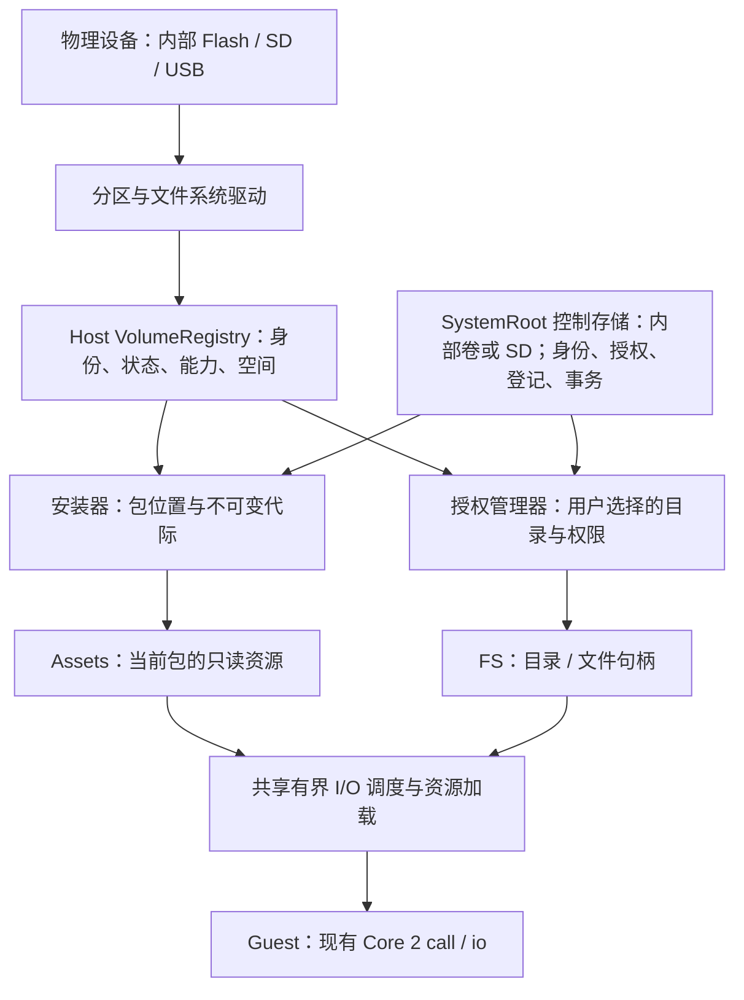

# PXA 多卷存储、资源访问与安装位置设计

状态：2026-10-18，分阶段实施。**FS 0.3 的授权只读根、C/C++ SDK、GameKit 目录选择器已先行实现并在真机验证；外部安装、READ_AT、分页、热插拔及下文其余提案尚未实现**。对应的[机器可读接口草案](design/pxa-multi-volume-abi.draft.json)标记实现子集，不替代 `deps/pxa-system/spec` 中的现行规范。

核心决定：Host 统一管理卷；应用通过授权目录句柄访问文件；安装器管理包的位置。系统控制数据由合格的 SystemRoot 后端管理，可以在内部卷，也可以全部在 SD；不要求存在 Flash 文件分区。应用身份、文件访问权和安装位置彼此独立。

后续用户要求已合并为[固定目录与 SD 系统盘契约](pxa-storage-layout.zh-CN.md)：每卷固定 `/PXA/system`、`/PXA/app`、`/PXA/data`、`/PXA/media`；新安装默认整应用放置，代码及私有数据一同选择卷。本文中“内部控制提交”统一指权威控制存储提交，不能再解释为必须写内部 Flash。

## 1. 现在能做什么

| 能力 | 当前实现 | SDK / ABI |
| --- | --- | --- |
| 系统访问 SD | DOIT GameKit 启动时将 FAT16/FAT32 卡挂到 `/pxa/sdcard`；Files、PXADB 显示 `/sdcard` | Host / 调试工具路径，不是 Guest 权限 |
| 应用读写私有文件 | 有；按发布者身份和 App ID 隔离，并受配额限制 | FS，Service 5；0.3 保留 0.2 的操作 1–8；C `pxa_fs.h`，C++ `FilesystemService` / `File` |
| 应用保存少量设置 | 有；私有 KV | Storage，Service 6；`pxa_storage.h` / `StorageService`，不是磁盘管理 API |
| 应用读取包内资源 | 有；包关联的只读资源，有界分块读取、加载和解码 | Assets，Service 21，2.3；`pxa_assets.h` / `AssetService` |
| 应用自动打开固定 SD 资源目录 | 已在 GameKit 首次启动及重启验证；无需目录选择或文件权限声明 | FS 0.3 app-media-root，OPEN_ROOT kind 5；C `pxa_fs_request_app_media`，C++ `fs.app_media()` |
| 应用取得用户选择的 SD 目录 | 已有授权只读根、可信选择器、持久 Grant；首版只读 | FS 0.3 操作 9、10、11、16、17；C `pxa_fs_roots.h`，C++ `Directory` / `DirectoryGrant` |
| 统一枚举多个分区、SD、USB 等卷 | 已有有界 Host 卷注册；GameKit 注册一个 FAT SD 卷 | 通用 Guest / 管理枚举接口及多分区板级驱动仍待实现 |
| 每个应用选择安装卷、迁移安装位置 | 尚无；ESP 使用一个配置的状态根 | 本文提出安装位置登记及新后端 |
| 不设 Flash 文件分区、SD 存放系统文件 | 尚无；当前状态根与系统字体仍在内部卷 | 固定目录设计新增 removable-system 配置及恢复启动契约 |

GameKit 当前不承诺热插拔，插卡后需要重启挂载；不会自动格式化卡。它的应用、字体和私有存档仍在内部 LittleFS。其他板是否有 SD、USB 或多个分区，由板级驱动决定，不能由 ABI 凭空提供。

`CONFIG_PXA_STATE_ROOT` 可以改变整个 Host 的单一状态根，但不是多卷接口。仅把它设成 `sdcard/...` 会同时移动包和私有数据；现有 ESP POSIX shim、路径语义和安装事务也不因此获得 FAT 支持。

现行安装器要求同一文件系统内可恢复的原子目录重命名和持久化屏障；其规范明确禁止把这些保证直接套到 FAT 或任意 VFS。普通应用也不能用私有 FS 的绝对路径或 `..` 绕到 SD。

## 2. 统一模型：设备 → 分区 → 卷 → 授权目录 → 文件



一个物理设备可以包含多个分区，每个已挂载文件系统是一个卷；同一张卡的多个卷共享物理 I/O 调度域。卷也可以来自无分区的整盘文件系统。挂载路径是 Host 实现细节，不进入持久化的应用配置。

| 标识 | 用途 | 生命周期 |
| --- | --- | --- |
| `DeviceId` | 区分物理介质及共享总线，用于调度和诊断 | Host 管理；不是应用授权 |
| `VolumeId: bytes[16]` | 引用特定介质上的特定卷 | 持久化、不透明；卷标不是 ID |
| `mount_epoch: u64` | 区分一次挂载实例，防止拔插后句柄复活 | 每次挂载变化；重启也不能复用旧实例 |
| `GrantId: bytes[16]` | 某应用获得的目录授权记录 | 可持久化、可撤销；不是可直接读文件的句柄 |
| `Directory / File: u64` | 当前实例内实际访问资源 | Core 代际句柄，组件所属，关闭或失效后不可复用 |

VolumeId 绑定分区标识、文件系统标识和可取得的介质身份。没有可靠 UUID 的设备通过控制存储登记及受控介质标记辅助识别，并记录身份可信程度；只读介质允许登记为弱身份。发现重复 UUID、克隆标记或无法区分的设备时标记 `ambiguous`，要求系统重新选择，禁止按同名卷标、端口号或 `/sdcard` 自动续接授权。

UUID 和卡 CID 都不构成密码学介质认证；无法可靠识别的介质不自动恢复持久目录授权。重新格式化、更换分区布局或身份冲突须重新绑定。安全性不依赖“所有硬件都有不可复制的唯一 ID”。

卷状态至少为 `offline / mounting / ready / draining / failed`，另带 `read_only`、身份可信度和错误原因。状态变化使用 Host 单调修订号；通知可合并，消费者发现修订断档后重新查询，不以事件队列作为唯一事实来源。

## 3. 卷能力与放置规则

卷描述符包含：可读写、可移除、是否实际支持热插拔、文件大小限制、分配单元、命名语义、随机读取、文件同步、原子替换、安装后端等级、总量/可用量/已预留量。空间与大小均为 u64；未知的总量不能编码成“零容量”。

`installable` 由经过验证的安装后端发布，不能从 `writable` 或 FAT 类型推导。存储卡可先作为资源来源，安装能力在后端和掉电验收通过后单独开放。板不支持的文件系统或分区，只报告不支持；不自动重分区、格式化或把多个卷合并。

默认放置：

| 内容 | 默认位置 | 迁移规则 |
| --- | --- | --- |
| 启动固件、最小恢复界面及其小字体 | 固件内置 | 无须 Flash 文件分区；无卡仍可显示恢复页 |
| 完整系统字体、主题、可更新系统资源 | SystemRoot 所在卷的 `/PXA/system` | 可以全部在 SD；使用不可变资源代际 |
| owner 身份、授权、启用策略、位置登记、事务日志 | SystemRoot 的合格控制后端 | 可在 SD；不随单个应用迁移 |
| Storage KV、私有存档 | 新安装随应用选定卷的 `/PXA/data` | 默认整应用迁移；legacy 保持旧位置至显式迁移 |
| 一个完整的应用包代际 | 用户选择合格卷的 `/PXA/app` | 与数据按同一 Placement 事务提交 |
| 大型 ROM、PAK、GRP、MIX 等用户数据 | 用户授权目录，可位于任意已支持卷 | 只读优先，无须复制到私有区 |
| 可重建缓存、临时数据 | whole-app 所选卷的 `/PXA/data` | 惰性创建、有配额；不保存唯一存档 |

控制存储需要预留提交和恢复空间，即使它与目标包不在同一卷。默认安装卷只是选择偏好，不能在目标卷离线时静默装到另一卷。控制卷丢失时停止相关系统实例并进入固件恢复页。

## 4. FS 0.3 提案：授权目录，而非全局路径

### 4.1 授权与句柄

复用 Service 5、Core 2 的 `pxa_call` / `pxa_io`、FILE / DIRECTORY 资源和关闭机制。目录根使用现有 DIRECTORY 类型（4），文件使用 FILE 类型（3）；SDK 用 `Root` / `Directory` 表达目录作用域。新增接口不引入原生 `sd_open`、裸挂载点、Host 指针或另一套取消系统。

默认游戏从 Assets 或 `fs.app_media()` 取得系统自动绑定的资源根，不弹目录选择器。app-media 使用 OPEN_ROOT kind 5，Permission 与 GrantId 均为零，且要求 app-media-root feature；Host 按已验证身份及明确的卷策略解析 `/PXA/media/<app-key>`，无可用目标时返回 unavailable，不猜测其他卷或请求用户找路径。当前先行配置由板指定 SD，最终由安装位置快照决定。

用户主动导入任意其他目录时才使用可信 Host 文件选择器：应用提供用途和所需权限，Host 创建绑定 `(lineage_root, app_id, VolumeId, subtree, rights)` 的授权，以 GrantId 重开。应用不能默认请求整张卡的写权限，自绘确认界面不能产生授权。private/cache/temporary 新根仍是后续接口，旧私有 FS 继续可用。

普通应用只查询自己获准访问的目录信息；全卷枚举和安装管理仅对可信系统管理组件、Files 和调试会话开放。GrantId 即使泄露，也不能被其他身份兑换成权限；选择器不返回原生路径。

授权复用现有 Permission 服务（11）的签名声明、策略存储和 Core authority，不另建一套可绕过它的允许列表。拟议声明为 `fs.user-directory`，scope 精确为 `read` 或 `read-write`；这是新声明，需同步加入包契约。用户目录的 `request-access` 和 `open-root` 携带 Permission 句柄，Host 按精确声明解析 authority，再与目录授权取交集；读 scope 不能请求写权限。Host 可将权限确认与目录选择合并呈现，SDK 封装整个流程。

撤销声明或更新包后声明不再存在时，沿用 Permission 规则撤销其 authority 及全部关联根、子文件和请求；撤销单个目录授权只影响该 GrantId。关闭根不等于关闭 Permission；SDK 保持相关权限租约活到最后一个子资源释放。应用未声明该能力时，即使知道 GrantId 也不能重开目录。

目录句柄持有作用域、权限、卷和挂载代际。子目录只会缩小作用域；路径禁止绝对路径、`.`、`..`、NUL 和跨挂载跳转，不跟随会逃出授权边界的链接。Host 必须用后端的安全目录解析实现，不能以字符串前缀校验代替。FAT 后端使用挂载对象及受锁保护的受限路径解析，不伪造 LittleFS 专用的 `F_GETPATH` 支持。

Host 管理的 `.pxa-*` 树不可由普通应用直接遍历、创建或修改，即使用户授予卷根目录权限。新固定布局还须保护卷根下 `/PXA/system`、`/PXA/app`、`/PXA/data` 及 `/PXA/.pxa-control`，而允许授权 `/PXA/media`。名称比较按卷的原生别名/大小写规则处理，防止换个大小写绕过。无法隔离这些位置的后端不能承担受管理安装；先行只读实现尚未开放这种安装能力。

关闭目录句柄只释放该引用，已打开的子文件各自持有有效作用域引用；撤销授权则使全部后代失效。应用退出、组件停止和拔卡统一取消其在途 I/O，资源最后一个使用者结束后才释放后端对象。

### 4.2 拟新增的操作

| FS 操作号（草案） | 操作 | 行为 |
| --- | --- | --- |
| 9 | `open-root` | 打开私有/缓存/临时/已持久授权根 |
| 10 | `request-access` | 可信 Host 选择器；返回授权根及可选持久 GrantId |
| 11 | `open-at` | 以目录句柄为起点打开相对路径 |
| 12 / 13 | `mkdir-at` / `remove-at` | 有权限的目录操作；不隐式递归删除 |
| 14 | `rename-at` | 两个目录下重命名，目标必须不存在 |
| 15 | `replace-at` | 后端明确支持时原子替换普通文件 |
| 16 | `stat-at` | 查询作用域内条目 |
| 17 | `query-root` | 查询目录所属卷、有效权限、语义和限额 |
| 18 | `sync` | 文件同步；不将它宣称为任意介质的掉电保证 |
| 19 | `read-directory-page` | 有界批量读取目录项，减少逐条往返 |
| 20 | `watch-roots` | 订阅本应用可见根的状态；返回 Core 可关闭的 LEASE 订阅资源 |

0.2 的操作 1–8、私有根解析及 payload 保持原样。旧 Guest 不会因新增接口获得 SD 权限。新增操作由版本和 feature 位协商；未实现功能返回 `unsupported`，不降级成任意路径访问。

`rename-at` / `replace-at` 限于同卷、相同可兼容作用域和权限；跨卷返回 `unsupported`。跨卷复制是明确的复制任务，不能偷偷把原子替换降成“先删后拷”。文件系统返回的只读、空间不足和介质故障按公开的 PXA 状态映射，避免抛出平台 errno。

### 4.3 FAT 命名和私有区兼容

旧私有 FS 保持 UTF-8 字节精确、区分大小写的契约及 255 B 路径 / 64 B 段限制。直接把 `A` 和 `a` 都有效的私有目录迁移到 FAT 会改变行为，故不透明支持。

新授权根报告 `byte_exact / native_case_insensitive` 命名语义及限制。第一版新接口的协议上限为路径 1024 B、单段 255 B UTF-8；后端可以报告更小限制，超限明确报错，不截断或隐藏。它是受控可移植子集，并非宣称支持文件系统全部原生名字。目录分页使用新的长度字段，不强迫旧 SDK 的 64 B 名称结构承载长名字。

枚举不提供目录快照；外部修改可能造成迭代变化。可检测的变更报告需重启枚举，不能伪称 FAT 上存在完整外部变更监视。私有数据迁移只允许满足原语义、配额和必需原子能力的后端；新设计通过 FAT 文件内的 LittleFS 私有镜像保留语义，适配及掉电验收完成前不能开放迁移。

分页请求在接收前预留结果容量。下一个目录项放不进剩余空间时结束本页，不消耗该项；单个条目超过协商上限则明确报错，不能返回空的非 EOF 页制造忙循环。符号链接和不能安全打开的特殊条目不被当作普通可访问文件。

## 5. 随机读取与 Assets 2.4 提案

现有 Assets `read(path, offset, max_bytes)` 保留，单次数据上限仍为 4064 B。新增可选 `open-blob`（Service 21，操作 8）返回只读 FILE。该句柄绑定当前包代际，不能打开未列入资源目录的任意路径；包从内部迁往 SD 后，应用代码和资源相对路径不变。

它适用于反复随机读取的 PAK/GRP/MIX，避免每次读取重复解析路径；小型一次性资源仍使用原接口。若压缩布局不支持低成本随机访问，构建工具需输出未压缩 blob 或可独立寻址的资源布局，不能在运行中为一次读取展开整个大包。

FILE 新增可选 I/O 操作 `READ_AT=16` 和 `CANCEL_READ_AT=17`，按 FILE 能力协商；避开现有通用 `READ=1 / WRITE=2 / POLL=3`。`READ_AT` 使用一块调用者提供的缓冲：

```text
offset:u64 | cookie:u64 | requested:u32 | reserved:u32=0 | data[requested]
```

头部共 24 B，固定小端，无结构体原生对齐。返回值是数据区实际字节数，不含头部；SDK 的 `ReadBuffer<N>` 自带头部空间，调用者取得数据区视图，无额外堆分配和 `memmove`。offset 不改变文件游标；offset 位于或超过 EOF 时返回 0；溢出、非法缓冲和超过协商单次上限立即拒绝。短读按实际长度推进，临时无数据返回 `would-block`。

缓存未命中时 Host 在限额内提交读取并返回 `would-block`；同一 `(handle,cookie,offset,requested)` 重试领取结果。每个文件第一阶段只允许一个在途 lane，不同请求冲突返回 `busy`。cookie 非零且在文件生命周期内不得复用；SDK 管理 cookie 和读取互斥。队列满时不接受后台工作。完成后用已有 Core `wait-resource` 唤醒；I/O 数据不进入控制消息完成池。

worker 不保留 Guest 指针，使用 Host 有界缓冲，结果在运行时重新校验 Guest 目的区后复制。`CANCEL_READ_AT` 接受 8 B cookie，立即使对应 lane 失效并幂等返回 0；不能中断的底层操作可结束，但晚到结果只回收、不唤醒新的请求。关闭文件取消其全部 lane。SDK Task 的取消清理走该操作；不生成第二套异步完成事件。任何路径都不能在 Host 大锁内等待驱动。

现有图片解码已接受 FILE / STREAM，新的文件来源可以复用，不再增加“SD 图片解码器”。Host 资源加载和音频仍直接消费文件，避免资源先复制到 Guest、再上传回 Host。

## 6. SDK 的目标用法

默认固定根用法已接入 C++ SDK，包须声明 scoped-roots 和 app-media-root：

```cpp
auto root = co_await ctx.fs().app_media();
if (!root) co_return show_storage_error(root.error());
auto file = co_await root->open("duke3d.grp");
```

参见[无选择器的 SDK 示例](../deps/pxa-system/sdk/guest-cpp/examples/fixed-files/README.zh-CN.md)。主动导入其他目录可用已实现的 request_directory/open_grant；下例包含尚未实现的 READ_AT 等目标 API，**不能作为完整可编译示例**。C SDK 不要求协程。

```cpp
// 仅用户主动导入其他目录时选择，保存 GrantId。
auto grant = co_await fs.request_directory({
    .purpose = "选择 Quake 数据目录", .rights = FsRights::read,
    .persistent = true,
});
if (!grant) co_return show_storage_error(grant.error());

auto pak = co_await grant->root.open("id1/pak0.pak", OpenMode::read);
if (!pak) co_return show_storage_error(pak.error());
ReadBuffer<4096> buffer;                  // 24 B 头 + 4096 B 数据，复用
auto bytes = co_await pak->read_at(0, buffer);
if (!bytes) co_return show_storage_error(bytes.error());
parse_pak_header(buffer.data().first(*bytes));
// 文件、目录、订阅采用现有 RAII 资源关闭；GrantId 本身不是资源句柄。
```

GrantId 存在私有 KV；读取授权已撤销时可再打开选择器。介质暂时离线则显示“请插入原存储卡”，保留授权，不把它当作撤销而反复弹窗。应用可以同时打开多个授权根；不需要自己管理 SD0、SD1、分区号和挂载路径。

包内数据使用 `assets.open_blob("data/pak0.pak")` 后走同一个 `File::read_at`。私有存档继续走 `fs.private_root()`，并在保留原子语义的私有后端写临时文件、同步、替换。应用不需要知道自己的安装卷。

## 7. 安装位置：SystemRoot 登记 + 不可变包代际

### 7.1 登记与兼容

应用管理身份始终是 `(lineage_root_key_id, app_id)`。安装位置登记引用 `VolumeId + generation + manifest_identity + backend_kind`，并有单调 `location_revision`。首次目标是每个身份只有一个激活位置；其他卷上的副本或旧代际不能因插卡顺序自动变成活动版本。

沿用现有内部安装后端和其三槽恢复状态机，不修改恢复优先级。升级时将已安装应用登记为 `legacy-fixed` 位置，原后端仍决定该路径内的当前版本。新一层登记只决定使用哪个后端及位置，不能同时维护两套“当前版本”。安装、迁移、卸载都取得同一个身份锁；升级后的启动和 inbox 扫描必须先经过位置管理，禁止旧扫描器把已迁出的 legacy 树重新激活。

切换到新位置后，旧路径仅作为待回收副本。控制存储格式迁移必须可恢复，并在固件降级策略中拒绝不能理解该登记格式的旧系统直接管理新状态；不能宣称可随意降级而不复活旧安装。

### 7.2 外部卷的新提交后端

不能使用 FAT 目录重命名来冒充现行安装事务。新后端在目标卷写入唯一的不可变代际目录，例如：

```text
系统卷：/PXA/system/control.lfs 内的 owners、grants、placements、transactions
目标卷：/PXA/app/<app-key>/<store-id>/<release-id>/...
目标卷：/PXA/data/<app-key>/<store-id>/<data-id>/private.lfs
```

这些是固定目录契约规定的 Host 物理布局，不是应用可拼接的路径 ABI。目录名不以用户提供的路径直接拼接。控制卷可为同一张 SD；其镜像提交后端也须经过资格验证。

流程：

1. 锁住应用身份；检查来源、目标 VolumeId / epoch、预期位置修订及信任策略。
2. 生成安装计划，在目标卷及权威控制区预留空间。目标卷上的旧版本仍保留。
3. 流式写入新代际，同时执行现有签名、文件清单、路径、数量、长度和内容校验；全部完成后同步 payload，再写完成记录并同步。
4. 在 SystemRoot 控制后端原子提交新的位置登记及操作状态。**这是激活点**；候选完成记录自身没有激活权限。
5. 返回明确的已提交结果；旧版本在没有启动、资源和 worker 引用后异步回收。

写入前还须按目标文件系统的实际名称等价规则检查整份清单，包括大小写、截尾点/空格和短文件名别名；清单中两个字节不同的路径若会落到同一条目，拒绝安装。后端不能悄悄改名，否则资源路径和签名清单将不再一致。单文件超过文件系统上限时也在计划/验证阶段拒绝。

提交前失败不改变当前登记。提交后清理失败只遗留可识别垃圾，不撤回成功的激活。控制事务日志包含操作 ID、原/新位置、预期修订和状态，以恢复中断操作；不能以卷上“最新目录”的名称或时间戳决定激活。

FAT 同步成功不等于任何卡都能抗任意掉电。后端必须验证实际驱动的同步行为和重挂载恢复能力；文件系统整体损坏仍可能使新旧副本一起不可读。无法满足部署要求的介质只开放资源访问。强持久化等级只能由实测合格的后端发布，不给 FAT 统一贴上强事务保证。

### 7.3 校验策略沿用现有资源设计

遵守本仓库资源设计的用户修订：**完整性校验在安装时执行；启动和运行时信任安装结果，不检测安装后的修改**。不为 SD 默认增加每次启动、重新插卡、每块读取的 SHA 扫描，也不新增块摘要表或专用校验缓存。

Host 在自己的可写接口中保护已安装代际不可修改，并按登记、结构和长度检查恢复。此信任策略不检测用户在其他设备上离线篡改卡内容，也不能保证发现无 I/O 错误的静默损坏。跨设备导入、修复或重新安装是新的安装操作，必须重新校验。未来若产品需要防离线篡改，应单独提出可选安全策略及成本，不改变本次默认策略。

### 7.4 跨卷迁移和私有数据

包迁移为“复制到目标新代际 → 按安装流程校验 → 提交位置登记 → 等旧引用结束后回收”，从不跨卷 rename。准备期间旧应用可继续运行；提交前停止旧实例，第一版不做无感热切换。若用户选择取消且尚未提交，丢弃候选；提交后取消只停止清理，不把已提交操作报告为失败。

包的位置改变不改变 owner、权限或数据身份。默认 whole-app 迁移在应用停止并清空写入后，复制并验证持久数据，再一次提交代码和数据位置；缓存可丢弃重建。高级的仅包迁移须明确提示存档仍在原处。FAT 私有镜像后端资格不足时拒绝整应用迁移，不能静默降级。应用新版本若会修改存档格式，代码回滚不能自动当作数据回滚，需应用迁移约定或备份。

## 8. Store Installer 0.6 与 PXADB 提案

Service 20 当前为 0.5，操作 1–8 保持 payload 和已配置 Host 默认位置语义（现行为内部状态根）；不能在旧请求尾部悄悄追加目标卷。新 removable-system 配置须实现相应默认后端或明确拒绝旧管理操作，不能回退到不存在的内部文件分区。

| 新操作号（草案） | 管理能力 |
| --- | --- |
| 9 `volumes` | 分页获取卷、epoch、状态、空间及安装资格 |
| 10 `prepare-operation` | 为安装、迁移或数据迁移制定计划和有期限的空间预留 |
| 11 `execute-operation` | 幂等接受计划，返回 OperationId；此时尚不能显示“已安装” |
| 12 `query-operation` | 查询阶段、进度、错误及是否已提交 |
| 13 `locations` | 分页查询安装位置、离线状态及 location_revision |
| 14 `cancel-operation` | 取消尚未提交的操作；已提交则报告其真实状态 |
| 15 `set-default-volume` | 修改用户安装位置偏好，不迁移现有应用 |

进度通知使用新事件号 `0x8002`，允许合并；最终状态由持久操作记录及查询确定。Core 请求仍各自只有一个终态；`execute` 的完成表示已接受，业务操作的提交状态来自 OperationId。操作记录有界保留，确认/过期后回收；提交结果与最新位置登记保持可查询。

计划包含目标 VolumeId / epoch、SystemRoot、固定布局版本、whole-app 等放置策略、代码及数据目标、应用身份、预期当前版本和修订、输入来源约束、安装及更新所需空间、控制提交余量、取消规则和过期时间。计划不能跨拔插或修改后复用。执行重试携带相同幂等键，不能创建重复安装；并发空间检查通过 Host 预留表串行记账。

`execute` 返回已接受之前必须持久保存操作及幂等绑定；提交时位置登记和操作提交状态通过同一控制事务或可恢复日志关联。操作结果的保留期限是协议能力的一部分；超过期限查询返回已过期，客户端须重新读取安装位置，不能直接重放旧安装。计划已消费、已过期或来源修订变化都不能再次执行。

大小按已验证清单、目标分配单元、目录/元数据估算、旧新版本重叠及暂存需求计算。只有下载大小而尚无可信展开清单时，计划标记为估算，取得并验证清单后重新检查和预留，不把预估当作保证。预留不能阻止其他设备离线写卡，实际 ENOSPC 仍须安全回滚。

当前 Store 规范有 4 MiB 包上限，不适合直接承载这些十几至几十 MiB 的游戏包。新接口单独协商容器大小、文件数、展开量和单文件限制，使用 u64 计数、流式处理及有界工作区；不能只修改常量而按包大小分配 RAM。

PXADB 也应使用同一 Host 计划与位置管理，建议命令：

```text
pxadb volumes
pxadb package install game.pxa --volume <opaque-volume-id> --dry-run
pxadb package install game.pxa --volume <opaque-volume-id>
pxadb package move <app-id> --volume <opaque-volume-id>
pxadb package locations <app-id>
```

以上是拟议命令。接收候选目录、上传租约或流式端点必须由 Host 返回；客户端不再拼接 `pxa-state/inbox`，不再只读取单个 LittleFS 的 `storage_free`。协议能力协商失败时保留旧内部安装流程，并明确拒绝外部目标。

支持的包布局可以直接流式解包到目标候选代际，避免同时保留容器和展开副本；需要随机读取的旧容器则使用受预算约束的暂存文件。传输确认、写盘完成和安装提交是不同状态，断线重连以 OperationId 查询，不把上传完成当安装成功。

## 9. 拔卡、离线与恢复行为

| 情况 | 系统行为 |
| --- | --- |
| 仅应用卷离线、系统卷仍在 | 系统正常启动；保留应用入口并标记离线，禁止启动该应用 |
| 无 Flash 文件分区、系统 SD 缺失或损坏 | 固件进入内置恢复页；不能依赖卡上的字体或安装登记 |
| 系统卷运行中丢失 | 停止全部依赖该系统的实例与资源访问，退入固件恢复流程 |
| 运行包所在卷丢失 | 拒绝新 I/O，取消请求并安全停止该实例；系统界面说明介质丢失 |
| 仅用户数据卷丢失 | 发出根状态变化；读取返回 `unavailable`，由应用暂停或让用户重选 |
| 同一张卡重新挂载 | 新 epoch；旧句柄永不恢复；重新打开授权并按已安装信任策略解析登记 |
| 插入同名另一张卡 | 不自动绑定、不访问旧授权、不把它当作旧包 |
| 安装中目标卡丢失 | 提交前失败并保留旧登记；提交后保留新登记及离线状态，报告已提交 |
| 用户撤销授权 | 重开授权返回 `denied`；Core 已关闭的句柄遵循原有失效句柄错误，待完成工作不得继续向 Guest 发布数据 |
| 卷只读或空间不足 | 只读访问可继续；写入/安装明确失败，不自动格式化或清理用户文件 |
| 离线卸载应用 | 控制存储提交卸载及精确代际 tombstone；匹配原卷返回后再回收包 |
| 多卷各有同一应用副本 | 只有当前 SystemRoot 登记的位置有效，其他副本不自动激活 |
| 将卡移到另一台设备 | 可读用户资源；应用包须经导入安装和架构/ABI/信任校验才获得激活资格 |

所有句柄先检查组件、权限和代际，后端对象在途引用结束前不能释放。后台完成必须同时匹配应用实例、卷 epoch 和读取 cookie；不能将拔卡前的结果投递给重启后的新游戏。

卸载不删除用户授予的 ROM 目录；默认清理管理的私有数据，可显式保留存档。离线清理只针对 tombstone 记录的 SystemId、store、卷身份及代际，不按 App ID 在任意后来插入的卡上递归删除。

## 10. 内存和帧率约束

复用现有资源 worker 和音频任务；按物理 I/O 域调度多个卷，不为每卷、每文件建立常驻线程。批量安装使用有界切片，音频补充和前台必需读取优先，同时给后台操作有限进展。单次驱动调用的最坏延迟仍需真机测量，优先级本身不保证无欠载。

按当前活动负载分配共享读取页和少量预取页，空闲可回收；禁止为每个文件预留 32/64 KiB。首轮建议从共享 2 × 4096 B 页开始，测试证明有收益后再增大；这不是全子系统仅占 8 KiB 的承诺。目录记录、句柄表、队列、任务栈、FatFS 扇区缓存、DMA 缓冲和在途结果都单独计入总预算。

缓存键包含卷身份、epoch、文件/包代际及偏移；可写用户文件不沿用只读包缓存的不可变假设。存在外部修改可能时，不承诺跨打开的一致缓存。AOT、资源和文件引用都计入包代际的使用租约，后台 GC 不得删除仍使用的文件。

SD 增加的是存储容量，不是 PSRAM。AOT 从 SD 加载也不等于在 SD 上 XIP；运行时要求的代码、Wasm 线性内存、引擎 arena、栈、帧缓冲和 Host 开销仍需放入可用 RAM。八兆设备不能仅凭装得下包就认定能运行 Quake II 或 Red Alert。

## 11. 分阶段实施及真机验收

1. **契约和 Host 注册。** 固定操作/feature 定义、SDK 类型、状态映射和限额；模拟多个卷及弱身份冲突。保持旧 FS、Assets 和内部安装流程通过兼容性检查。
2. **先完成 SD 数据访问。** GameKit 板级卷登记、授权选择器、FS root/open-at、随机读取和取消。游戏能用 SD 上的大数据文件，存档留内部；不以外部安装事务作为数据访问前提。
3. **开放整应用及 SD 系统盘。** 实现固定目录保护、SystemRoot 引导、私有/控制镜像、整条位置登记、代际后端、迁移及 PXADB/Store；用无 Flash 文件分区配置完成恢复矩阵后才开放对应 FAT 安装及系统盘能力。
4. **逐个游戏验收。** 对原有包、优化包使用相同场景、分辨率及输入脚本，记录启动成功、可操作游戏画面、声音、存档、退出和恢复。每个游戏分别给出结果，不能用菜单截图代替进入关卡。

第二阶段重新构建支持固定数据根的游戏：只有代码和必要小资源留在内部包，PAK/GRP/MIX 默认从系统自动绑定的 SD 媒体根读取，不要求用户选目录；其他已有资源目录仅在主动导入时使用可选授权。不能从现有签名包中随意删掉已声明的大文件，然后把缺文件的包称为兼容安装。若代码及 Host 加载开销本身仍超出内部存储或 RAM，必须继续优化或等待第三阶段，按实际容量决定。

必须覆盖：无卡开机、重启挂载、拔卡/重新插卡（仅声明热插拔的板）、另一张同名卡、弱身份/克隆冲突、多个分区、只读、满盘、控制存储区满、取消/退出竞争、两次更新、迁移中拔卡、每个提交点重启、旧 ABI 兼容、跨卷原子操作拒绝、私有数据隔离、FAT 大小写冲突，以及无卡系统可恢复。

性能报告至少包含：内部 RAM / PSRAM 空闲及最大连续块、Guest 线性内存和栈高水位、AOT 与资源驻留、Host I/O 峰值、冷启动时间、读取延迟 p50/p95、帧时间 p50/p95、实际呈现 FPS、音频欠载和介质配置。分开统计 CPU 绘制和端到端帧时间；不把 Node 或桌面基准当作设备 FPS。

2026-10-18 初始检查：GameKit 是 ESP32-S31，约 16 MiB PSRAM，内部应用分区可用 5,083,136 B，SD 已挂载；pai-touch 是 ESP32-S3，约 8 MiB PSRAM，内部可用约 0.83 MiB且有运行中的应用。随后仅为 GameKit 更新应用固件分区，保留分区表、NVS、文件系统与原有应用；安装了独立签名的 `pxa-scoped-files` 测试应用。真机通过 SD 8192 B 数据内容、4091 偏移 seek、EOF、只读隔离、子句柄生命周期及重启后的持久授权恢复。它验证授权读取链路，不代表游戏关卡、FPS、外部安装或 SD 系统盘已经通过。原始 Flash 私有备份仍保留；pai-touch 未改动。

后续固定根示例通过首次启动及重启后的无选择器读取；Duke3D 已自动读取 SD 资源并进入 Hollywood Holocaust 屋顶关卡，线性内存上限仍为 4 MiB。早先的 INFO 帧率采样带入存储扫描干扰，不能用来量化优化收益；测量状态详见[真机验证记录](validation/2026-10-18-duke3d-sd.zh-CN.md)。其余游戏、完整存档及长期稳定性仍待设备验收，整应用安装与 SD 系统盘尚未实现。

先行实现已完成：FS 0.3 已接入 scoped-roots、可选 user-directory-grants 及无需选择器的 app-media-root，原有操作兼容；ASan/UBSan 的 Host Core、作用域目录和包测试通过，C SDK 测试、C++ FS/roots 测试通过，PXADB 78 项测试通过。app-media-root 的签名 SDK 示例已在真机首次启动和重启后通过，manifest 无文件权限声明，全程无选择器。未实现功能不发布 feature。更完整的随机读取、整应用后端、系统盘引导和掉电恢复仍属于后续验收。

已完成链路的固件摘要、可复现夹具与截图见[授权 SD 读取真机记录](validation/2026-10-18-sd-roots.zh-CN.md)。
默认固定目录且无权限/选择弹窗的验证见[固定根真机记录](validation/2026-10-18-sd-fixed-root.zh-CN.md)。

## 12. 代码落点与依据

| 模块 | 需要的改动 |
| --- | --- |
| `libpxa` Host 存储适配层 | 卷注册、能力描述、安全目录后端、空间预留、位置登记、共享 I/O 调度 |
| FS / Assets 服务及 C、C++ SDK | 增量接口、typed root、RAII、读取缓冲、取消、feature 协商 |
| ESP 板与服务初始化 | 从硬编码单根改为注册内部卷与板级外卷；默认私有根兼容 |
| 包存储与 Store Installer | 保留旧事务，新增代际后端及位置管理，计划/查询接口 |
| Files / Store | 选择卷、可信目录授权、安装位置和离线提示 |
| PXADB server / Python client | 卷枚举、Host 返回上传目标、按卷预检、操作查询及迁移 |

现状依据：

- [GameKit 挂载与使用约束](../firmware/boards/doit-gamekit/README.md)、[板级挂载实现](../firmware/boards/doit-gamekit/src/doit_gamekit_board.cc)。
- [FS 当前协议](../deps/pxa-system/spec/draft/pxa-fs.json)、[私有 FS 路径契约](../deps/pxa-system/spec/draft/fs.md)、[C++ FS SDK](../deps/pxa-system/sdk/guest-cpp/include/pxa/fs.hpp)。
- [Core 2 wire 与资源生命周期](../deps/pxa-system/spec/draft/core-wire.md)、[Assets 当前协议](../deps/pxa-system/spec/draft/pxa-assets.json)。
- [安装器的事务前提与恢复规则](../deps/pxa-system/spec/draft/installer.md)、[Store Installer 0.5](../deps/pxa-system/spec/draft/pxa-store-installer.json)。
- [ESP 私有根初始化](../firmware/components/pxa/src/services/pxa_esp_services.c)、[单根包存储](../firmware/components/pxa/src/package/pxa_esp_package_store.c)、[PXADB 客户端](../tools/pxadb/pxadb.py)。
- [资源设计中的安装时校验及有界 worker 策略](pxa-resource-design.zh-CN.md)。本文复用其资源系统及信任策略。
