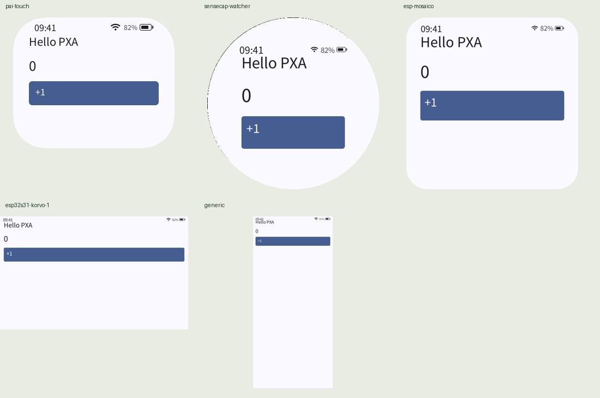
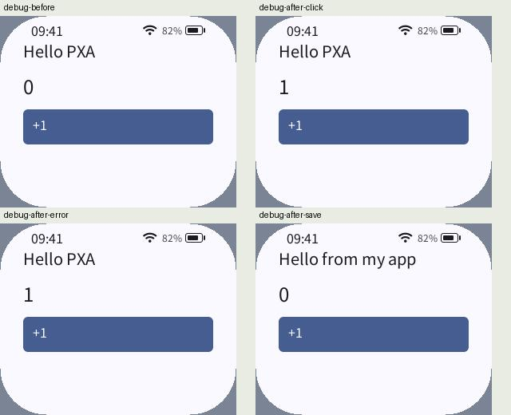
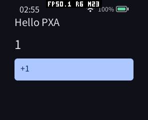

# 官网教程、中文首页与发布说明验证（2026-10-14）

本轮检查官网全部 19 篇原有指南，补充术语速查后共 20 篇。使用已经发布的 DevKit 0.3.0 执行入门代码和打包/运行命令；工作区打包兼容修复使用当前源码验证。没有替换 v0.3.0 资产或移动 tag。

## 修正与阅读体验

| 问题 | 处理与收益 |
| --- | --- |
| challenge 译为“挑战”，Host/Guest 等术语缺乏上下文 | 解释为“一次性验证串”，保留 API 英文字段；增加术语速查 |
| 安装与入门重复 init，旧 C Hello 不能代表当前 SDK | 安装页仅安装工具；入门使用真实 C++26 模板，说明重复 init 会被拒绝 |
| 独立 App、工作区和后台 Console 的命令混在一起 | 每页注明环境与前提，说明项目父目录、工作区根目录、浏览器 Console 的区别 |
| 缺少 DPI、漏掉 esp-mosaico、误称 dev 不支持实例 | 核对五份 TOML，记录 density_dpi、圆角和安全区；说明项目调试选择器与多实例 |
| 全局 pip 安装容易失败；GUI 与 DevKit 边界不清 | PXADB 使用自带工具；GUI 可选并使用 venv；公钥证明只需 Python 标准库与 OpenSSL |
| 小字、代码按钮随横向滚动、复制失败难处理 | 正文 16px / 手机 15px，代码 13px / 手机 12px；独立工具栏标明代码用途，复制被浏览器拒绝时自动选中代码 |
| 仓库首页默认英文、中文信息过时 | 四个仓库默认中文 README.md，互链 README.en.md；旧中文路径保留跳转入口 |
| Release 只有英文 | 既有说明调整为中文在前、英文在后；增加未来发布模板与维护规则 |

这些文档/UI 更新不改变 Guest、设备帧缓冲或游戏常驻内存，也不宣称提高游戏 FPS。

## 实际发现并修复的实现问题

公开的公钥证明脚本原来输出一般 ECDSA 签名，而商城要求 canonical low-S；签名随机性会使一部分登记失败。新脚本使用 OpenSSL 签名、规范化 low-S 并转换为 P1363，兼容未加密/加密的 P-256 PEM。口令通过管道传给子进程，不放在参数、环境变量或临时文件。工具不发网络请求，只输出公钥和签名证明。

工作区旧打包器要求显式 cmake_target，且没有为 find_package(Pxa) 提供 Pxa_DIR；因此 pxa init 创建的项目不能按 apps.toml 教程使用。现默认采用组件 ID，仍支持显式目标；提供 SDK CMake 路径。验签失败也不再错误地报告为应用 ID 不匹配；自定义签名在工作区模拟器中需要对应公钥，已明确设置并验证。未引入新的源码列表、运行时缓存或 Guest 开销。此修复属于当前源码，已发布的独立 DevKit 原有路径不需要它。

## 真实执行结果

| 范围 | 结果与证据 |
| --- | --- |
| 全部指南 | 60 个 shell 代码块语法通过；TOML 可解析；49 个源码引用存在；23 个 HTML 的站内链接、资源、锚点及 20 个搜索条目通过 |
| 官方入门 | 从文档提取完整 C++ / CMake，编译实际 Guest；重复 init 拒绝覆盖；生成锁文件 |
| 打包 | esp32s3、esp32s31、simulator 多目标包、两个单目标 AOT 包与 publish --check-only 通过 |
| 模拟器 | 五种 Profile 运行并截图，包含高 DPI、圆屏和圆角屏 |
| watch / PXADB | 点击计数 0→1；故意语法错误后保持旧 Guest 与计数 1；修复源码后标题更新且重启计数 0；debug INFO、截图与输入通过 |
| 工作区 | 新模板通过 tools/app.sh 与 tools/dev.sh 的隔离实例（使用匹配公钥）；CMake/WASI 回归脚本通过，包括旧显式目标、共享分配器和多任务数结果检查 |
| pai-touch | /dev/ttyACM2、2000000；查询 Core 2.0，安装/启动新 C++ Hello，截图确认计数 0→1；测试包卸载后与原先一样无已安装包；未修改设备设置或固件，原有自动锁屏状态已恢复 |
| 真实 HTTPS 发布 | 隔离 SQLite 与上传目录，真实 TLS 服务：注册→验证串→公钥登记→应用→令牌→官方 CLI 上传；返回 pending，服务器 SHA-256 与本地一致 |
| 原生相关检查 | 包存储、包解析、容器工具、目录、元数据与模拟器 smoke/self-test 共 7 项通过 |
| 后端回归 | 25 项通过，覆盖真实证明、错误口令/曲线、无第三方模块执行、CSRF、验证串复用、low-S 规范化及既有发布流程 |
| 浏览器 | 实际检查目录开合、术语搜索、复制权限拒绝时的选中降级；375px 手机与 1351px 桌面内容宽度均无整页横向溢出，正文分别 15px / 16px；代码区域独立横向滚动 |

HTTPS 测试曾被默认“磁盘剩余百分比”规则正确拒绝；仅在隔离测试进程中设为 0 后验证成功路径，生产配额没有放宽。测试账号与令牌只存在本地测试数据库，未向生产商城创建测试账号或发布测试包。







## 可复现入口

先下载并解压官方 DevKit，取得官网源码，将下面路径改为自己的绝对路径；output 必须是不存在的新目录：

```sh
python3 tools/test-website-tutorials.py \
  --website /path/to/app_store_backend/pxa-website \
  --devkit /path/to/pxa-devkit-0.3.0-linux-x86_64 \
  --output local/tutorial-validation
```

脚本使用隔离 XDG 目录、离线编译和 SDL dummy，输出每阶段日志、截图与 validation.json，不修改真机或服务器。截图需要视觉复核，不能只根据 CLI 退出码宣布交互正确。

官网仓库执行：

```sh
.venv/bin/python -m pytest -q
cd pxa-website
npm ci --ignore-scripts
npm run build
npm run check
```

工作区 CMake/WASI 回归使用 `deps/pxa-system/tools/package/test_cmake_wasi_apps.sh`，设置 WASI_SDK_DIR 和 WAMRC 指向固定版本工具。

## 验证边界与部署

新板移植、已有固件适配是需要产品实现的指南，不是可直接复制的完整 BSP。本轮核对接口、文件路径、配置和示意代码，没有新移植不存在的硬件，也没有为验证教程重烧所有开发板。GUI 页面说明及命令与源码核对；没有重复测量其历史预览 FPS。桌面截图和真机计数验证不能推导出游戏帧率、触摸延迟或音频延迟的收益。

部署使用现有 app.doit.am SSH 服务器：先备份数据库和上传卷，保留旧 Web 镜像与源码，再构建/替换 Web 服务；官网静态产物通过版本目录与原子软链接切换。下载目录、已有账号/应用/版本、密钥与环境配置保持原位。上线后再核对健康检查、目录、教程、静态脚本及签名下载清单。

2026-10-14 已完成部署与线上核验：

- 商城 Web 容器处于 healthy，HTTPS `/health` 返回 `ok`；容器内 `app/main.py` 的 SHA-256 与本轮源码一致；格式正确的未授权上传被 HTTP 401 拒绝。原有 16 个应用、39 个版本、83 个制品保持不变。
- 官网构建版本为 `f26608c3ed0c6773c817a6a9e9f35223c380e813`，20 篇指南均返回 HTTP 200，正文、首页及全部静态资源与本地产物字节一致；搜索索引包含 20 项，旧商城文档路径正确跳转。
- 下载的 `distribution.json`、签名和 `SHA256SUMS` 与原 v0.3.0 文件一致，发行签名验证通过。三个仓库的 Release 说明均为中文在前、英文在后；发布状态、标签对象和所有附件身份、大小、摘要未变。
- 当前 Core 2.0 目录返回 0 项，旧 Core 目录第一页返回 10 项，均正常返回签名封装。这说明历史商城应用尚需逐个重编译并审核后才能用于新 Core；本轮未发布或重新审核应用，不能把服务正常与新 Core 已有兼容应用混为一谈。
- 已停止本轮的工作区模拟器、PXADB 服务及本地文档 HTTP 服务；真机测试包已卸载，自动锁屏已恢复。

备份保留在服务器 `/opt/backups/pxa-tutorials-20261014/`，旧 Web 镜像标签为 `doit-app-store-web:tutorials-before-20261014`；官网当前版本目录为 `domain-releases/20261013T191752Z`（UTC）。回退可切换旧镜像或旧官网软链接，无须恢复未改变的数据库。

详见 [机器可读结果](tutorial-audit-20261014.validation.json)。
