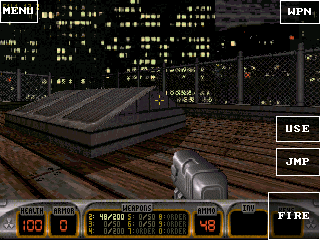
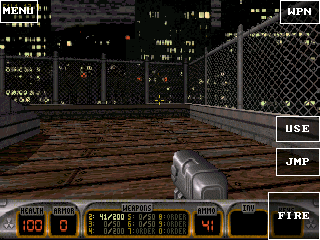

# Duke3D 固定 SD 资源与帧率真机验证

2026-10-18，DOIT GameKit / ESP32-S31，320 × 240，约 16 MiB PSRAM。Duke3D 已进入 Hollywood Holocaust 屋顶场景，并验证转向和射击；Quake、Quake II、C&C 的设备验收仍待完成。

应用使用 FS 0.3 的 `app-media-root`，自动读取 SD 卡 `/PXA/media/<app-key>/duke3d.grp`。本测试身份的 AppKey 为 `77d00fb7ef81f44ad42666cac0f94dbe3689561832ef029ac8ad9be417ebf341`，GRP 为 11,035,321 B。启动没有文件权限或目录选择流程；音频播放仍使用独立的可选权限。代码和私有存档目前在内部旧布局，不能将本测试称为“整个应用装在 SD”。

以下为当前 0.1.6 在加载超时提示中选择“等待”、恢复运行后的截图；不作为启动稳定性通过的证明。

## 性能与内存

当前 0.1.6 在恢复后的屋顶场景中，以 `PERF FPS` 采集 15 个样本，范围 **10.8–11.9 FPS**，中位数 **11.9 FPS**；请求往返 6.20–9.27 ms。每隔五秒点击 USE 保持唤醒，未轮询 INFO，未开启额外逐帧探针。这仅代表该短时恢复场景，不是启动过程或全游戏平均。此前一次锁屏期间的采样已排除，不能将其零帧当作游戏帧率。原始数值及历史状态见[测量数据](duke3d-sd-metrics.json)。

同一活动场景的 SRAM 空闲 123,923 B，最大连续块 81,920 B；PSRAM 空闲 8,419,868 B，最大连续块 6,946,816 B。预算拒绝和分配失败均为 0；引擎栈 73,380 B，回调栈 232 B，continuation 704 B。最大线性内存仍为 4 MiB，实际 4,063,232 B。以下较早内存数值属于 0.1.3 的独立快照。

**以下是受诊断干扰的历史记录，不能作为纯性能对比。** 最初在同一设备、固件、资源和分辨率下，用 `INFO.presentation_fps_x10` 对加载完成的屋顶采样。该字段计数 LCD DMA 完成的内容呈现，但 INFO 同时调用 `esp_littlefs_info`，后者持有文件系统锁执行 `lfs_fs_size` 遍历。每秒采样会争用存储并改变被测负载，因此撤回依据这两组数据作出的优化收益结论。

| 版本 | 改动 | 呈现 FPS 范围 | 样本中位数 | 样本数 |
| --- | --- | --- | --- | --- |
| 0.1.2 | 128 KiB 读取缓存；独立的定时让出 | 0.9–1.9 | 0.9 | 7 |
| 0.1.3 | 384 KiB 缓存、最近页快速命中、避免重复让出 | 5.9–13.9 | 9.9 | 15 |

0.1.3 对应窗口中记录约 34,000–38,000 次缓存命中、0 次 SD 页缺失、0 次 NVM 读取；较早窗口有 2–3 次缺失。这些仅是该窗口的缓存观测，不能消除上述采样干扰。后续使用独立的 `PERF FPS` / `pxadb perf`，不扫描存储，也不打开额外逐帧探针。

最大线性内存保持 **4 MiB**，实际增长到 4,063,232 B；扩大缓存使用原先已固定预留的内存，不能称为减少了 Guest 已提交内存。关卡中 SRAM 空闲 123,731 B、最大连续块 81,920 B；PSRAM 空闲 8,425,892 B、最大连续块 7,733,248 B。资源预算拒绝和分配失败均为 0。Guest 栈高水位：引擎 73,380 B，回调 232 B，Asyncify continuation 672 B。这些是本次短时测量，不是所有关卡的峰值保证。

## 修复与验证边界

真机初次出现“帧在提交但画面全黑”。定位到 pinned linear memory 的两处实现问题：WAMR 的预留配置未传到 adapter，以及 ESP-IDF 的 remap override 未沿用预留容量内原地增长。现已统一编译配置，并恢复容量检查、原地增长及新增区间清零。仅给 Guest 声明 pinned 而不修复 Host 并不足以保证映射缓冲地址稳定。

实际 remap override 的 ASan/UBSan 测试通过，覆盖地址稳定、旧数据保持、新尾部清零、移动分支及分配失败；替换为旧行为时回归断言失败。配置不一致的负向编译检查也按预期失败。扩展读取缓存的 ASan/UBSan 测试覆盖跨页读取、命中统计、NOR 写入、擦除态、重开、旧格式和损坏头部。

固件 3,920,032 B，SHA-256 `d5ae23d18864453809795d36cd98d8b6fb41e7863a8700355c6d8462b8392cf8`。仅刷应用固件分区，分区表保持原样；挂载失败自动格式化关闭。通过正常安装流程更新本次测试包，原有三个应用保持安装，另一台设备未改动。

0.1.4 修复控制器逐轴读取提前消耗相对转向量的问题，真机拖动后观察方向改变、按住 FIRE 后弹药减少。该版本还在加载时出现一次回调超时提示，选择等待后恢复；因此不能称为稳定验收通过。后续修复给热缓存读取循环增加有界让出，设备复测结果须另行记录。

0.1.5 增加热缓存循环让出后，频繁 INFO 采样时加载超时仍复现。Host 的慢调用记录出现 FS 8 KiB 读取约 1.96 s、seek 最高约 2.51 s。这些是在诊断线程争用文件系统的条件下观测到的墙钟耗时，不能据此断言私有后端自然运行时同样慢。同步调用共享 Guest 回调的 3 s 限制，连续调用仍需合理让出。0.1.6 在文件读写返回后按已消耗时间让出，未提高 Host 超时阈值。最终实现的慢 I/O 协议回归检查了 59 次调用边界，并通过 C/C++ 栈对象和文件内容验证；它不代替设备验收。

当前固件 3,920,672 B，SHA-256 `6bd85ed8a0d925b9817e6ee18cdf3df7d202f74fbe251665c218aa418711746a`；当前 0.1.6 容器 2,167,677 B，SHA-256 `45783deb884b19a6f8d0226bdd1daa8cd0e25d0090915fee3f9cfdc34059437c`。新 PERF 接口的 PXADB 80 项测试通过，实际请求确认不扫描文件系统。0.1.6 在轻量采样下仍出现加载超时，选择等待后可以运行并完成上述转向、射击和帧率检查，故**启动稳定性仍未通过**。验证完成后已停止测试游戏，保留安装及固定 SD 资源。

仍需验收长时间运行、其他关卡、完整存档恢复、音频连续性和其余游戏；本次不据此发布热插拔、整应用 SD 安装或无 Flash 文件分区启动能力。固定目录及 SD 系统盘的后续契约见[存储布局设计](../pxa-storage-layout.zh-CN.md)。
