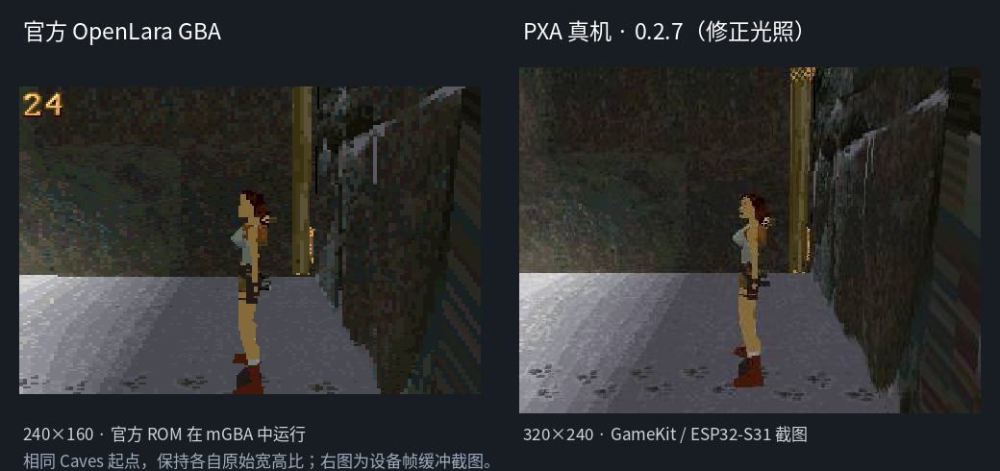
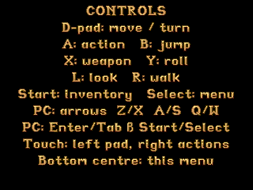

# OpenLara PXA 完整验收

2026-10-18，DOIT GameKit / ESP32-S31 / ST7789 320×240，串号 `1c:29:04:d0:af:5e`。最终交付 **0.2.7 / release_sequence 14**，已安装在真机并保留前台可玩状态；原开发命令的桌面模拟器也实际启动成功。

源码位于 `local/pxa-apps/openlara`，移植 [XProger/OpenLara](https://github.com/XProger/OpenLara) 的 fixed 引擎，固定提交 `3b268ca4bf986c380f44a26ffd9218bf6d376249`。此上游 alpha 提供标题及 **GYM、Caves、City of Vilcabamba 三张可玩关卡**，不是完整桌面版的全关卡移植。

## 场景与原版

实际运行作者发布的未修改 GBA ROM，在同一 Caves 起点与 PXA 真机对照，确认关卡资源逐字节相同、256 项调色板完全一致；定位并修复了上游 C++ fallback 把房间光照再次右移 8 位导致的偏亮。仅修普通房间路径，保留水下独立的小数转换。



[原版对照报告](2026-10-18-openlara-original-comparison.zh-CN.md) 记录了 ROM 来源、运行方法、资源偏移和颜色误差。独立上游参考加这一处光照修复后，在相同 320×240、相同时间和起点，与生产 WASM 的 **76,800 个 RGB565 像素完全一致**。这不等于官方 GBA ROM 或所有场景逐像素一致。

## 完成功能

原版标题背景、Lara、敌人、模型、动画、碰撞、门洞裁剪及背包均保留。PXA 暂停菜单可进入三关、保存/恢复、返回标题、修改设置和查看控制说明。每次读取至多 8 KB 并返回 Host，关卡切换异步执行，加载失败有明确提示。

原 GBA ADPCM4 音乐和六通道 PCM 混音已接入，修复有符号 PCM 输出，10512 Hz 线性重采样为 16 kHz 单声道 S16，媒体增益 -6 dB。申请可选媒体音频权限；拒绝仍可游戏。队列背压保留原包重试，无声源和尾音清空后停止提交静音包，后台及关卡切换清空队列。

私有 `data/save.bin`、`data/settings.bin` 含版本、长度和 CRC；有界序列化并逐项校验读档边界。临时文件写完并关闭后 FS REPLACE，只有 Host 成功回执才显示保存成功；短写继续、替换失败保留旧档。设置包含音效、音乐、动作/跳跃互换、FPS、亮度。

## 手柄及模拟器

GameKit 既有固件提供完整 12 位手柄状态。应用修正 Start/Select 反置：**Start 原版背包、Select 暂停菜单**；菜单 A 确认、B 取消；确认/取消键消费到松开，避免返回游戏时误动作，Select 不再同时触发引擎自由相机。生命周期和断开事件清除按住状态。

桌面 Host 补齐安全只读应用媒体根，使用已有 POSIX scoped FS 实施应用隔离和路径校验，保留私有 FS。路径为 `local/simulator/PROFILE/media/<AppKey>/`，缺少外部媒体文件时应用使用 `assets-simulator/game` 打入的资源。修复前原命令报 `activation plan status=-3`；修复后直接运行：

```sh
./tools/dev.sh sim --board doit-gamekit openlara
```

SDL GameController 支持十字键、左摇杆、动作及肩键、Start/Back，左摇杆 25% 死区，可热插拔。键盘产生相同控制器事件，支持组合按键；SDL 失焦会清键，后台暂停和断开手柄不会留下持续输入。

| 操作 | 手柄 | 模拟器键盘 |
| --- | --- | --- |
| 移动、转向、菜单选择 | 方向键 / 左摇杆 | 方向键 |
| 动作 / 菜单确认 | A | Z |
| 跳跃 / 菜单取消 | B | X |
| 拔枪 / 收枪 | X | A |
| 翻滚 | Y | S |
| 观察 | L | Q |
| 慢走 | R | W |
| 原版背包 | Start | Enter |
| 暂停菜单 | Select / Back | Tab |

启动后 Tab 打开菜单，方向键选择 `New game: Caves`，Z 确认。触屏底部中心 `(180,220)` 也能打开菜单。GameKit 系统保留 Select+Start 返回桌面等组合键。



[键盘完整运行证据](openlara-complete-20261018/simulator-proof.json) 通过 SDL 键盘事件实际执行进关卡、移动、保存、再移动、恢复及打开背包；恢复位置/角度完全一致。[Guest 控制器测试](openlara-complete-20261018/controller-proof.json) 将动作、跳跃、武器、Start 背包、Select 暂停的帧输出与独立触屏输入相比较，并测试断开和后台清键；[菜单按键测试](openlara-complete-20261018/controller-menu-proof.json) 验证持键取消及 Select 关闭菜单不会产生额外游戏动作。SDL 虚拟手柄测试覆盖方向、组合键、轴死区、失焦和拔出；与媒体根、桌面启动 smoke 一起 [3 项 CTest 均通过](openlara-complete-20261018/simulator-tests.log)。同时修复了关闭 SDL 窗口后继续回调已删除 UI 的路径。

## 真机帧率与功能回归

原生 320×240，相同 Caves 起点、视距和 30 Hz 墙钟仿真，音频设置开启。起点没有持续声源，因此静音包优化可省去无效混音和 Host 提交；有声音时仍正常发送 PCM。使用 `PERF FPS` 读取实际 LCD 完成帧率，每秒约一笔，每五秒点无动作区保持唤醒。截图、MEMORY 和 SD 校验在采样窗口之外，未轮询 INFO 或开启逐帧性能探针。

| 版本 | 用途 | 样本 | 最小–最大 FPS | 中位数 | 均值 |
| --- | --- | ---: | ---: | ---: | ---: |
| 0.2.5 / seq 12 | 修正光照，静音包基线 OL_AUDIO_IDLE_SKIP=0 | 20 | 34.6–35.9 | 34.8 | 34.940 |
| 0.2.6 / seq 13 | 相同固件、连续独占串口，启用静音优化 | 60 | 35.7–37.9 | 36.8 | 36.723 |
| **0.2.7 / seq 14** | 最终控制器改动后独立回归 | **20** | **35.6–37.8** | **36.75** | **36.540** |

受控 0.2.5→0.2.6 A/B 中位数提高 **5.75%**。[同固件原始数据](openlara-complete-20261018/same-firmware-device.json)。0.2.7 另行冷启动复验，复用基线数据只作参考，未伪装成新的一次连续 A/B；最终结果约 **36.8 FPS**。[最终真机记录](openlara-complete-20261018/final-device.json) 中 `passed=true`。

两次完整回归均通过标题、转向、行走、保存后移动再恢复、升级保留旧档、原版背包开关、设置 OFF 经重启保留后再开启、重启恢复存档、三张关卡加载、后台恢复。最终包保存/重启恢复的四元组为 `[75264, 3072, 3345, 32496]`，恢复后完全相同。另六个应用在最终包回归前后身份及版本一致。

[419 帧确定性比较](openlara-complete-20261018/pixel-proof.json) 验证 OL_OPTIMIZED=0 与最终优化在标题、菜单及 300 帧转向/行走/跳跃/武器/动作中的 RGB565 全部一致。它与独立上游参考/官方 ROM 对照属于不同证据，均不用于推算硬件 FPS。[实际 WASM 集成回归](openlara-complete-20261018/integration-complete.json) 覆盖短写、失败替换保留旧档、损坏/截断拒绝、跨实例恢复、音乐开关、音频拒绝与背压、三关保存恢复；音乐 OFF 稳态非零样本为 0，ON 后恢复输出。

## 内存、交付及复现

最终线性内存 **6,684,672 B**，pinned，上限 **8 MiB**，预留栈 64 KiB（未测栈高水位）。启动窗口最低 SRAM 92,119 B、PSRAM 5,548,644 B；稳态窗口 SRAM 空闲 131,355 B、最低 130,443 B，PSRAM 空闲 6,316,260 B、最低 6,310,504 B。共享预算拒绝和分配失败均为 0。这些为全设备局部堆/预算观测，不相加为应用独占内存。

最终签名容器 **450,206 B**，SHA-256 `8cb41966f9c182b9dfc861d5da1c49d625983096713b40d60528a2b703daa00d`；S31 AOT **620,184 B**。[签名/安装检查](openlara-complete-20261018/final-release-check.txt)、[包/AOT/WASM 散列](openlara-complete-20261018/artifacts.json)、[源码散列](openlara-complete-20261018/source-sha256.json)。交付在 `local/releases/openlara/0.2.7/`，包含安装包、应用源码、桌面 Host 补丁及 SHA256SUMS；构建、资源准备与操作命令见应用 README。

六份游戏数据由固定提交下载且逐个校验，位于本签名的 SD AppKey 目录；[来源记录](openlara-complete-20261018/game-data.json)。数据独立于引擎 BSD-2-Clause 许可证，不纳入 Git、源码归档或硬件代码包。模拟器在本地资源准备后使用独立测试资源包。

本任务没有刷写固件、格式化或删除其他应用；更新保持身份与递增序列，使用 archive 释放本应用代码空间并保留私有数据。共享设备的固件由另一任务变更，本次 A/B 及最终复验使用同一 [revision19-read-at 镜像记录](openlara-complete-20261018/firmware.json)。A/B 后的共享间隙另一任务将 Duke 升至 0.1.11，原始日志保留；最终 0.2.7 测试期间独占设备且未改其他应用。首次暖重启 HELLO 超时后补充有界重试、锁屏唤醒及功能段续跑，保留失败与重试证据，没有重复安装低序列包或把未完成运行标为通过。

## 验证边界

未做全关卡通关、其他板型真机、长期老化、板载每个物理按键的人工按压验收、外接实体 SDL 手柄或蓝牙配对、扬声器声学录音。手柄事件测试与 SDL 虚拟手柄测试不冒充实际按键电气测量。音频证据区分非零混音、Host 已消费样本和实际声学输出，不声称测量音压。Host 未提供 fsync，不能承诺任意断电时刻最新一次写入必定落盘。上游震动钩子未实现。

应用和 SDK 分别提交于独立 Git 仓库；[源码提交记录](openlara-complete-20261018/source-commits.json) 固定本次版本与提交号。此记录为本地提交，不表示已推送远程。
