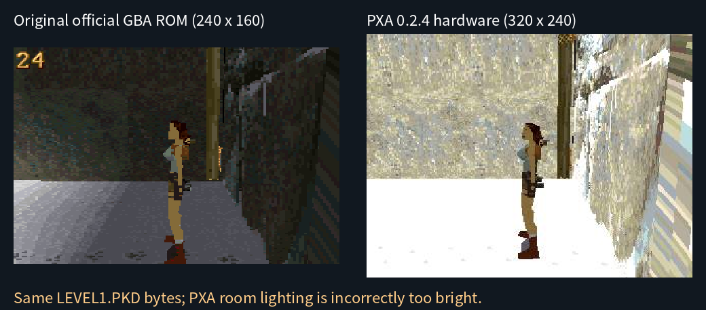

# OpenLara PXA 与作者发布版实际对照

2026-10-18。对照对象是作者发布的 **OpenLara GBA 版**，对应本次移植的 fixed 引擎；不是桌面 OpenLara 的现代渲染器，也不是对 1996 年 PC 可执行文件的逐像素复刻。

## 实际运行与结果

从 [作者 Release](https://github.com/XProger/OpenLara/releases/tag/latest) 下载 `OpenLara_gba.zip`（发布页标记 gba 更新为 2023-03-02），未修改 ROM，在 mGBA 0.10 中实际启动、进入 Caves、转向和前进。右侧来自 GameKit / ESP32-S31 真机的已完成显示帧缓冲截图。

**关卡几何、角色、贴图和起点相机来自相同数据；之前的 PXA 房间光照确实不对，现已修正。** 图中 Lara 侧身出现在墙边，也是官方 GBA 版的 Caves 起点表现。GBA 是 240×160（3:2），PXA 原生 320×240（4:3），图中保留各自宽高比；视口、光栅边缘和动画时刻不完全一致。

此前的结果：

## 发现及修复

上游 `src/platform/gba/render.iwram.cpp` 的普通房间 C++ 变换先将打包光照转换为 0–31 的 lightmap 行号，却在写入顶点时再次 `vg >> 8`，结果恒为 0，墙面、地面及雾按过亮的档位绘制。官方 GBA ARM 汇编直接保存 `vg`，因此官方 ROM 没有这个问题。

PXA 的 `vendor/renderer.cpp` 现在直接写入 `res->g = vg`。只改普通房间这一处；水下光照另有 8 位小数，保留其右移。无 PXA 改动的上游 C++ 参考也复现偏亮，说明此前的“优化前后像素相同”仅能证明优化没有改变该 C++ 路径，不能证明它符合官方 ROM。修复从 0.2.6 起交付。

## 可核对的证据

官方 ROM 大小 10,210,240 B，SHA-256 `26cc785df788279226312f827d6af05d478b0b1e6307fd54f74a1dca020f7b0a`。在 ROM 中逐字节找到 TITLE、GYM、LEVEL1、LEVEL2 四个 PKD，与移植使用的固定上游资源完全相同；Caves 的 256 项调色板也全部一致。

| 文件 | 大小 B | 官方 ROM 中的精确偏移 |
| --- | ---: | ---: |
| TITLE.PKD | 313,700 | 6,577,004 |
| GYM.PKD | 1,465,004 | 138,252 |
| LEVEL1.PKD | 2,356,992 | 1,603,256 |
| LEVEL2.PKD | 2,616,756 | 3,960,248 |

同为 240×160 时，官方 ROM 与上游 C++ 起点画面的每通道平均绝对颜色误差，从修复前 **16.3749** 降到 **0.5345**（RGB 各按 0–31 计）。仅排除左上 40×15 的 FPS 字样，比较 37,800 个像素；22,026 个像素三通道完全相同（58.27%）。ARM/C++ 光栅路径及动画时刻未完全统一，不宣称官方 ROM 逐像素一致。[原始测量及 ROM/资源 SHA-256](openlara-original-20261018/rom-comparison.json)。

另用未修改的上游 fixed 游戏代码与 C++ 光栅器，只加上述一处光照修复及最小平台桩，在相同 **320×240**、相同时间、相同 Caves 起点运行 180 个更新。它与生产 PXA WASM 的 **76,800 个 RGB565 像素全部相同**，SHA-256 同为 `767464b2688e9ee6f72a5d8bc79e007814181449d92ce0b10f1b5ebed69ec2f7`。[独立参考比较](openlara-original-20261018/reference-comparison.json)。这项结论限定于所测起点，不代表所有房间和动画均已穷举。

截图与完整运行记录保存在工作区 `local/openlara-original-compare`。本目录保存 mGBA 捕获程序、独立参考桩和比较脚本；ROM 与游戏资源不纳入 Git。源码、真机 FPS、音频/存档及控制器回归见 [完整验收](2026-10-18-openlara-complete.zh-CN.md)。
