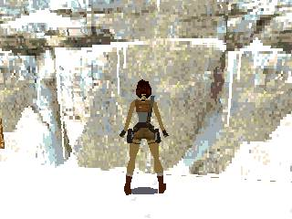
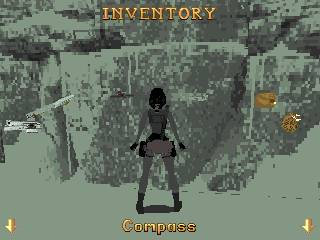

# OpenLara PXA 移植与 GameKit 真机优化

> 历史记录：本文截至 0.1.5。后续已补齐音频、存档、标题和控制器，并通过官方 ROM 对照修正了旧版房间光照偏亮。本文截图与性能数据不代表最终版本；参见 [完整验收](2026-10-18-openlara-complete.zh-CN.md) 和 [原版对照](2026-10-18-openlara-original-comparison.zh-CN.md)。

2026-10-18，DOIT GameKit / ESP32-S31，320×240 ST7789，约 16 MiB PSRAM。设备串号 `1c:29:04:d0:af:5e`，PXADB `/dev/ttyACM0`、2000000 baud，固件报告 0.4.0 / Core 2.0。

移植的是 [XProger/OpenLara](https://github.com/XProger/OpenLara) 的 fixed 定点引擎，固定 commit `3b268ca4bf986c380f44a26ffd9218bf6d376249`。保留上游的关卡、角色、敌人、动画、碰撞、门洞裁剪、排序表和 C++ 软件光栅化；不是已有 Tomb Explorer 演示。源码在独立应用仓库的 `local/pxa-apps/openlara/`，构建、资源准备、控制及边界详见该目录 `README.md`。

## 实测结果

全部使用原生 **320×240**、相同 Caves 起点和视距，仿真按 30 Hz 的墙钟时间推进。`PERF FPS` 计数完成的 LCD 呈现，不是 Guest 提交速率。

| 版本 | 改动 | 样本数 | LCD FPS 范围 | 样本中位数 |
| --- | --- | ---: | ---: | ---: |
| 0.1.1 | 定点引擎、16 ms 时钟、逐像素转换 | 20 | 32.8–33.9 | 33.7 |
| 0.1.2 | 普通 RAM 光栅访问、固定纹理指针、四像素转换、游戏逻辑 Os | 20 | 34.9–35.9 | 35.8 |
| **0.1.5** | 缓冲释放后补帧，同时限制最短生产间隔为 16 ms | **60** | **37.7–38.9** | **38.7** |

最终中位数相对基线提高 **14.8%**，均值从 33.585 升至 38.51 FPS。同一最终包停止并重新启动后的独立 10 样本复验为 37.8–38.9 FPS，中位数 38.65 FPS。

这些是约一分钟的首关起点稳态观测，不是全游戏平均、通关或长期稳定性保证。各组按顺序执行，未做随机化 A/B/A；结果限定于这台设备、这份固件与该场景。

采样前唤醒并以有节奏的上滑解除锁屏，等待本次 Guest ready 和预热。约每秒读取一次 `PERF FPS`，每五秒点无动作区域保持唤醒。截图、MEMORY 查询与 SD 校验在 FPS 窗口之外；未轮询会遍历 LittleFS 的 `INFO`，未启用逐帧 PERF 探针。

### 游戏画面和交互

下图来自最终硬件包，转向并前进后；背包图来自同包重新启动后的第二次验收。

已在设备验证转向、行走、打开背包、关闭背包并恢复关卡。输入为 PXADB 注入，经 Host 和 Guest 实际处理；未测物理按键电气扫描和按键到光子的延迟。模拟器也验证了相同操作。

## 优化及正确性

GBA renderer 原来的 volatile 访问针对 VRAM；PXA 的目标是普通 Guest 线性 RAM。优化版移除该限定，在每个多边形入口快照纹理指针，避免扫描线写入时反复加载全局指针。INDEX8 → RGB565 改为每次读四个像素、写两个 32 位字，不改调色板或采样位置。大型虚函数游戏逻辑翻译单元使用 Os，变换与扫描线保持 O3。

同一场景五秒统计窗口的每帧耗时中位数，渲染由约 12.38 ms 降至 11.86 ms，转换由约 6.65 ms 降至 5.48 ms。它们是 Guest 侧墙钟观测，和 LCD FPS 含义不同。最终版本同时利用 Surface release 事件减少等时钟的空档；release 也可能来自待显示帧被替换，因此设置生产间隔，避免回收事件形成持续生产循环。每次写入仍必须成功 acquire，`WOULD_BLOCK` 返回后不修改缓冲。

确定性 Wasm 集成测试固定时间和输入，覆盖站立、转向、行走、跳跃、切武器和动作。基线 `OL_OPTIMIZED=0` 与最终实现的连续 **300 帧 RGB565 输出完全一致**，整体 SHA-256 为 `50823b709e8ef18b760248efea54444b1e579b945ac9d9ff8bbbafbf9c1b72ca`。这不覆盖所有关卡，也不能拿 Node 运行速度当真机 FPS。

## 内存与包

线性内存实际 **3,604,480 B**，最大值 **4 MiB**，声明 pinned。链接栈预留 64 KiB；本次未测该栈的实际高水位。最终稳态局部监测窗口：

- SRAM 空闲 131,407 B，窗口最低空闲 131,135 B，最大连续块 81,920 B。
- PSRAM 空闲 10,691,656 B，窗口最低空闲 10,685,960 B，最大连续块 6,946,816 B。
- 启动窗口 PSRAM 最低空闲 9,912,700 B，SRAM 最低空闲 128,811 B。
- 共享资源预算拒绝和分配失败均为 0。共享预算、Surface 范围和全设备堆不能相加，也不是完整的单应用 RAM 统计。

AOT 从 **608,052 B** 降至 **551,692 B**，减少约 **9.3%**。最终 0.1.5 容器 **398,715 B**，SHA-256 `562331807da12fb995908db8ab8c774230dde4d85e18ac6be6694eca593a6148`；S31 AOT SHA-256 `07df03087e357b761fd7b778825255b59039993a32221dc89ec97a7c82cda77d`。`pxa publish --check-only`、设备签名与安装校验通过。

## 资源及设备状态

四个上游 PKD 文件共 6,752,452 B，分别为 TITLE、GYM、LEVEL1、LEVEL2。通过正常 PXADB 写入 `/sdcard/PXA/media/78670e6ca3833ee694be1ba9443f4d04b9e6ffc7617c7fbd7fe4a5363419135c/`，启动使用 FS 0.3 `app-media-root` 自动绑定，无目录选择流程。硬件包仅含引擎和许可证；本次实际进入并测量 LEVEL1，其余文件存在及 SHA-256 校验不等于已运行对应关卡。

每次回调至多读取 8192 B，之后返回 Host，不把整个关卡读取塞进一个回调。首版曾因错误请求 8 ms 时钟而不产生帧，修正为接口允许的 16 ms 后才采集基线；未运行的首版没有 FPS 验收结论。

本次未刷写固件、格式化存储、修改分区或改动另一台设备。内部空间不足以同时保留两个测试代际时，仅卸载本次新建的 `pxa-openlara` 测试包再装下一版；原有六个应用及其版本保持一致，SD 公共资源保留。最终 0.1.5 已保留安装，验证结束停止游戏，回到系统桌面。

当前范围为上游 fixed 早期引擎。**音频、音乐、持久化存档与设置尚未接入，标题背景为空底。** 未做所有关卡通关、其他板型实机、长期运行或音频连续性验收。桌面 Host 当前不发布 SD 固定根能力；模拟器使用独立构建副本声明基础 FS 并走 assets fallback，不能用它证明硬件 SD 能力。

原始 [性能与内存汇总](openlara-20261018/summary.json)、[最终 60 样本](openlara-20261018/final-metrics.json)、[300 帧比较](openlara-20261018/final-render-comparison.json)及串口日志保存在 [证据目录](openlara-20261018/)。应用目录的 `tools/prepare-data.py`、`tools/measure.py`、`tools/compare-render.mjs` 可复现资源准备、设备采样和像素比较。
