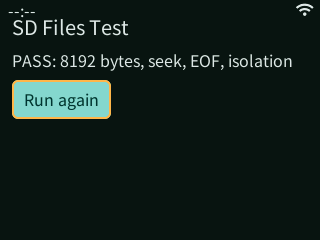

# GameKit 固定 SD 目录，无选择器真机验证

2026-10-18，DOIT GameKit / ESP32-S31，320 × 240，约 16 MiB PSRAM。

签名 SDK 示例为 `pxa-fixed-files`，包中 `permissions` 是空数组。组件声明 FS 0.3 的 `app-media-root` 和 `scoped-roots`，调用 `ctx.fs().app_media()`，不调用 Permission acquire、request_directory 或 open_grant。

Host 根据已验证身份和板级明确指定的 SD 卷，自动打开卡内 `/PXA/media/<app-key>`。本示例的 AppKey 为 `e5edae3776f8191e87efe5ada9138f0db533129969617bb800a5a43af9a7945d`，其中放置 8192 B `fixture.bin`，内容与[授权目录测试](2026-10-18-sd-roots.zh-CN.md)一致。应用首次启动直接显示 PASS；停止、重启设备并重新启动后再次显示 PASS。两次均未确认文件权限或选择目录。设备包列表确认活动身份为 `pxa-fixed-files`，旧 `pxa-scoped-files` 测试应用未运行。

检查覆盖数据内容、4091 偏移 seek、EOF、写入拒绝、路径逃逸拒绝、关闭父根后的子文件生命周期及失效句柄。UI 与可选授权示例复用同一测试主体，标题仍为 SD Files Test；本次没有选择器流程。

固件大小 3,919,904 B，SHA-256 为 `e8d00a4b7c6f02ff6401c2ec23545444537ea7cd41bb67dd9d92365964e60b79`。刷写仅更新应用固件分区，分区表与原始备份一致，没有整分区刷写文件系统或 NVS；示例安装及数据写入由 Host 正常完成。内部 LittleFS 挂载失败自动格式化在板默认配置及本次构建中均关闭。原有三个应用保持安装，其他设备未改动。

验证也发现并修复了组件依赖解析及 Host 启动能力表未发布新 feature 的问题；该能力表现按实际后端生成，不为未启用的目录选择器发布 user-directory-grants。

本次 Host ASan/UBSan Core、作用域 FS、包测试 3 项通过，C SDK FS 与 C++ roots 测试通过，PXADB 78 项测试通过。新增 Core 检查包括不携带 Permission/GrantId 的固定根访问、私有域授权钩子拒绝、非法 GrantId 参数拒绝；现有撤销、取消和子句柄行为保持通过。

为移动已有测试资源，PXADB 增加 `fs move`：仅移动同一个已登记外部卷内的普通文件，目标必须不存在。已在 SD 内移动 11,035,321 B 的 Duke3D 资源，无须再经串口复制；对同一已存在目标的移动返回 `destination_exists`，不覆盖。该命令不支持跨卷或目录迁移，不等于安装事务。

本次完成的是默认固定资源根。应用代码及私有存档仍在内部旧布局；[整应用与 SD 系统盘](../pxa-storage-layout.zh-CN.md)的私有镜像、安装事务及无 Flash 文件分区引导仍待实现。以上截图不作为游戏关卡或 FPS 验收。

随后 Duke3D 已在更新后的固件上自动读取固定 SD 目录并进入真实关卡；该项及帧率测量另见[游戏真机记录](2026-10-18-duke3d-sd.zh-CN.md)。

加入 pinned memory 修复及慢 Host 调用计时后，再次在 GameKit 启动同一固定根示例，直接通过全部读取与隔离检查，未选目录。本次固件 3,920,432 B，SHA-256 `fcb884f09f2eebf181429c591960de82706de4a10ab10acb01bde0bf5a4a231e`；刷写仍只涉及应用固件分区。

## 有界同步随机读取复验

后续签名示例 0.1.1 在固件 19 上通过 `read-at` 真机检查，日志包含 `SD TEST positional=1 cursor_unchanged=1 eof=1 cancel=1` 和完整 `SD TEST PASS`。单次最多 4096 B，数据直接写入调用方包缓冲；指定偏移读取不改变顺序游标，验证 EOF 短读、取消 cookie 以及拒绝重用 cookie。原有内容、只读隔离、父子生命周期和失效句柄检查同时通过。此次新增随机读取检查为正常启动验证；上述重启记录属于较早版本。

当前固件 3,921,472 B，SHA-256 `c85967b052eb23b2a79c9b89ca0ed4de1295478e7f782492a9b48d4c0837831f`；仅刷 0x10000 应用分区，刷前分区表与备份逐字节一致。C SDK 全套检查、C++ roots 测试及 ASan/UBSan Core/作用域 FS/包测试均通过。旧 backend 的可选尾字段按 `struct_size` 识别，不要求旧 provider 扩大结构才保留固定媒体根能力。

这是同步有界 profile，没有 pending worker，也没有宣称取消正在执行的磁盘操作。异步读取、可写外部私有根、整应用 SD 安装和 SD 系统盘仍需后续实现。
