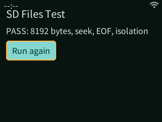
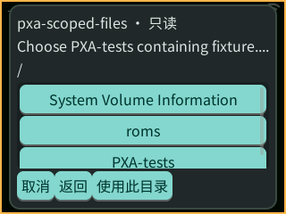

# GameKit 授权 SD 读取真机记录

日期：2026-10-18。设备为 DOIT GameKit / ESP32-S31，约 16 MiB PSRAM，320 × 240 显示。验证对象是 FS 0.3 只读授权目录链路，不是整应用 SD 安装或 SD 系统盘。

仅更新 GameKit 的应用固件分区，保留原分区表、NVS、文件系统和原有三个应用。修改前保留了私有完整 Flash 备份。测试固件为 3,916,560 B，SHA-256 为 `008020c13f46e9ab449072d193cba717a1940c8f9c1cacc364239456575e89e1`。其他板没有刷写或停止应用。

使用独立签名的 [`scoped-files` SDK 示例](../../deps/pxa-system/sdk/guest-cpp/examples/scoped-files/README.zh-CN.md)。SD 上 `PXA-tests/fixture.bin` 为 8192 B，字节 `i` 的值为 `(i * 37 + 11) & 255`，PXADB 上传后回读比较一致。经系统权限确认和目录选择器授权后：

```text
SD TEST PASS bytes=8192 seek=4091 eof=0 readonly=1 isolation=1 child_lifetime=1 stale=1
```

实际验证了逐字节内容、非对齐 seek、EOF、写入拒绝、作用域越界拒绝、关闭父目录后已打开文件仍可用，以及关闭后的句柄失效。重启后重新启动应用，在没有再次选择目录的情况下显示 PASS；再次点击 Run again 也产生新的 PASS 日志。



后续清除该测试应用数据，再次走系统目录选择器，验证深色主题、中文导航和目录进入流程。选择器是 Host 界面，不接收 Guest 原生路径权限。



一次测试应用运行快照：PSRAM 空闲 15,101,612 B，最大连续块 14,680,064 B；内部 SRAM 空闲 168,419 B，最大连续块 110,592 B；资源预算 allocation_failures 与 denied 均为 0。这是读取示例的快照，不能作为游戏内存或 FPS 成绩。

Host 验证包括 ASan/UBSan 下的 Core、作用域 FS 及包测试（3 项通过），C SDK 测试、C++ 既有 FS 和新增 roots 测试，以及 PXADB 77 项测试。原生作用域测试覆盖路径逃逸、符号链接/硬链接/FIFO、目录重命名、只读、权限撤销、重复卷身份与 epoch 失效。

当前只发布 scoped-roots 与 user-directory-grants，使用已有 FILE read 和 FS seek。没有发布 READ_AT、分页、watch、热插拔、FAT 安装或私有镜像能力。整应用固定目录及无 Flash 文件分区启动的目标契约见[SD 系统盘设计](../pxa-storage-layout.zh-CN.md)。
