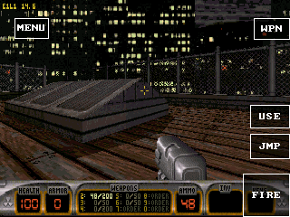
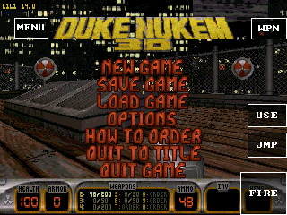
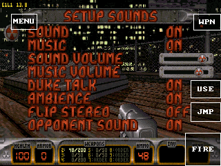

# Clock 0.3 与 Duke 后续验证（2026-10-19）

## Clock 已通过真机

设备：doit-gamekit，ESP32-S31，320MHz、16MiB PSRAM。仅更新应用固件，刷写前核对分区表与原始备份一致，没有格式化存储或改写 SD 资源。固件应用镜像3,922,416字节，SHA-256 `ddbc163bb96b7978f2f592236b147a60df6e9caaeb878aa3c175a403e3310fff`。

构建时SDK工作区另有其它任务未提交的图像适配改动；记录的SHA对应实际测试镜像，不能仅凭本轮提交号复现完全相同的发布二进制。本轮提交未包含那些改动。

Clock 0.3 增加 `timing` 能力、`limits` 和带完成消息的 `configure(period_us)`。该固件报告1000～60000000µs、步长1µs、计时调度量化1µs。取消为0。旧 `set-period` 保留0/16～1000ms语义；新游戏仍用16ms，分别评估接口和游戏改动。

测试应用 `sdk/guest-c/examples/clock-timing` 0.1.1 对每阶段收集128个间隔，采集期间不逐 tick 打印。数据为 Guest 收到的单调时间，非硬件中断间隔。

| 请求周期 | 中位数 | 平均值 | 最小～最大 |
|---|---:|---:|---:|
| 1ms | 1.828ms | 2.001ms | 1.044～20.807ms |
| 8ms | 8.000ms | 8.002ms | 6.402～9.553ms |
| 33ms | 33.000ms | 33.000ms | 27.446～38.573ms |
| 999µs拒绝后原33ms订阅 | 33.001ms | 32.980ms | 30.489～33.539ms |

统计以整数微秒输出，偶数样本中位数与均值向下取整。1ms请求可接受，但此配置下不能保证1ms回调；延迟会合并，恢复原期限节奏时也可能出现小于请求周期的相邻间隔。60s阶段仅验证成功接受和取消，没有等待满一分钟。量化值不等于最大回调延迟，空载测试也不能替代游戏帧率。

ESP Host 使用独立一次性 Clock 定时器，待处理或暂停的订阅不继续唤醒它。原5ms系统/指针维护保留，尚未测量整机空闲总唤醒次数。微秒配置由公共处理器预留完成空间后调用后端；无效配置、后端失败和完成空间不足均不修改已有定时器。generation 丢弃取消、暂停或重新配置前的队列事件。

原生测试覆盖最小值、8ms、33ms、长周期、无效参数、溢出、后端失败、完成空间不足、取消、暂停/恢复、组件销毁与事件合并。C/C++ SDK覆盖解析、旧Host拒绝、传输失败与协程取消；C++ awaitable不新增嵌套Task。公共库ASAN/UBSAN的Core、scoped FS、Package回归通过；ESP固件构建及桌面产品模拟器构建通过。桌面产品模拟器运行同一诊断流程输出PASS，不能用于证明硬件精度。

首轮兼容性检查拦截了安装器能力表漏报，已补齐。早期诊断一次打印8条日志导致PXADB丢部分记录；最终0.1.1在应用内部完整统计后输出一条摘要，完整四阶段结果及PASS均已收到。最终数据见 [clock-v03-metrics.json](clock-v03-metrics.json)。

## Duke 游戏验证

0.1.14保留320×240、完整音乐和音效、16ms唤醒与原引擎逻辑。共享控件合并UI屏幕安全边距和Window系统栏边距，绘制和命中使用同一矩形；顶部MENU/WPN与RTS的RMB进入可触控区域。音频环形缓冲按最多64帧批量转换和提交，降低逐样本跨函数调用。全部65536种8位左右声道组合及环形边界输出与旧算法逐样本一致；没有降低采样率或关闭音频。

帧缓冲70组原始采样/光标/控件像素对照、非对齐输出、安全边距及极窄可用区测试通过。WASM协议宿主进入原始关卡，在24px系统栏边距下点击(18,35)打开MENU，线性内存实际3.75MiB、上限3.875MiB。Stop回调遵守Host先撤销资源、Guest不再调用Core的规则；旧0.1.13在严格宿主中因退出导入被拒绝，修正后的运行通过。慢I/O的C/C++对象生命周期fixture通过63个回调边界。真机首次采样约152秒、重开采样约114秒均进入原始屋顶，无回调超时；扩展稳定窗口的中位数均为14.9fps。共同80～110秒窗口对照如下，均为相同屋顶视角、320×240和完整音频，未达到20～30fps。

同固件旧版0.1.12的80～140秒窗口共57个样本，中位12.9fps，范围10.9～13.9fps，无回调超时。中间版0.1.13同窗口58个样本，中位15.9fps，范围14.8～15.9fps；真机菜单另行确认音乐和音效均为ON，重开后的25个短样本中位14.9fps。中间版没有正确合并系统栏边距，最终以0.1.14为准。此前固件19的0.1.12是13.9fps，不能把跨固件差异直接当作游戏改动的收益，也未单独确认其原因。

| 版本（同固件21） | 共同80～110秒中位数 | 样本数 |
|---|---:|---:|
| 0.1.12 | 12.9fps | 29 |
| 0.1.13中间版 | 15.9fps | 30 |
| 0.1.14首次 | 14.9fps | 30 |
| 0.1.14重开 | 14.9fps | 28 |

0.1.14已在真机点击移位后的MENU打开菜单，检查音乐和音效均为ON，并验证转向及开火（弹药减少）。WPN共用绘制与命中矩形，但此次初始武器库存未足以确认换枪效果，不列为通过。启动早期显式快照查询返回BAD_STATE，随后Window的METRICS_CHANGED提供有效边距，界面正常；没有将此日志判为启动失败。退出后的WAMR当前动态分配回落至416字节；全局堆最低水位包含OpenLara等其它应用，不归因于Duke。

最终安装包2,183,837字节，AOT2,990,308字节，容器SHA-256 `bdc663c8ec6e9b8fe613442ad3c8ed146118d03db31f9b764e5335b59f8d33c0`。最大线性内存4,063,232字节（3.875MiB），实际3,932,160字节（3.75MiB）。大资源继续从固定SD媒体根读取；包和私有存档仍在内部存储，整应用SD安装、无Flash系统根与其它游戏真机验收未完成。

详细数据见 [duke3d-followup-metrics.json](duke3d-followup-metrics.json)。测试后Duke停止，恢复此前OpenLara前台，删除本轮Clock诊断应用，原有应用保留。

