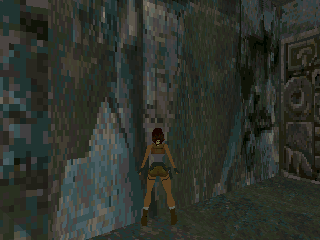
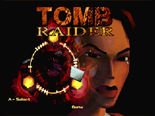

# OpenLara TR1 完整主引擎移植

本次从 0.2.7 的 fixed/GBA alpha 切换到 GitHub 原版 `src/` 主引擎，PXA 应用源码在 `local/pxa-apps/openlara`。上游为 [XProger/OpenLara](https://github.com/XProger/OpenLara/tree/3b268ca4bf986c380f44a26ffd9218bf6d376249/src)，固定提交 `3b268ca4bf986c380f44a26ffd9218bf6d376249`，BSD-2-Clause。

**这是完整 TR1 玩法引擎的移植，不是已经包含并验收 15 关的完整商业游戏包。** 本机没有找到完整原版数据，默认只提供公开 PC 演示版的 TITLE 和 City of Vilcabamba，已询问原版 DATA 或 GAME.GOG 路径。其他关卡、引擎过场、后期大型关卡的资源和内存仍待验证。外部 FMV 尚未接入。

应用实现提交 `4836a86`，手柄提示提交 `8c60ef3`；候选版本 0.3.4，release_sequence=19。

## 实现范围

原版主引擎的敌人、机关、动画、碰撞、房间翻转、背包、物品和关卡流程保留。PXA 接入 RGB565 Surface、媒体目录、原版音乐/音效、手柄、触屏暂停菜单及私有设置/存档。15 个主线关卡、Lara's Home、标题及 4 个引擎过场均列入目录，缺失数据不能进入。New Game 从第一个已安装主线关开始；完整数据下为 Caves，演示数据下为 City。

完整导入工具接受原版 DATA/游戏目录和 ISO/GOG/BIN 光盘镜像。检查全部 21 个 PHD 及二进制布局，先验证后替换；PHD 原样复制。音乐可由编号音轨转换为流式 PCM8，保留上游 AD4 兼容。仅镜像中的 PHD 被只读提取，不修改源镜像。

新版原版背包也显示 A/B 手柄操作提示，模拟器用 Z/X 对应；ENTER 提示不再误导 GameKit 操作。

完整引擎使用 `data/classic-save.bin` 和 `data/classic-settings.bin`，旧 fixed 存档保留。采用 OLS2 原版状态及外层 CRC、结构验证和原子替换；失败保留旧档。手柄和模拟器键盘映射沿用 0.2.7，并保持原版自定义映射跨关卡有效。

## 内存和渲染

音乐银行不整体加载，改为 2048 字节目录和 64 KiB FIFO，支持 SD seek、部分读取及超过 8 MiB 的银行。PHD 数组在对齐并通过范围检查后借用原始输入；静态网格转移所有权，避免重复分配。

[独立主引擎对比](openlara-full-20261019/memory-proof.json) 在相同 City、320×240、90 次固定更新下：

| 项目 | 原始复制 | 借用数组及转移所有权 |
| --- | ---: | ---: |
| WASM 线性内存峰值 | 11,206,656 B | 7,274,496 B |
| 像素 SHA-256 | `087657b9…5965b` | `087657b9…5965b` |

减少 **3,932,160 B（3.75 MiB）**，153,600 字节 RGB565 完全一致。此处是独立引擎探针；完整 Core 2 Guest 在 City 约 7.4 MiB，保存/恢复峰值约 7.44 MiB。线性内存上限配置 11 MiB、pinned，不能据此推断真机所有关卡均能分配成功。

[实际 Guest 集成记录](openlara-full-20261019/integration.json) 另外验证标题图配套调色板和 20 次 City/标题切换，后半程线性内存保持 7,733,248 B，没有持续增长。

光栅扫描线独立 O3，其余大主引擎 O1。360 帧固定时间及同一输入的比较覆盖转向、行走、跳跃、拔枪、动作、观察和慢走，[逐帧 RGB565 一致](openlara-full-20261019/raster-comparison.json)。优化后的真机性能提升尚未测得。

## 当前验证边界

已运行真实 WASM Guest 的保存/跨实例恢复、损坏与伪造存档拒绝、失败替换保留旧档、旧存档文件保留、音乐设置、SD seek/部分读取、97 字节音乐短读及缺失关卡保护。PCM 测试在普通银行、8,401,168 字节银行和短读情况下[输出一致](openlara-full-20261019/music-streaming.json)，Guest 内存不随音乐银行增大。

原开发命令 `./tools/dev.sh sim --board doit-gamekit openlara` 已实际构建并启动完整引擎。[实际 SDL 键盘事件](openlara-full-20261019/simulator-proof.json)验证了手柄模拟路径、移动、原版背包、暂停、保存后移动再恢复及缺失关卡保护。最终 0.3.4 在既有桌面 Host 更新后复测通过，安装 AOT 与构建产物的散列一致（[安装记录](openlara-full-20261019/simulator-installed.json)）。角度日志允许原版 16 位角度序列化产生的 1 单位误差（约 0.0055°），整数坐标必须一致；Guest 存档测试另外比较实际保存的序列化位置。

真机为 DOIT GameKit / ESP32-S31，串号 `1c:29:04:d0:af:5e`。构建了同签名完整引擎 S31 AOT 基线（约 2.6 MiB），已上传公开 PC 演示资源。安装时设备仅剩约 0.99 MiB，安装需约 2.81 MiB，PXADB 在上传包之前拒绝。安装尝试时仅临时归档了旧 OpenLara 代码；确认空间不足后已恢复安装 0.2.7，其私有数据保留；其他应用未归档、未清数据，固件未更换。Duke3D 代码已只读备份，是否归档以腾出空间等待用户确认。

因此本次**没有完整引擎的真机 FPS、真机 15 关或完整过场的通过结论**。此前 0.2.7 Caves 的约 36.8 FPS 属于另一个引擎和场景，不能作为本次结果。

## 后续验收所需

提供原版 DATA 或 GAME.GOG 路径后，运行资源导入并检查完整清单，再逐关检查加载、内存、机关、保存和自动关卡转换；提供配乐目录可补齐原版音乐。设备需腾出安装空间后才能继续 S31 冷启动、帧率优化和重启恢复测试。源码、使用方法与测试命令见应用 README；工作仍处于目标模式，未把全关卡验收标为完成。

## 候选发布物

0.3.4 / sequence 19 的 S31 AOT 为 **2,697,568 B**，签名包 **1,851,582 B**；包 SHA-256 `86a15c0cb5e66af0c00ebf73d7f26971e7bc5100ba3c6b4bb41a58221495a86f`。[签名及安装规则检查通过](openlara-full-20261019/package-check.txt)，此检查在本机沙盒中完成，不代表真机安装成功。WASM、模拟器、S31 和源码散列见 [产物记录](openlara-full-20261019/artifacts.json)。

候选包、源码、构建来源和 SHA256SUMS 位于工作区 `local/releases/openlara/0.3.4/`。源码和测试已提交，未推送。原版资源和真机空间确认仍是目标模式的未完成事项。
