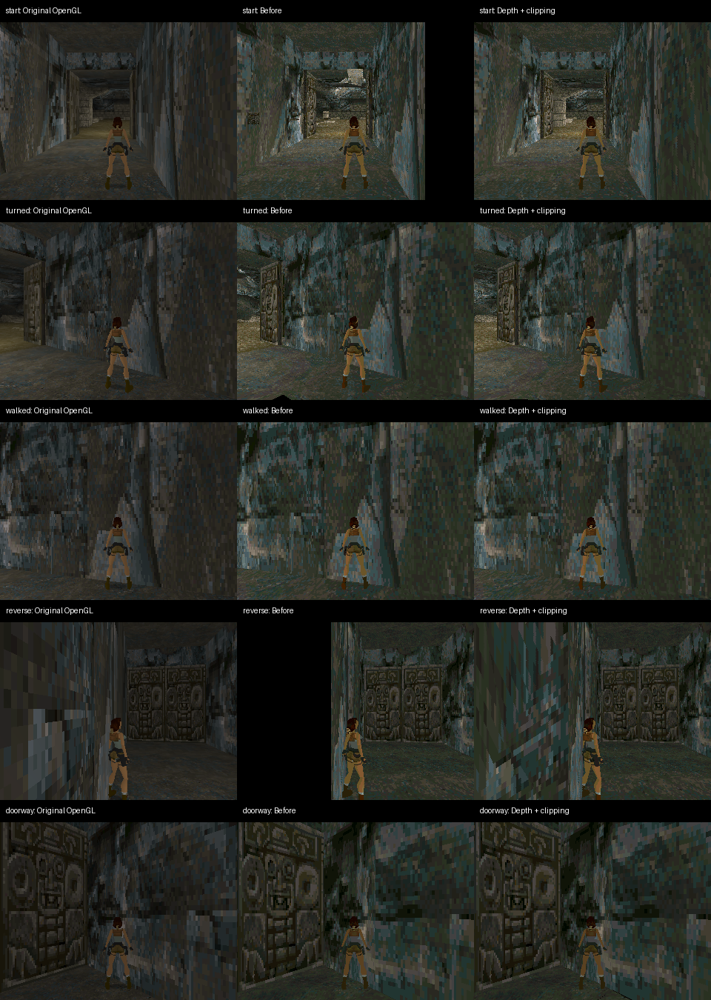

# OpenLara 0.4.3：输入延迟、原版画面对照与数据入口

版本为 `0.4.3`、release_sequence `28`，沿用完整 TR1 主引擎与发布者身份。上游固定为 `3b268ca4bf986c380f44a26ffd9218bf6d376249`。本次可使用的资源仍只有公开 PC 演示版的标题和 City of Vilcabamba（1/15 主线）；完整商业数据未获得，15 关通关、其他大型关卡和引擎过场没有验收，外部 FMV 未接入。

## 输入延迟

旧版会在缓冲释放通知中立即再次绘制，Host 处理这些通知时反复进入昂贵渲染，延后了手柄命令；短按的按下与松开还可能在更新前相互覆盖。现在只由时钟触发绘制，忽略过期时钟，保留短按边沿到游戏更新。支持细粒度时钟的 Host 在绘制前暂停周期计时，提交后安排下一帧，让已经排队的手柄命令先被处理；旧 Host 保留 16 ms 计时回退。

同时移除慢帧超过 250 ms 就重置引擎时间的代码，保留上游自身的追赶上限。暂停、后台和存储等待仍冻结游戏时间。不透明平台菜单跳过背后的 3D 绘制，并恢复完整裁剪框、字形调色板与退出前的光照状态。

输入统计范围是 **Host 手柄状态采样至 Guest 提交画面**，不包含物理开关消抖和 LCD 扫描。测量脚本通过 GameKit controller-0 上报路径注入，不是机械按键到发光像素的实验。`render_us` 包含逻辑和绘制，`logic_us` 单独计数，两者相减才是绘制开销。

## 原版画面对照

使用未修改上游源码的 OpenGL/GLES2 后端作为参考，关闭高级光照、阴影、水效果和滤波以匹配掌机设置。另行编译原版软件后端和本次软件后端。三者运行相同关卡、320×240 分辨率、固定 34 ms 时间步和相同操作脚本。五个截图点的角色位置、朝向、相机眼点、目标、视向、FOV 和宽高比完全一致，记录见 [original-comparison.json](openlara-latency-20261019/original-comparison.json)。

确认并修复两类问题：

- 原软件后端没有启用深度缓冲，后提交的面可覆盖较近的面。现在使用 16 位逐像素深度测试，并遵循引擎的深度写入开关。透明索引 0 不覆盖颜色或深度，UI 保留无深度路径。额外深度缓冲为 153,600 字节。
- 原软件后端遇到顶点在相机背后时会丢掉整个面，导致靠墙转向出现黑洞。现在对跨过近面、软件远距离或安全固定点范围的多边形进行齐次裁剪，保留可见部分；普通屏幕边界沿用整数扫描线处理。裁剪前用共同越界位剔除完全隐藏面，并跳过没有跨越的裁剪面。深度插值限制在有符号 32 位范围内，避免溢出。

在反向门口机位，原版有几何的区域内，软件输出黑像素由 30,502 降至 22；起始机位由 15,847 降至 5。这只是几何缺失的辅助指标，**不是画面相似度或整体画质评分**。其余机位也记录在 JSON 中，小范围黑像素仍可能来自纹理及软件着色差异。软件调色板、仿射贴图和光照仍与 OpenGL 不同，不声称逐像素一致。

中间版本对普通屏幕边界也做完整浮点裁剪，真机约 7 FPS；最终版本保留整数扫描线快路径。中间 0.4.1→0.4.2 的剔除优化通过 360 帧逐像素一致性检查，但帧率没有显著改善，未将它计作性能收益。最终快路径重新进行五机位原版对照及功能验收。

独立光栅测试覆盖交叉面片改变提交顺序、透明纹素、只读深度和最远深度；裁剪测试覆盖非零网格起始偏移、屏幕边界、跨近面和完全隐藏面。后者也保护了多批次网格的索引偏移。

## 真机结果

最终 0.4.3 已安装到 DOIT GameKit / ESP32-S31，串号 `1c:29:04:d0:af:5e`；使用修复音量保存的固件 `21c9d28c…`。手柄保持中立，City 起始位置及朝向在整个计时阶段不变。60 个一秒窗口的 Host presentation FPS：中位数 **6.9**、平均 **7.32**、范围 **6.9–7.9**。这是补上正确遮挡与裁剪后的实际速度，低于原先无深度的版本，不把画质修复计作帧率提升。

20 次 120 ms 右转短按产生 40 个按下/松开边沿，Host 采样至 Guest 提交平均 **184.1 ms**、最大 **272.6 ms**。行走、转向、原版背包往返、存档恢复及设备物理重启后恢复均通过；保存和恢复的角色位置与朝向一致。平台菜单截图响应上界为 0.95–1.34 秒，包含脚本按键等待和 JPEG 截图传输，不能当作精确输入延迟。

证据按阶段保留：[final-native.json](openlara-latency-20261019/final-native.json) 汇总有效静止阶段与单独完成的功能阶段。60 次计时完成后，原运行在背包测试期间因 USB 串口桥断开而结束，其原始报告仍保留 `passed=false`；[USB 主机日志](openlara-latency-20261019/usb-interruption.log) 记录了桥接设备重新枚举，重连日志中的持续设备时间和原位置说明游戏没有重启。随后在相同安装包与固件上重新完成全部功能、短按和重启检查，功能报告 `passed=true`。其单个 FPS 检查值不加入前述 60 个样本。

历史有效对照：0.3.5 的静止阶段有 20 个有效样本，中位数 11.9 FPS；其完整控制测试因短按未转向而失败。菜单响应上界约 2.7–3.1 秒，包含脚本等待和截图开销。修复输入但尚未加入深度的 0.4.0 完成 60 个真机静止样本，中位数 10.9 FPS、平均 10.42 FPS；40 个按键边沿样本平均 156 ms、最大 244 ms，并通过存档和设备重启恢复。这里不能宣称修复输入使帧率上升。

## 原版数据入口

电脑侧可把持有的 `DATA/`、`GAME.GOG` 或 ISO/BIN 放进应用 `game-data/`，准备脚本自动识别。严格完整导入要求 21 个文件，失败保留原资源；显式部分导入会保留缺失标记。模拟器和真机菜单新增 **Import game data**。真机可直接放入 scoped SD media 的 `DATA/` 或 `data/`，扫描识别大小写 PHD 文件名。扫描只验证长度与 PC 文件头，完整布局检查在实际加载时执行。GAME.GOG 需要先在电脑提取。

保留已有标题、音乐和目录索引；21 项探测不代表 21 个实际原版关卡已运行。原版资源不进入源代码包。

## 复现与证据

应用源码提交为 `672b5ff`。构建、签名、真机脚本和原版对照命令见应用 README。72 个实际编译输入文件和 6 个构建产物均已按 SHA-256 核对，见 [build-source-binding.json](openlara-latency-20261019/build-source-binding.json)。当前 [artifacts.json](openlara-latency-20261019/artifacts.json) 为 0.4.3 的实际 SHA-256，[native-provenance.json](openlara-latency-20261019/native-provenance.json) 记录签名身份、序列和构建工具。应用安装包已通过 `pxa publish --check-only`。

完整引擎回归、20 次反复切换关卡的内存稳定性、手柄/触摸一致性、A/B 设置持久化、旧存档升级、时钟协商与回退、SD 扫描和覆盖菜单像素检查均通过。SDL Host 的键盘、存档恢复、背包、按键交换和导入页实测通过，见 [simulator.json](openlara-latency-20261019/simulator.json)。资源测试覆盖严格不完整导入、自动放置入口、ISO 2048/RAW 2352 两种数据偏移、PCM 编码和大音乐银行。

当前 City WASM 约 7.56 MiB 线性内存；20 次关卡切换后稳定在 9,240,576 字节，低于固定 11 MiB 上限。完整大型关卡仍需实际资源验证。
