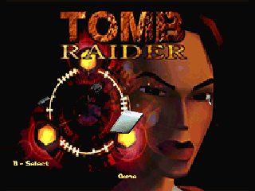
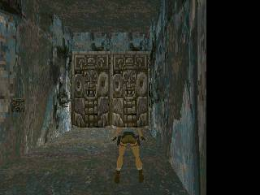

# OpenLara 代码体积与存档验证补充

此报告补充完整主引擎移植的候选验证。完整原版数据仍缺失，测试资源是公开 PC 演示版的 City。新增了真机 WASM 解释器诊断；常规 AOT 安装空间仍不足，全关卡和 AOT 帧率仍待验收。

## 保留 TR1 玩法的代码体积实验

以 0.3.4 的完整主引擎为基线，分别测试主引擎 TU 使用 Oz、以及在 Oz 基础上将 PXA 的格式固定为入口已校验的 TR1 PC PHD。第二组让编译器排除其他版本/平台的解析路径；TR1 的敌人、机关、房间、翻转和关卡流程保留。实验没有改用旧 fixed alpha。

| 构建 | WASM | S31 AOT | 目录安装预估峰值 |
| --- | ---: | ---: | ---: |
| 原 O1 | 933,522 B | 2,697,568 B | 2,949,120 B |
| Oz | 728,977 B | 2,160,952 B | 2,400,256 B |
| Oz + TR1 PC 格式常量 | 696,967 B | 2,039,652 B | 2,277,376 B |

最小实验 AOT 减少约 **24.4%**。两组各自的 360 帧 City 输入比较均逐帧一致；格式常量实验还通过了与原版本之间的双向读档，实际 Lara 的位置、角度和物品得到恢复。报告只证明这些演示场景和存档案例；后期关卡仍需原版资源。

诊断前设备保留 0.2.7，可用内部存储为 380,928 B；上一轮实际归档旧 OpenLara 后约有 0.99 MiB。最小实验仍需约 **2.17 MiB** 才能通过目录安装检查，所以不能靠这两项优化解决现有空间缺口。未归档 Duke3D 或其他应用。

实验没有真机性能数据，保持实验状态；0.3.5 的默认编译策略沿用 0.3.4。[体积、散列及安装峰值](openlara-size-20261019/profiles.json)、[WASM 分析脚本](openlara-size-20261019/wasm-footprint.py)、[复现补丁](openlara-size-20261019/pc-size-experiment.patch) 和 [格式常量实验逐帧证据](openlara-size-20261019/pc-pixel-proof.json) 可供复查。补丁相对于应用仓库中的 `openlara/`，试验时在独立源码副本中应用，再使用普通 `tools/app.sh build --source-root ...` 构建。

## 修正存档测试定位

早期 Guest 测试的存档字节断言取了第一个实体；PC 演示 City 的该实体是机关，实际 Lara 在 **91 号**，原始位置为 `(78336, -1024, 12800)`、房间 90。此前实际 SDL 输入测试另有玩家位置日志，仍有效；早期字节断言不能作为 Lara 位置恢复的证明。

PHD 检查器现在输出 Lara 的实体索引、原始位置/角度及房间。测试按可变长度 OLS2 实体记录定位 Lara，并检查其 48 字节扩展；取机关记录会被明确拒绝。它先确认 Lara 确实移动，再保存、转向并读档，独立比较玩家日志和重存后的 Lara 记录；跨实例也检查实际玩家日志。

[修正后的 0.3.4 实际 Guest 结果](openlara-size-20261019/lara-integration.json) 中，保存位置为 `(78336, -1024, 14869)`，转向后角度日志为 16400，读档后位置相同且角度回到 0。原引擎 16 位角度允许每次恢复出现 1 单位舍入误差。[双向版本恢复测试](openlara-size-20261019/pc-upgrade-proof.json) 另外覆盖了移动、转向后从原版本到实验版本、再返回原版本。

## 手柄交换后的原版背包

发现原版背包既读取动作映射，又直接把固定 A 当作确认。交换动作/跳跃后，可能出现 A 和 B 都确认、取消不可用的情况。0.3.5 的 PXA 分支统一按当前动作/跳跃映射处理确认和取消，并用同一映射生成提示。

回归分别检查交换后的 B 确认、A 取消，退出再启动保留提示，以及交换后的 A 跳跃与默认 B 跳跃逐帧一致。原 0.3.4 会在提示测试失败；只修改提示文字的中间版本会在取消测试失败。最终修复需要同时通过这些检查。默认映射和其他平台的输入路径保留。

0.3.5 应用源码提交为 `e0ebd7e`。最终 WASM 的[完整 Guest 回归](openlara-size-20261019/0.3.5-integration.json)、[交换映射回归](openlara-size-20261019/0.3.5-controls-settings.json)、[默认手柄回归](openlara-size-20261019/0.3.5-controller.json) 和[360 帧比较](openlara-size-20261019/0.3.5-pixels.json) 均通过。实际 SDL Host 的[键盘与重启回归](openlara-size-20261019/0.3.5-sdl.json) 也通过；已安装的模拟器 AOT 与构建产物 SHA-256 一致，见[最终产物记录](openlara-size-20261019/0.3.5-artifacts.json)。

交换后按 A 取消回到原版背包选项的实际 SDL 截图：

最终 S31 AOT 为 2,697,712 B，SHA-256 `da4767f02a80e30536448282a465d00617caa33d3e217051efed35222e625ab8`；签名容器为 1,851,305 B，SHA-256 `1cffa0928fedd7dbd858c31dcf941ecfa389a2071b42862cc4d241570b35eee4`。WASM 为 933,565 B，SHA-256 `569495d39c4c9bdccfa94a1c1be5f578e10216abe46968d9c4cf9ca9dd94f7b4`。两包均通过本地 `pxa publish --check-only`，该检查不代表真机已安装。

## 真机解释器诊断

现有固件编译配置启用了 WAMR fast interpreter。用独立 App ID `pxa-openlara-probe`、相同发布身份构建 0.3.5 的 Oz/TR1-PC 格式常量版本，保留完整 TR1 玩法。原始 WASM 为 697,031 B，目录安装峰值约 913,408 B。临时归档旧 OpenLara 自身代码后，诊断包成功安装，未归档 Duke3D 等其他应用；固件保持不变。

真机进入了标题和 City，显示原版 Lara 及 3D 房间；City 的 Guest 线性内存为 7,733,248 B。初始化触发过一次 3 秒无响应提示，选择等待后继续。正式采样期间没有超时提示，每次读取 `PERF FPS` 前均检查活动应用仍为诊断 OpenLara，且没有周期点击。

20 次显示完成帧率采样的中位数为 **1.9 FPS**，平均 1.555 FPS，范围 0.9–2.0 FPS。这是 **WASM 解释执行**的真实硬件结果，不能替代 AOT 结果，也不能作为可流畅游玩的完成结论。详见[采样及范围声明](openlara-size-20261019/interpreter-s31-result.json)、[原始串口日志](openlara-size-20261019/interpreter-safe-run.jsonl)、[源版本与散列](openlara-size-20261019/interpreter-source.json) 和[内存记录](openlara-size-20261019/interpreter-memory.json)。

首次诊断的自动采样触点误中了系统无响应弹窗的“停止”，随后触点打开了 SD Files Test。那次帧率全部作废；已停止该测试应用。复测采用只读采样并校验活动应用，原始无效过程没有混入上述数字。常规 `measure.py`、`validate-device.py` 已在应用提交 `359dfa5` 中增加 Guest 超时、前台变化检查，并限制清理时的输入范围，避免误采其他应用帧率。修正后的脚本通过 Python 编译检查；0.3.5 的已签名 Guest 代码未改变。

诊断结束后已归档探针代码，恢复原签名 0.2.7 并启动。其他应用的版本、安装、启用和活动状态与诊断前一致，见[恢复记录](openlara-size-20261019/device-restored.json)；没有清除游戏存档或重刷固件。恢复后的可用内部存储为 348,160 B，比诊断前少 32,768 B。归档探针的后续卸载接口返回 `package_action_failed`，未强制删除 Host 数据，见[最终清理记录](openlara-size-20261019/device-final-cleanup.json)。探针的独立 SD 演示资源保留，方便后续复查。

资源和 AOT 安装空间两项外部条件仍未满足，目标保持进行中。解释器诊断不替代 15 个主线关卡及真机 AOT 帧率验收。
