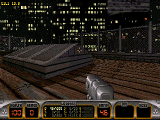
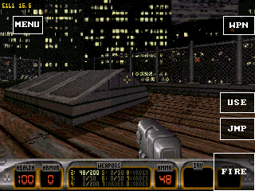

# 游戏手柄操作自动隐藏触控按钮

共享 Apps 提交：`f480f2c`。适用于 Quake、Quake II、Duke3D、C&C 和
Red Alert 的普通版及 SD 版。已安装的旧包需要更新才能获得此行为。

## 行为

- controller 0 有新的有效按下动作时，隐藏全部触控按钮，并释放已有触控动作。
- 松开、空闲状态刷新、切后台及恢复不会自动显示按钮；其他 controller 不抢占席位。
- 重新触屏的第一段 down/move/up 手势只显示按钮，下一次触屏正常操作。
- 手柄断开恢复按钮；触屏后仍按住的手柄键不会在每次状态刷新时重新隐藏按钮。
- 隐藏后同时跳过绘制和按钮命中检测。RTS 保留游戏光标，避免从 RMB/OK 位置跳动。

新增一个 guest 内可见性状态，不新增堆分配或帧缓冲，不改变公共 ABI。
未修改引擎上游源码。后续同步上游仍复用此共享适配层。

## 自动验证

`common/recrof/tests/run_input_mode.py` 实际构建并执行 callback/main-loop ×
FPS/RTS 四种 Wasm 组合，共 56 次像素捕获。检查有效操作、另一手柄、空闲刷新、
触控动作释放、后台忽略输入、前台恢复、首次触屏不触发按钮、按住手柄时触屏、
断开恢复及 RTS 光标位置。四种组合全部通过。

隐藏帧与纯游戏画面逐字节一致；原始 RGB565 捕获以无损 gzip 保存于
`game-controls-20261020/runtime/`，索引包含原始 SHA-256。

原生 ASan/UBSan 图像测试通过：保留原有 70 组采样/光标/控件像素一致性，
另检查隐藏状态不改写任何像素、无隐藏按钮命中、布局通知不恢复按钮。
既有手柄映射、RTS 混合输入及 Duke 扩展方向键测试通过。

这些协议及原生测试不代表硬件 FPS 或实体手柄电气链路验收。

## 设备构建

GameKit `1c:29:04:d0:af:5e`，固件 ELF：
`c5eef7676c5c387e1c5fe05d8753983137efff9edd3182ee4ce9669e768b6845`。

签名候选包：

| 游戏 | 版本 / sequence | 额外编译优化 |
| --- | --- | --- |
| Duke3D | 0.1.34 / 35 | 已验证边界语义的独立 known-alignment AOT 编译器 |
| Quake | 0.4.13 / 133 | 相同 AOT 编译器及逐像素一致的 lit-cache 实验 |

包、Wasm、编译器、源码与固件哈希见 `game-controls-20261020/artifacts.json`。
这两个 FPS 包在添加仅 RTS 启用的光标保护分支前编译；该分支不参与其条件编译。
默认画质、资源及原采样率 PCM 保持原配置。

## Duke 关卡验证

0.1.34 已安装到上述 GameKit。通过 PXADB 的 controller 0 / pointer 路由注入，
在 E1L1 Hollywood Holocaust 实际关卡检查：

- 手柄操作后 196 个 FIRE 边框采样像素全部消失；松开后仍不显示。
- 首次触屏恢复完整边框，弹药 HUD 与触屏前逐像素相同，未误开火。
- 再次按手柄恢复隐藏，图中保留原始游戏 HUD。
- 四种组合的自动测试另外覆盖另一手柄不抢占与后台输入忽略；
  这不等同于测试了所有实体手柄型号。

同一静止出生点的完整 60 秒窗口：平均 **18.383 FPS**，中位数 **18.35 FPS**，
最低 **17.8 FPS**，最高 **18.9 FPS**。10 条去重实际关卡记录跨越 50.31 秒；
采样前后均有实际关卡状态，原采样率 PCM 协商成功。此结果超过 15 FPS，
尚未达到 20 FPS，也不代表移动、战斗或其他关卡均有相同表现。
该包同时包含对齐优化与悬浮按钮变化，不能把全部帧率提升归因于隐藏按钮。

原始记录见 `game-controls-20261020/duke-level/`。首次尝试停留在菜单并遭遇
USB 断连，单独保存在 `duke-first-attempt/`，不计入性能窗口。
第二次完整采样和触控切换完成后，脚本尝试 controller 1 被板卡诊断接口以
`invalid_controller_state` 拒绝；原始错误保留，释放输入、停止应用和返回桌面
均成功。断开恢复另用仅 controller 0 的检查补测。

断开补测通过：保持 `connected=0`，观察到新的
`PXA CONTROLS source=disconnect visible=1` 日志及全部 196 个边框像素恢复，
并正常释放输入、停止应用、返回桌面。该检查在菜单进行，不计入关卡 FPS。
最初的补测脚本会在定时保活时立即发送 `connected=1`；其失败记录保留于
`disconnect-immediate-reconnect/`，修正后的记录在 `disconnect-held/`。

手柄模式：

首次触屏恢复：

本报告记录时，Quake 0.4.13 仅完成签名构建；其余三款需重新打包升级后生效。
后续 Quake 实际关卡、控件切换及原生转换对照见
[快速路径验证](2026-10-20-game-fastpath.zh-CN.md)，不计入本报告原始验收窗口。
