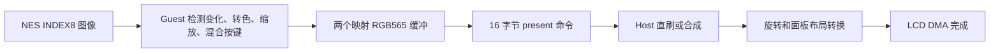

# PXA NES：局部绘制与实际 LCD 完成帧率

正式版本 **0.1.18 / release_sequence 19**。本轮修改 Guest 视频绘制，保持全屏、RGB565 调色板、半透明按键和手柄事件行为；没有更新设备固件。

## 提交和直刷分别代表什么

现有应用已经注册两个 Guest 映射的 RGB565 缓冲，并设置 `GUEST_MAPPED | PREFER_DIRECT_SCANOUT`。每次提交发送缓冲索引和帧 ID（16 字节），没有把整张 RGB565 图像再从 Guest 复制进 Host Surface。提交的是一张完整逻辑帧的所有权，而不是图块命令。

PAI Touch 宿主源码已有绕过 LVGL 的直刷路径。全屏 RGB565、连续 stride、无额外合成要求时可以使用；系统浮层等情况会回退。此路径仍把逻辑图像旋转、换序到板卡输出缓冲，DMA 能力也可能要求暂存。本轮未加入板卡直刷命中计数，不能把优先标志当作每帧实际命中的证据。

三个指标需要分开：

- `NES PERF submit_x100` 是 Surface 接受的提交频率；缓冲可能被更新的提交替换。
- `NES DISPLAY consumed` 是 Host 使用并释放 Guest 缓冲的累计次数，旋转复制完成后就可能释放，并不等于 LCD 完成。
- 固件的 `PERF START display` / `PERF STOP` 返回 `display=1` 时，`completed × 1e6 / window_us` 才是此探针窗口的 LCD 全帧传输完成频率。它包含相同内容的重复传输，不是独立变化画面的计数，也不是面板内部扫描 Hz 或光学测量。

对应源码：应用 `local/pxa-apps/nes/main.c` 的 Surface 注册和 present；宿主 `firmware/components/pxa/src/services/pxa_esp_surface.c` 的 register/present 与显示完成计数；板卡 `firmware/boards/pai-touch/include/parallel_sw_rotation_flush.h` 的 `PresentPxaSurface`、旋转和传输完成路径。主机源码说明当前架构，不代表本轮重新编译或刷入这些文件。

## 本次减少的工作

以源图像 8×8 图块记录变化，仅重做相应输出区域的调色板转换、最近邻缩放和按键混合。两张输出缓冲各自累计失效块，因此变化后恢复原样、缓冲交替使用时仍能更新正确。按键按下、隐藏/恢复、透明度变化和暂停后恢复都触发相应区域重新绘制。

对未变化的整行使用对齐 32 位精确比较，只在变化的行内定位图块；非对齐输入有安全回退。完全无变化且目标缓冲已有效时可直接结束。历史 INDEX8 图像占 61,440 字节，复用原预留输出数组的闲置尾部，296×240 不新增此大小的堆分配。元数据约数 KiB，固定 4 MiB Guest 线性内存不变；320×320 无足够尾部空间时自动完整重绘。

这减少的是 Guest 重写 RGB565 的像素数和相应逐像素计算。检测仍需读源图像、更新变化行的历史图像；Surface 仍提交完整帧，Host 的全帧旋转和 LCD 传输仍存在，属于局部重绘优化，不能称为端到端零拷贝。持续大范围卷轴滚动时效果可能小于静态场景。

## 实机方法

PAI Touch / ESP32-S3，序列号 `a4:cb:8f:d5:d4:f0`，Core 2 / PXA 0.3 / Clock 0.2 / FS 0.2。对照为重新安装的 0.1.16 临时测试包，最终版使用另一临时身份；同一 ROM、全屏 296×240、声音开启、默认 DISPLAY 1/4 和原自动追赶策略。每个工况重启、进入初始游戏场景，预热 8 秒后采集三个约 5 秒的完整实时窗口。

LCD 探针在预热前启动，停止于采样结束，因此探针窗口包含预热，和三段 NES 遥测窗口不完全重合。按各自分母独立计算，不能把两个窗口的帧数互除。截图、存储和内存查询在探针停止后执行。移动工况持续注入右方向，周期性按 A；两版采用相同驱动。这是初始场景短测，不代表所有地图、战斗或通关性能。

马里奥 CRC `9a2db086` 由内核数据库识别为 PAL，满速为 50fps；重装机兵中文版 CRC `6f2a4afc` 为 Mapper 74 / NTSC，目标 60fps。

| 工况（38% 按键） | 版本 | 模拟 FPS | 提交 FPS | LCD 完成 FPS | 绘制 ms/张 | 写入像素/张 |
| --- | --- | ---: | ---: | ---: | ---: | ---: |
| 马里奥初始场景 | 0.1.16 | 49.881 | 4.897 | **4.775** | 20.118 | 71040 |
| 马里奥初始场景 | 0.1.18 | 50.075 | 6.960 | **6.785** | 5.137 | 74 |
| 重装机兵初始场景 | 0.1.16 | 60.111 | 5.980 | **6.004** | 19.810 | 71040 |
| 重装机兵初始场景 | 0.1.18 | 59.969 | 8.687 | **8.696** | 4.895 | 15 |
| 马里奥持续右+A | 0.1.16 | 49.855 | 4.573 | **4.513** | 20.158 | 71040 |
| 马里奥持续右+A | 0.1.18 | 50.041 | 5.180 | **5.197** | 14.105 | 14091 |

LCD 完成频率的相对提升分别为 马里奥初始场景 42.1%、重装机兵初始场景 44.8%、马里奥持续右+A 15.2%。该幅度仅适用于此短测；静止与移动收益不同，不能推广为所有游戏的固定倍数。最终默认策略的五个工况均通过模拟速度检查，所有采样点的积压均为 0 帧，Guest 音频丢采样为 0。隐藏按键的额外工况及完整窗口见[实机汇总](nes-render-20261020/device-summary.json)与[前后对照](nes-render-20261020/comparison.json)。

另试菜单的 DISPLAY 1/1（其余设置相同）：

| 工况 | 模拟 FPS | 提交 FPS | LCD 完成 FPS | 模拟速度检查 |
| --- | ---: | ---: | ---: | --- |
| mario / 持续右+A | 50.000 | 5.053 | 5.100 | 未通过 |
| metal-max-cn / 初始场景 | 59.906 | 9.427 | 9.347 | 通过 |

DISPLAY 1/1 只增加尝试绘制频率，缓冲背压和积压保护仍会跳帧；马里奥 1/1 的平均模拟速度仍接近 50fps，但积压最高达到 3 帧，未通过积压检查，因此默认继续保留 1/4。[策略实测](nes-render-20261020/policy-summary.json)。当前没有达到 LCD 60fps。进一步显著降低显示工作可考虑宿主借用 INDEX8 源图像，将转色、缩放和旋转合成一次输出；当前 PAI 固件没有在本轮部署这样的新接口，不能以预期收益代替测量。

## 回归与颜色

原生完整绘制参考与局部绘制逐像素比较 **4,160 帧**，覆盖四种尺寸、开启/关闭缓存、对齐/非对齐输入、两个缓冲、变化抵消、随机变化、控件状态和失效恢复；普通版本及 ASan/UBSan 均通过。NES 内核和调色板未改，本轮新增回归集中于视频输出；内核兼容性仍沿用既有验证范围。

| 截图 | RGB565 匹配率 | 调色板外像素 |
| --- | ---: | ---: |
| device-mario-off | 99.9555% | 0 |
| device-mario-on | 100.0000% | 0 |
| device-metal-max-cn-off | 100.0000% | 0 |
| device-metal-max-cn-on | 100.0000% | 0 |
| sim-mario-off | 99.9536% | 0 |
| sim-mario-on | 99.9466% | 0 |
| sim-metal-off | 100.0000% | 0 |
| sim-metal-on | 100.0000% | 0 |

[颜色验证日志](nes-render-20261020/device-colors.log)、[渲染器测试日志](nes-render-20261020/video-test.log)。

继续采用 FCEUX 2.6.6 / new PPU、Composite Direct FBX 调色板参考，按编码后的 RGB565 比较。实机排除顶部 20 行宿主 FPS 浮层，显示按键时排除控件区域；桌面另排除面板圆角和宿主手势条。马里奥小量差异来自参考与采集时序的金币闪烁；这不是 LCD 的光学色温校准。

桌面通过方向+A、自动隐藏、松开保持隐藏、第一次触摸恢复、X 暂停和纯手柄菜单验证。控制器输入来自 SDL 键盘转换的标准 PXA 事件；本轮未新测外接蓝牙/USB 手柄或 GameKit 的运行速度。之前的 GameKit 输入链路范围见[前次报告](2026-10-20-nes-fullscreen.zh-CN.md)。

## 内存、收尾与交付

重装机兵开启声音的窗口外快照：可用 PSRAM 2,199,724 字节、可用 SRAM 34,451 字节；宿主预算拒绝 0、分配失败 0。历史最低值与峰值属于设备累计边界，不限定为本轮。完整[内存记录](nes-render-20261020/device/metal-max-cn/on/performance/memory.json)。声音只验证采样队列统计，没有人工听感或声学延迟测量。

重装机兵暂停后读取 8,192 字节电池 RAM，CRC 与原子保存日志一致。[保存验证](nes-render-20261020/persistence-final.json)。临时身份 `pxa-nes-render` 已停止并卸载，原正式身份与私有数据保留并升级到 0.1.18 / release_sequence 19。最终加载正式包内的原创诊断 ROM，点击 MENU 暂停，声音关闭；原浏览器保留。[设备最终状态](nes-render-20261020/final-device.json)。

自行启动的桌面模拟器和服务均已停止。模拟器清理用 SIGTERM 后返回 134，服务返回 0；与旧版相同，日志未提供原因，不能把自然关闭验收计为通过。独立 `--package` 运行方式的 Package stop 返回 package_action_failed，也未计为通过；实机的停止、更新和重新运行正常。[桌面收尾记录](nes-render-20261020/simulator-cleanup.json)。

正式包：`local/app-output/pai-touch/pxa-nes.pxa`；随包只有原创 CC0 诊断 ROM，商业 ROM 没有放进正式包或本报告附件。[包与 AOT 校验值](nes-render-20261020/artifacts.json)、[测试和正式前端源码一致性](nes-render-20261020/frontend-identity.json)、[重新编译对象一致性](nes-render-20261020/build-identity.json)、[用户原 ROM 校验](nes-render-20261020/rom-integrity.json)。

