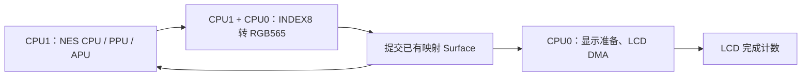

# NES 并行调度与原生 INDEX8 转换验证

测试设备为 **DOIT GameKit-1 / ESP32-S31**，320×240，设备标识 `1c:29:04:d0:af:6a`。应用 `pxa-nes` 更新到 **0.1.29 / release 35**；性能测试使用 release 33，交付版仅递增签名安装序号，两种架构的 AOT 及全部资源逐字节相同，见 `delivery-identity.json`。本次没有操作另一块正在进行音频开发的 GameKit，也没有将此结果推广到 PAI Touch 或 Korvo。

## 帧率与测量方法

声音开启，默认自动跳帧，控制器输入使悬浮按键自动隐藏；NES 以原始 256×240 居中显示，两侧各留 32 像素黑边。马里奥采用持续右移和 A 脉冲；重装机兵采用同一房间对话场景，实际已进入游戏。后者不代表战斗、室外地图等场景的性能。

| 版本/固件 | 马里奥模拟 Hz | 马里奥 LCD 完成 fps | 重装机兵模拟 Hz | 重装机兵 LCD 完成 fps |
|---|---:|---:|---:|---:|
| 基线：0.1.27 / 原固件 | 41.229 | 4.757 | 60.037 | 5.566 |
| A：0.1.28 / 原生转换及 Host 调度修改 | 43.175 | 4.757 | 60.082 | 6.317 |
| B：0.1.28 / 显示准备、PCM 移到 CPU0 | 49.883 | 9.236 | 未测 | 未测 |
| B：0.1.29 / 关闭详细扫描线采样 | 50.036 | 13.839 | 60.004 | 29.380 |
| C：0.1.29 / 补齐浮层切换的首帧背景 | 49.993 | 12.258 | 59.988 | 29.358 |

0.1.28 是诊断版本，扫描线时钟导入会拖慢被采样的帧、影响跳帧耗时估计。A→B 使用同一诊断应用，能观察到核心布局的收益；最终性能应看默认关闭详细采样的 0.1.29。在原固件上运行 0.1.28，马里奥仅 39.060 Hz / 4.606 LCD fps，说明诊断开销不能忽略。B 的诊断版本两个窗口分别丢弃 192 和 1,024 个 PCM 样本，最终 0.1.29 两个游戏的三个窗口均为 0。

马里奥这份 ROM 为 **PAL 50 Hz、Mapper 0**，重装机兵为 **NTSC 60 Hz、Mapper 74**。最终 B 测量中，两者三个窗口的 `debt_frames` 都为 0。基线马里奥欠帧从 173 增至 244；基线重装机兵保持约 60 Hz，但保留了此前累计的 46 帧债务。

**持续性能边界：** C 固件马里奥三个窗口分别为 50.86、50.22、48.88 Hz，最后一个窗口欠 4 帧，未通过脚本的严格逐窗口验收。继续测量六个窗口时，欠帧从 17 恢复到 0，随后为 0、0、0、1；追赶窗口出现 3,904 个 PCM 样本溢出，其余五个窗口为 0。后四个窗口约 49.76–50.03 Hz；整个扩展窗口 LCD 完成 11.237 fps。因此可以确认明显提速和欠帧恢复，不能声称马里奥所有片段持续满速或音频始终零丢样。所有失败窗口也保留在证据中，没有用较好窗口替换。C 固件的重装机兵三个窗口全部通过：欠帧 0、PCM 丢样 0，声音保持开启。

模拟 Hz 由三个完整五秒窗口的执行帧数总和除以墙钟时长总和计算。LCD fps 使用固件 `PERF START display` / `PERF STOP` 的 `completed × 1e6 / window_us`，窗口包含预热。环形明细缓冲装满时，累计完成计数仍覆盖整个窗口。测试窗口内没有截图或文件系统读取；截图在停止计数后采集。**Surface 提交、宿主释放 Guest 缓冲、LCD 传输完成是三个不同事件；上述 LCD 数字也不是面板内部扫描频率或光学测量。**

## 慢在哪里，改了什么

1. **主机调度开销。** 旧 Host 在每条已处理命令后执行 `vTaskDelay(1)`；这里 FreeRTOS tick 为 1ms，短输入、定时器及维护命令连续到来时会累计空等。现在按实际经过的 32ms 预算让出 CPU，保留 IDLE/watchdog 运行机会，空队列等待逻辑不变。
2. **显示准备与模拟争用 CPU1。** GameKit-1 的 LVGL/显示准备原先与 Guest 都在 CPU1。现在 Guest 留在 CPU1，LVGL/显示准备和 PCM 输出固定在 CPU0，既有 LCD 提交线程也在 CPU0。上一帧的合成、输出准备可与下一帧模拟重叠；未新增线程、队列或整帧缓存。
3. **Guest 像素转换。** 增加 GameRender 1.3 `BLIT_INDEXED_RECT` / `0x109` 与 C/C++ SDK 包装。Host 同步借用 INDEX8 源图及 RGB565 调色板，写入已获取的映射 Surface。现有双核执行器按缓存行边界拆分目标字节范围，返回前等待全部写入完成。马里奥实际绘制阶段从基线约 4.36–5.90ms 降至约 2.84–2.86ms。
4. **采样误差。** 默认关闭逐扫描线详细计时。保留每五秒的帧级 `PERF`、`CORE`、`SCHED`、`RASTER` 指标。`NES PHASE` 的 CPU/PPU 分项包含大量时钟导入和抢占开销，不能解释成无扰动的精准 CPU/PPU 用时。

CPU、PPU 寄存器、Mapper IRQ 和 APU 帧计数器存在逐扫描线依赖，仍按原内核顺序执行。并行化放在已完成图像的转换及显示流水线上，没有把存在时序依赖的模拟模块强行拆开。

新接口直接按源/目标尺寸采样，避免旧 `0x108` 的 320×240 中间网格在 256→256 时丢列或重复像素。旧操作的行为保持兼容；未改变已有包的采样语义。描述符、跨度、地址范围和源目标别名仍先完整校验，再开始写入。

实机还发现直刷转音量浮层时，LVGL 只重绘顶部区域，而用于拼接局部更新的 `frame_` 没有接收此前的直刷帧，第一帧下半幅会使用旧背景。C 固件将直刷后的首次 LVGL 失效区域扩展到全屏，在同一次合成中重建完整背景；后续局部刷新恢复正常。没有为此在每个直刷帧增加缓存拷贝。

C 实机立即触发音量条并截图，背景完整；关闭后恢复游戏。浮层下方 56,320 个像素中有 56,304 个与关闭后的截图一致，16 个差异都在对话框闪烁的三角提示处（截图时刻不同）。`verified-volume-overlay.png` / `verified-overlay-restored.png` 和 `overlay-check.json` 保留了这次检查。

只有按键隐藏时启用原生转换；触摸显示按键时使用已有的 RGB565/透明覆盖渲染器。GameRender 1.0–1.2 Host 不支持新操作时自动回退；安装包要求至少 GameRender 1.0，仍使用 0.x 服务的旧固件需要先更新。源图和调色板不另行上传或复制，但 LCD 仍保留主机的输出复制/传输缓冲，**不是端到端零拷贝**。

## 剩余瓶颈

0.1.29 / B 的马里奥跳过视频输出时，内核调用仍需约 14.1–16.7ms；生成视频时需约 19.3–20.8ms，之后还要约 2.85ms 转换。PAL 每帧预算只有 20ms，因此仍需跳过部分绘制。

重装机兵同一场景跳帧调用约 10.1ms、绘制调用约 15.25ms，加上约 2.7–2.8ms 转换及提交，超过 NTSC 16.67ms 的每帧预算；当前通常每两帧绘制一次。以上是调用墙钟耗时，包含抢占，不能全部归因于 6502 指令解释器。后续应重点优化内核热点、AOT 生成代码和内存访问；单独提高 SPI 时钟不能消除这些计算开销。

已检查现有 AOT 配方：优化等级为 3。WAMR 的 `size-level` 在此控制 LLVM 代码寻址模型（small/large 等），不是直接的“速度优先”开关，本轮没有据此盲目更改 S31 编译配方或关闭安全检查。追赶积压时产生的额外 PCM 会受 256ms Guest 队列容量限制，增大队列只能延长缓冲，不能消除平均算力不足或无限增长的声音延迟。

## 正确性与兼容性

- 实机重装机兵静态标题：对比 FCEUX 同调色板参考的 NES 第 8–231 行，**57,344 / 57,344 个 RGB565 像素一致**，没有调色板外颜色。验证编码及采样，不代替 LCD 光学校色。
- 桌面模拟器运行 S31 对应源码的 x86 AOT，新原生转换路径生效；标题对比排除底部 10 行系统手势条后 **56,832 / 56,832 像素一致**。触摸恢复按键、控制器隐藏按键、中文暂停菜单已检查。
- 原生渲染器对照覆盖 9,360 帧、六种尺寸、三种源对齐、双缓冲、取消、原生路径失败回退和透明按键切换。
- Host GameRender 两项测试通过；新矩形操作覆盖五种尺寸、带填充和非对齐源行、光标裁剪、逆序 67 字节分区及别名拒绝。ASAN/UBSAN、C SDK 与 C++ SDK 包装测试通过。
- PPU 像素核对照覆盖 6,291,456 行；DMA/总线 144 个场景通过。DMA 测试第一次遗漏 ROM 参数，修正调用后通过，未修改实现掩盖错误。
- 关闭详细采样后的马里奥、重装机兵各 1,200 帧 CPU/RAM/PPU/视频/PCM 签名，与原 0.1.23 内核逐帧一致（绘制间隔 4）。这证明本轮保留了原内核行为，不表示所有 NES 游戏或硬件时序测试都已通过。
- 输入、pacer、声音/权限/背压、系统 i18n 回归通过；固件构建及 GameKit-1 输入、触摸、总线协议测试通过。调试控制器注入不等于实际机械按键按压，测试结束使用 `INPUT CANCEL` 恢复 GPIO 上报。

## 固件、应用与证据

固件构建使用隔离源码快照，未将另一个任务正在开发的音频 ABI 混入。每次仅刷写应用分区 `0x10000`，核对分区表与设备身份，保留 bootloader、文件系统、签名身份和私有数据。原始固件及存档备份保留在本地 `local/nes-parallel-20261021/backup/`。

可运行应用：`local/nes-parallel-20261021/package-delivery/pxa-nes.pxa`，SHA256 `1a2a42bbed75403bd97d6a286c95b4ac6ab54124e8d9de77b97004802b63021d`。本地包包含用户提供的游戏，公开验证目录不复制 ROM 或存档内容。

交付固件：`local/nes-parallel-20261021/firmware-c/pxa_esp_platform.bin`，SHA256 `b51022b39bb017f73c6726ad755a3753ef6bb03907be7d2903bf7b9c18bed555`。设备 INFO 的 ELF SHA256 为 `4d22ba1b0a7f83867e214ee408806590e72e857605c305c144770a5fbe0a7e97`。

重装机兵暂停后内存快照：SRAM 可用 123,831 字节，最大连续块 102,400 字节；PSRAM 可用 10,716,816 字节，最大连续块 9,961,472 字节。资源分配失败与预算拒绝计数均为 0。Guest 固定线性内存仍为 4MiB；这些数字不是内核单独用量，最小可用堆还包含启动过程。

自动进入新游戏的测试确实写入了 SRAM 存档。测试结束保留了该副本，并恢复测试前的原存档；私有数据目录的文件列表、8,192 字节长度及 SHA256 均须与初始快照一致：`2853b421787ea158ee3577ce4e35ae334d058726a98f9cd5d56d00c1aecc02bb`。调试接口拒绝直接写私有目录，因此临时签名恢复版 release 34 通过 NES 自身的 FS 保存及原子替换接口恢复，且只有当前 8KiB 文件逐字节匹配本次测试副本才写入。恢复后替换为不含恢复代码的普通 release 35；不修改调试 FS 权限。详见 `restore.json`、`state-after-tests.json`、`state-final.json`。

最终停在 NES 游戏列表，选中“重装机兵：汉化版”，按 A 即可加载原存档并进入游戏。调试控制器接管已取消，GPIO 输入恢复。原始测量、失败窗口、截图、来源哈希与最终状态见本报告旁的 [证据目录](nes-parallel-20261021/)。
