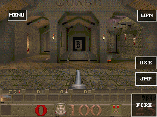
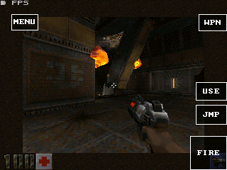

# GameRender 1.2 与 Quake 整帧批次实测

本阶段实现同步跨材质批次和原生 INDEX8 输出，保留原引擎的透视、光照、
逆深度、画面尺寸、资源与音频设置。合成计算已在 GameKit 实际执行，
Quake 候选也进入实际 START 关卡。性能结论以出生点的完整 60 秒窗口为准。

## 实际关卡结果

**未达到最低 15fps，也未达到期望的 20fps。新路径继续作为默认关闭的实验选项。**
公开 Quake/SD 的源码版本提升为 0.4.5（seq125），超过测试包的防回滚序号；
这里没有把公开 0.4.5 AOT 声称为已经构建、安装或验收的正式包。

| 候选 | 固件 | 中位 FPS | 平均 FPS | 最低–最高 |
| --- | --- | ---: | ---: | ---: |
| 原默认 Guest AOT，重新签包 seq123 | v9 | **6.9** | **7.017** | 5.9–7.9 |
| 跨材质批次 seq120 | v7 | 5.9 | 6.052 | 5.9–6.9 |
| 加原生颜色转换 seq121 | v9 | 5.9 | 6.017 | 4.9–6.9 |
| 加批量快照 seq122 | v9 | 5.9 | 6.067 | 3.9–6.9 |
| 加批量读取与编码 seq124 | v9 | **6.9** | **6.817** | 5.9–7.9 |

同固件基线使用原 5888788 字节 AOT，SHA-256
`1c6a037fe0c872b8116dfc2880ce982be66c66ed339983df24209539c9641c96`，
只更新签名 manifest 以通过防回滚，没有重新编译。
最终候选 5906544 字节，SHA-256
`0ffb230aa21e79c5c98059db0af270830ebb2a718e7ac7c71ae190ad85e6a2d6`。
最终候选收回了前几个组合的部分开销，尚未证明优于默认路径。

完整窗口的实际关卡日志审计见 [measurement-window-audit.json](measurement-window-audit.json)：
各窗口均有 12–13 条来自当前测量时段、不同设备时间戳的就绪记录，HP100、出生点一致。
审计按设备与接收时钟的偏移排除重放/延迟超过 2 秒的日志，再核对不少于 45 秒的设备记录跨度。
[审计脚本](audit-measurement-windows.py) 在工作区根目录运行，只读本目录证据。
[基线](quake-same-fw-baseline-measurement.json)及[最终候选](quake-frame-io-measurement.json)
均保留全部 60 个 FPS 样本，测量脚本也保留在本目录。

| 渲染分项中位数 | 默认 | frame-bulk | 最终 frame-io |
| --- | ---: | ---: | ---: |
| view / 帧 | 109.86ms | 131.04ms | 116.33ms |
| 其中表面阶段 / 帧 | 73.11ms | 94.06ms | 79.99ms |
| Host 预检 / 帧 | 0 | 11.10ms | 10.74ms |
| Host 执行 / 帧 | 0 | 14.87ms | 14.69ms |

跨材质路径的世界绘制为 **2 批/帧、48202 像素/帧**，加颜色转换后总计
**3 批/帧、125002 像素/帧**；所有实际窗口均无 Host 拒绝。
各分项有嵌套关系，Host 执行还包含输出转换，不能把表格各行相加。
详见 [profile-comparison.json](profile-comparison.json)。
批次数由上一阶段的 316 降至 2，并不等于整帧达到 20fps。

20fps 的整帧预算是 50ms，目前默认路径的 view 阶段已经约 110ms。
这次改动只把后段透视采样、光照、深度及输出转换交给 Host，仍有引擎遍历、
材质准备和来源捕获工作。现有计数不能把所有剩余时间归因于某一个复制函数。
继续优化需要测清这些准备阶段，评估更早提交可直接借用的数据；
原生输出也应另做独立 A/B。上述后续方向尚未实现或计入本次收益。

最终候选采样及输入检查后的全局剩余 SRAM 为 93367 字节，PSRAM 为 6276492 字节。
[内存记录](memory-comparison.json)同时保留各候选的观测值；最低水位是固件启动以来的
累计值，包含先前测试，不能当作每个候选独立测得的内存峰值。

测试先用手柄 START、A、A 进入单人新游戏，等待 `ready=1 hp=100`。
记录出生点 `xyz=544,288,50`，每秒读取一次实际呈现 FPS，共 60 次。
计时窗口不截图、不移动；截图、前进和转向检查均放在测量之后。
FPS 来自设备的 `PERF FPS`，不是用合成内核耗时反推。
订阅会重放设备日志，因此分析按原设备时间戳去重并排除陈旧重放。

`frame-bulk` 的手柄前进和转向确实改变玩家位置；转向后较轻场景的 7.9fps
不计入出生点性能改善。相关截图和完整串口记录均保留在本目录。
原逐材质投影候选的 3.9fps 见[上一阶段记录](../game-render-projected-20261020/README.md)。

## ABI 与内存契约

- `EXECUTE_FRAME_SPANS (0x107)`：一次提交多个材质，来源使用父包相对偏移，
  颜色和深度目标使用 Guest 线性内存偏移。完整预检所有材质后才写输出；拒绝时不写目标。
- `BLIT_INDEXED_FRAME (0x108)`：同步借用 INDEX8 图片、512 字节调色板、可选光标和
  RGB565 目标，保留原 `port_blit` 的 320×240 中间网格、两步缩放与零索引光标透明规则。
- 请求结束前等待并行 worker 完成。本次导入重新解析偏移，不跨调用保存 Guest 原生指针。
  处理 `memory.grow` 后仍须重新解析内存；设备测试包含移动命令包和内存增长。
- Host 不新增帧、深度或纹理堆缓冲。内部状态使用带类型标记的 C99 联合体，
  x86_64 为 200 字节，RV32 为 168 字节；不是每材质分配一个 Host 对象。
- Quake 复用已取得写所有权的 Surface 后缓冲作为 153600 字节命令/快照区，
  同步计算结束后再写显示图像。原有两个 RGB565 Surface 缓冲仍共占 307200 字节。
  新增 Guest 静态排队状态约 4KiB，没有再申请一块整帧命令堆缓冲。
- C/C++ SDK 使用调用者提供的存储，命令从头增长，来源从尾部保留，支持直接填充来源区。
  构建错误保持到重置，短成功响应也按失败处理。
- 限制：262144 字节命令包、1024 材质、262144 颜色像素、2MiB 累计光照预检工作量，
  每材质扫描行数受上下文上限约束。重复来源仍计入累计预检工作量。
  目标、父包及来源的重叠、后部无效材质、算术溢出和未对齐输入均有拒绝检查。

1.2 增加 feature 协商，保留 1.0/1.1 wire 请求。Core imports 不变。
派生 Quake 的光照和透视内核保留 GPL-2.0-or-later 声明。

## 捕获、回退与生产端开销

适配层在临时纹理与光照被复用之前预留空间、捕获必要来源，空间不足时先 flush。
纹理按资源身份去重；光照逐材质捕获；世界批次在实体读取深度之前完成。
拒绝批次时用捕获的材质、投影、扫描行和深度参数调用当前上游原 Rows 函数，
完成后恢复引擎实时状态。没有只回放最后一个材质的问题。

`frame` 使用普通快照复制；`frame-blit` 再启用 Host 颜色转换；`frame-bulk`
给大块快照使用定点 WASM `memory.copy`。最后的 `frame-io` 另外启用：

- 至少 128 字节的文件、只读虚拟 flash 和缓存读取用 `memory.copy`，小型元数据沿用 libc。
- 固定描述符先逐项静态断言大小、每个字段偏移和 WASM 布局，再整块编码。
  非 WASM 平台和默认配置仍使用可移植的逐字段编码。没有向 wire 放入指针或原生 padding。
- 显式 builtin 浮点位转换和小结构清零，避免 `-fno-builtin` 产生大量 4 字节 libc 调用。
  反汇编证据显示每材质原有的 18 次微小复制调用已消除。

这些选项没有给整个引擎打开 bulk-memory，没有扩大读取缓存或线性内存上限。
私有 Quake 构建的线性内存仍为初始 46 页、最大 56 页。
CPU 分项中 `io` 已包含于调用它的渲染阶段，不能与 `view/surf` 简单相加。

## 正确性与实际硬件

设备为 ESP32-S31 GameKit，320MHz、16MiB PSRAM，320×240，
序列号 `1c:29:04:d0:af:5e`。只使用 `/dev/ttyACM0`，PXADB 2Mbaud、1024 字节块。
最终原生固件 [firmware.json](firmware.json) 的 SHA-256 为
`3a10bc3c11ddab6fdd0d0d61596ab8dc2d1e6d1ece95209a2afd148afff3402d`。
仅刷写 0x10000 应用分区；分区表、NVS、SD 资源与应用私有数据保留。

固件使用 SDK `9539547` 编译。后续 SDK `ab461fd` 增加可选 Guest 编码优化，
没有修改本次原生执行内核或 wire 布局；该 Guest 编码已经在同一最终固件上另行核对。
`frame` 最初用 v7 固件，之后三个组合与重新测量的默认基线使用 v9。
对应固件元数据分别保留，早期结果不能伪称同固件 A/B。

- Host/WAMR 43 项、ESP 严格 C99 宿主适配、C SDK 全套和相关 C++ 四项通过。
- 当前上游原函数与 Host 投影、光照、深度的 GCC/Clang 差分各 40000 组通过。
- 原 `port_blit` 与原生输出的 GCC/Clang 差分各 500 组通过，包含缩放、透明光标、
  负位置裁剪、任意字节分区、padding、别名和原子拒绝。新内核使用 ASan/UBSan。
  工具生成的反汇编与文本日志仅规范行尾空白，设备 JSONL 与像素证据保留原样。
- WASM 实际排队适配器在强制拒绝后与原 Rows 逐像素比较，每种配置 256 个批次、
  768 个材质；覆盖普通/批量快照与批量编码、临时来源覆盖、mip、非二次幂纹理、
  重叠写入、满亮、负偏移、颜色与深度，并核对实时状态恢复。
- 文件读取复制测试覆盖两种配置共 4096 次，包含阈值、所有字节对齐、0 到 8192 字节、
  完整目标哨兵和来源不变。common Python 回归 23 项通过。
- [原生设备测试](native-compute-device.json) 和[批量编码设备测试](packed-codec-device.json)
  的旧 span、投影、跨材质和输出四条路径均为零像素差异。
  合成批次的时间受缓存和调度影响，不能当作游戏 FPS 改善。

## 复现与上游同步

构建配置在 `tools/game-perf/profiles`，命令和独立源码目录选择见
[性能工具说明](../../../tools/game-perf/README.md)。构建使用 SDK 默认 WAMR 编译器；
没有把之前的已知对齐编译器试验设为默认。
完整包哈希见 [package-artifacts.json](package-artifacts.json)。

旧 `frame-bulk` 的跟踪配置代码段哈希一致，完整模块有两处构建时间差异。
`frame-io` 两次构建中 83 个对象完全相同，另两个只含 `__TIME__` 差异；
恰好相同的时间会被链接器合并，从而改变数据地址和代码中的重定位常量。
固定这两处时间重新编译、执行同一链接及 Asyncify 命令后，完整 WASM 逐字节一致。
原始比较和固定时间后的结果均记录在 [io-profile-reproduction.json](io-profile-reproduction.json)，
没有声称常规构建天然可逐字节复现。

2026-10-20 重新检查四个上游，HEAD 均等于版本锁定提交，见 `upstream-head-check.jsonl`。
现有 `upstream.py prepare/apply/resolve` 保留三方合并流程；本次 Quake 同一锁定版本导出
为零修改、零冲突，新增渲染钩子包含于适配补丁，见 [upstream-export.json](upstream-export.json)。
这是无更新导出检查，不能保证将来新版本没有冲突。更新后仍须运行原函数差分与实际关卡测试。
大型适配器留在 `port/`，vendor 只保留必要调用点，便于以后合并。

## 恢复与兼容回归

为腾出 LittleFS 的测试空间，期间只临时归档 Quake II 和 Jump 的代码；
私有数据、授权、SD 资源和字体保留。测试 Quake 已归档，原五个应用恢复为：
OpenLara 0.5.2、App Store 0.8.8、Voxel Craft 0.12.10、Quake II SD 0.1.13、Jump 0.1.9。
[最终清单及堆状态](restored-device.json)确认五个均安装、启用且未运行，面板回到 HOME。
恢复包的 AOT 摘要与上传校验日志一并保留。

[兼容回归](compatibility.json)确认 Jump 和 Voxel 启动、绘制、退出正常；
Quake II 已进入真实 base1 关卡，取得新的 `PXA Q2 INPUT destination=0` 记录，
随后正常停止。测试脚本在主菜单直接确认，按键保持期间持续发送相同状态。
Quake II 的加载和菜单不算作关卡通过，本轮也没有为它宣称新的 60 秒 FPS 结果。
关卡采样时全局 PSRAM 剩余 288276 字节，余量仍很有限。

这一阶段没有给 Duke3D、C&C 新增已验收的渲染配置或 FPS 结果。
RA 的装载预算不足仍未解决，详见[代码体积与常驻内存记录](../game-render-projected-20261020/ra-alignment-size.json)。
因此不能据此宣布全部游戏或最低 15fps 目标完成。
