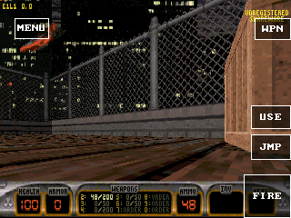
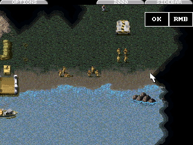
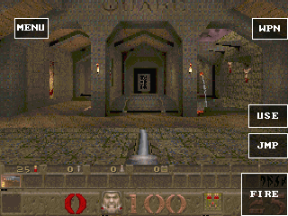

# GameRender 后续真机对比与执行成本审计

本阶段继续使用同一 GameKit / ESP32-S31、320MHz、16MiB PSRAM、320×240，
序列号 `1c:29:04:d0:af:5e`，固件为已验证的 v9，未重新刷写。
[固件摘要](firmware.json)与[应用摘要](package-artifacts.json)用于区分不同产物。
这一阶段没有完成全部游戏的 15fps 和完整音频目标。

## Duke3D：单独测量原生输出

同一固件、Hollywood Holocaust 实际屋顶，均保持
`x=-31243 y=7160 z=-158228 angle=422 mode=4`，热身后每秒读取设备呈现 FPS，
持续 60 秒，窗口内不截图、不移动。两个测量前截图的原始 RGB565 SHA-256 均为
`f11872c8f06a9ea312b1ecfb56cfbe384da52295ef8b0ffd8fb26f3fdcd4e431`。
这些截图位于热身前、开场下落期间（z=-181472），并非稳定 FPS 窗口的状态快照；
测量窗口中的新设备日志确认玩家已稳定在上面的 z=-158228。

| 输出路径 | 包版本 | 中位 FPS | 平均 FPS | 最低–最高 |
| --- | --- | ---: | ---: | ---: |
| 原 Guest 输出 | 0.1.27 / seq28 | 15.9 | 16.165 | 15.8–16.9 |
| 原生输出候选 | 0.1.28 / seq29 | 15.9 | 16.325 | 15.8–16.9 |

平均值只增加约 1%，尚不能认定稳定收益。公开构建保留原默认输出，
不把候选直接发布为加速版。原世界渲染、分辨率和音频设置未因 A/B 改变；
这也不代表既有音频桥接通过了原音频保真验收。

[基线完整报告](duke-v9-baseline/report.json)、[候选完整报告](duke-v9-native/report.json)
保留 60 个样本、前后状态和截图；[AOT 来源](duke-v9-artifacts.json)记录摘要。
基线复用原有 AOT，只重新签包以通过防回滚。候选为标准 WAMR 编译器构建，
在原有输入记录中增加 Host 计数，避免另加周期日志。
候选测量前后成功批次由 2988 增至 3977，共 989 次，拒绝数始终为 0，
执行计数差为 2416104us，约 2443us/次，证明原生路径实际执行。

窗口后全局空闲 SRAM / PSRAM：基线 82795 / 9060296 字节，
候选 83019 / 9059824 字节。最低水位是固件启动以来的累计值，不能解释为
各次运行独立内存峰值。候选计时后另检查手柄前进、后退，相关状态与截图保留。
基线和候选分别收到 8、9 条新设备状态记录，跨度 50.224、55.327 秒，均为上述稳定位置。
状态日志最长间隔约 15.1 秒，不能当作每秒状态快照；设备呈现 FPS 的 60 个样本均完整。

## C&C：实际任务通过性能检查，音频保真尚未通过

0.1.10 / seq11 在实际第一个 GDI 试玩任务热身 30 秒后采样 60 秒：
中位 **41.9fps**、平均 **41.183fps**、最低 **35.9fps**、最高 **44.8fps**。
前后截图均为活动地图，包含士兵、MCV 和登陆艇；菜单、载入和授权弹窗均不在窗口内。
完整记录见 [报告](cnc-v9-device/report.json)和该目录的串口日志。

测量后触屏选择 MCV、手柄下方向移动光标、A 选择士兵、START 打开选项菜单。
没有据此声称 MCV 已移动。退出后读取的 [conquer.ini](cnc-v9-device/conquer.ini)
没有音频关闭设置。停机记录的线性内存峰值为 6488064 字节，WAMR 动态分配峰值
312989 字节；没有取得此关卡的独立全局空闲堆快照。

**历史“音频开启”不等于“完整原音频质量”。** 锁定上游
`CommandConquer-ESP32S3@9a54fccb69474f31b5de58fe4986b16c0129b0b0`
的 `main/board_config.h` 默认 22050Hz、立体声。
当前 PXA `command-conquer/sound.cpp` 混音为 16000Hz，公共 `port_pcm` 与
ESP Audio 后端也限制 16000Hz 单声道。GameKit 驱动将单声道复制到两个 I2S 槽。
因此本轮 C&C 数据只证明实际任务的性能，不作为完整目标通过。
报告单独标明 `audio_fidelity_qualified=false`。

Duke/Quake 的 U8 立体声桥接也在进入 Host 前混为单声道；Quake II 的 S16
立体声进入公共桥接后仍会下混。四个游戏均需核对完整链路，不能仅以有声音验收。
下一阶段应恢复原混音采样率，协商源格式与实际输出能力，保留声道到设备边界，
使用有界 PSRAM 队列并测量欠载/丢帧。单扬声器是设备能力，不能由当前固定后端
倒推出它必须将所有游戏都限制为 16kHz。

随后 App 提交 `de89472` 将 U8 转 S16 辅助函数改为保留双声道，采样率和最多 64 帧
的批次不变。转换块由 128 增至 256 字节，放在既有 Guest 栈中，无新 Host SRAM
缓冲或队列。GCC/Clang ASan/UBSan 与 WASM 核对所有 65536 个 U8 声道对、
U8/S16 环绕、空数据、分批和旧单声道平均值，见 [来源及范围](audio-source-stereo/provenance.json)。
这是源格式保留的前置改动，当前 `port_pcm` 和 Host 仍为 16kHz 单声道；
本轮上机游戏 AOT 早于该改动，没有把宿主/WASM 测试冒充新游戏的设备验收。

## Quake：同一 AOT 分离世界与输出

私有 0.4.6 / seq126 AOT 为 5913612 字节，SHA-256
`68e638ecba0fbf89fc569c023228ac2490bfd4f8f85bfff7a99e150ae596b296`。
所有模式使用同一产物和 v9 固件，默认画面/来源和现有音频设置一致。
通过 START、A、A 进入实际 START，HP100、位置 `544,288,50`；每次模式确认后热身
20 秒，采样 60 秒，不截图、不输入移动。

| 顺序与模式 | 中位 FPS | 平均 FPS | 最低–最高 |
| --- | ---: | ---: | ---: |
| 初次 Guest 世界 + Guest 输出（独立启动） | 6.9 | 6.683 | 5.9–7.9 |
| 仅原生输出 | 6.9 | 6.833 | 5.9–7.9 |
| 原生世界 + 原生输出 | 5.9 | 6.150 | 4.9–6.9 |
| 仅原生世界 | 5.9 | 6.050 | 4.9–6.9 |
| 切回 Guest 世界 + Guest 输出 | 6.9 | 6.447 | 3.9–7.9 |

后四项在同一个运行实例中顺序切换；初次基线来自先前正常完成的窗口。
完整 [审计结果](window-audit.json)及 [只读审计脚本](audit-windows.py)
核对每个窗口 60 个原始设备 FPS 回应、统计值和新状态记录。
每个 Quake 窗口都有 12 条新状态、超过 45 秒设备时间跨度、相同出生点与指定模式。
按原设备时间戳去重，排除重放/延迟超过 2 秒的状态。所有原生窗口拒绝数为零。
最后基线的 3.9fps 保留，没有为改善数字而剔除。

| 分项中位数 | 初次 Guest | 仅原生输出 | 世界与输出均原生 | 仅原生世界 |
| --- | ---: | ---: | ---: | ---: |
| 全帧统计中的 view | 113.22ms | 113.33ms | 128.43ms | 128.42ms |
| 采样帧的表面准备 prep | 48.34ms | 48.28ms | 54.65ms | 55.19ms |
| 其中光照来源 load | 23.25ms | 22.81ms | 25.37ms | 26.15ms |
| 其中光照打包 pack | 6.90ms | 6.67ms | 7.04ms | 7.01ms |
| 采样帧的跨度 rows | 27.90ms | 28.60ms | 22.94ms | 22.24ms |
| Host 校验 / 完成帧 | 0 | 0.07ms | 10.88ms | 10.80ms |
| Host 执行 / 完成帧 | 0 | 2.29ms | 14.61ms | 12.32ms |

`prep/load/pack/rows` 仅在 1/16 的引擎帧采样，计时进口本身有开销；
`load/pack` 是 `prep` 的子区间，不能相加，采样帧也不能与全帧平均时间直接相加。
该结果提示表面准备依然昂贵，原生世界批次虽减少 Guest 的跨度阶段，
新增 Host 校验/执行和准备开销抵消了收益。仅原生输出也没有改善中位数。
这不能证明所有剩余时间都来自某一个复制函数，更不能据此推算已达 15/20fps。
这些都是诊断包测量，公开默认仍关闭新批次与原生输出。

最早的 SD 控制文件替换失败发生在完成初次基线之后；FAT 未替换已有目标，
脚本改为只删除自己创建的探针文件后上传。PXADB 应用私有目录写保护保持不变。
两次串口桥重新枚举造成的残缺窗口保留在 `rejected-attempts`，不计 FPS 结果。
一次重新连接后的模式等待因没有新的游戏就绪状态超时，也未计入结果。
最终四模式完整运行没有串口中断，结束后停止测试、移除自建 SD 控制文件。

## Red Alert：代码段已经超过装载预算

`ra-size` 仅将引擎 C/C++ 编译改为 `-Oz`，没有降低画质、单位、缓存或现有音频设置。
它不是完整音频保真构建，也没有安装为可运行候选。

| 离线产物 | AOT 文件字节 | TEXT 节字节 | TEXT 加固定线性内存 |
| --- | ---: | ---: | ---: |
| `-Oz`、原 Asyncify | 7155880 | 6175548 | 16202556 |
| 相同 Binaryen 优化，去掉 Asyncify | 4112612 | 3159212 | 13186220 |

固定线性内存 10027008 字节，观测到的空闲 PSRAM 最佳值 15684068 字节。
第一项仅 TEXT 加线性内存就欠 518488 字节，尚未计入重定位、模块元数据和运行时。
去掉 Asyncify 的 TEXT 减少 **3016336 字节（48.84%）**，该下界留下 2497848 字节。
不能把这个余量当作实际装载通过。

**无 Asyncify 产物保留未解析的 coroutine imports，当前 PXA 不能执行，未上机。**
没有声称它已有 FPS、原生主循环 ABI 已实现，或 RA 已完成移植。
另一个未经 Binaryen `-O2` 的原始对照也保留为 `ra-result.json`，不混同上表的公平对照。
编译器、原始 WASM、标志和产物摘要见 `ra-optimized-inputs.json`、
`ra-optimized-result.json`、[统一内存下界报告](followup-ra-memory-comparison.json)。
`check-ra-*.py` 保留当时从同一 CMake 对象重新链接的实验步骤，仅用于代码体积诊断。

新的只读工具 `tools/game-perf/aot_memory_budget.py` 可重复核对已存在的 v6 AOT，
区分文件大小和 TEXT 下界，拒绝截短节、重复节和非 v6 格式。
它不装载、不签名、不把离线产物变成可运行包。

## 上游与公开源码

App 提交 `ecb43ea` 保留私有的同 AOT 渲染探针、采样钩子、Duke 原生输出计数和相关回归。
后续源声道保留提交 `de89472` 将公开 Quake/SD 源码提升为 0.4.8 / seq128，
Duke SD 为 0.1.30 / seq31，Duke 为 0.1.3 / seq4，
高于本次测试包；这里不声称这几个公开版本的 AOT 已构建并验收。
SDK 为 `ab461fd`；原生固件使用 `9539547`，后续 Guest codec 与固件 wire 兼容。

[四仓库 HEAD 检查](followup-upstream-check.jsonl)均与锁定提交一致。
再次 `upstream.py prepare quake --ref b4c8c22bae3298b98c02166116eaeb91a34ffc24`
为零变化、零冲突；[导出的 vendor 适配补丁](quake-adaptations.patch.gz)
包含新增采样钩子。大型实现继续位于 `port/`，更新仍需运行差分和实际关卡测试。
本次只是同一锁定版本的导出检查，不保证未来版本自动无冲突。

常驻调用栈、事件等待与格式协商的下一阶段约束见
[执行和音频草案](../../design/pxa-game-execution.zh-CN.md)。草案尚未实现，
本轮没有发布新的 Core/Audio ABI，也没有替换默认编译器。

## 设备恢复：Jump 仍待恢复

测试游戏的代码已归档，私有数据、授权、SD 游戏资源和系统字体保留。
Quake II 0.1.13 已用原 AOT 恢复；OpenLara 0.5.2、Voxel Craft 0.12.10
和 App Store 0.8.8 均安装且未运行，见 [最终设备清单](restored-device.json)。
设备回到 HOME。

**原五个应用尚未全部恢复：Jump 0.1.9 仍归档，恢复工作未完成。**
直接恢复时约 1.90MiB 可用空间，低于 CLI 估计的 2.07MiB 安装峰值，上传未开始。
期间将 Store 的 8 个文件完整读回并逐项核对签名 manifest 的大小/摘要后临时归档，
先恢复 Jump；随后 Store 的恢复又被约 0.07MiB 的空间缺口拒绝。
因此已撤回这一临时顺序：再次归档 Jump，并从精确备份恢复 Store。
恢复后的 Store 8 个设备文件已再次逐项核对 SHA-256，与备份相同。

没有绕过客户端空间预检、服务端 128KiB 提交余量或签名检查，也没有删除其他应用
数据腾空间。[Store 备份来源](store-backup-provenance.json)、两次拒绝及恢复日志均保留。
重启未释放足够存储；重启后的短时 HELLO 无应答随后恢复，最终仍为同一设备的 2Mbaud。
Jump 的原签名包和私有数据保留，后续必须解决存储空间并完成恢复，不能把本记录
当作五个应用完整恢复的通过证明。
