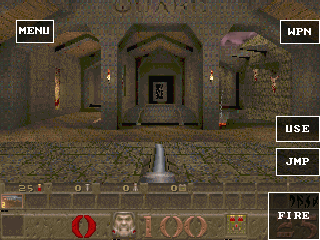

# GameRender 1.1 投影路径：真机验证与未采用原因

这一阶段完成了投影扫描行、逆深度写入、C/C++ SDK 和真机功能验证，
但没有改善 Quake 的实际帧率。`PXA_QUAKE_PROJECTED_SPANS` 默认关闭。
15fps最低目标及20fps期望均未达到，不将计算测试当作游戏FPS。

## 已实现

- GameRender 1.1 / feature bit 2，`io(0x106)`；1.0请求继续兼容。
- 每个表面提交152字节固定参数和每行8字节，Host执行原来的32像素细分、
  10.6光照采样和可选16位逆深度写入。严格f32，无FMA重排。
- 不分配纹理、帧、深度或span数组；复用已有worker和Guest缓冲。
  256行的Guest命令区为2200字节，旧256个预计算span为6216字节。
  借用仅持续到同步导入返回，适用于非固定线性内存与memory.grow。
- 全批预检，拒绝批次不写颜色或深度；检查浮点转换、边界、别名和工作量。
- 上游原函数保留用于回退。差分测试从当前vendor提取原函数，仍可三方同步。

SDK提交：`5bda499`。衍生算术保持GPL-2.0-or-later授权与原版权。
接口细节见SDK的 `spec/draft/game-render-indexed-spans.md`。

## 设备与固件

GameKit / ESP32-S31，320MHz，16MiB PSRAM，320×240面板，
序列号 `1c:29:04:d0:af:5e`，只使用 `/dev/ttyACM0`。
仅刷写0x10000应用分区，没有更改分区表、NVS或游戏资源目录。
固件3937392字节，比上一阶段增加3648字节；完整摘要见[firmware.json](firmware.json)。

[真机计算记录](native-compute-device.json)：

| 检查 | 结果 |
| --- | --- |
| 原span路径8批 / 512000像素 | 零错误，非固定内存增长通过 |
| 新投影路径8批 / 512000像素 | 零错误，含逆深度与第二次内存增长 |
| 新投影路径总耗时 | 111329us；其中预检19383us，原生执行79628us |

以上是合成计算任务，包含64000像素每批，不是实际游戏帧率。

## Quake 实际关卡

私有包0.3.0（seq110），stock WAMRC、固定全局状态直接寻址开启；
旧预计算Host span关闭，新投影路径开启。包摘要见[package-artifacts.json](package-artifacts.json)。
实际START关卡出生点x544/y288/z50，HP100，原320×200逻辑画面、原音频，
未降低材质、mip或视距。进入关卡并热身后连续60个一秒样本，测量窗口内不截图，
每秒发送中性手柄状态防止自动锁屏。就绪记录在窗口前后均通过。

| 指标 | 结果 |
| --- | --- |
| 中位FPS | **3.9** |
| 平均 / 最低 / 最高FPS | 3.485 / 2.9 / 4.0 |
| 上一阶段默认Guest渲染中位FPS | 6.9 |
| Host批次 / 帧 | **316** |
| Host像素 / 帧 | 48202 |
| Host拒绝 | 0 |
| 表面阶段 / 帧 | 208266us |
| 其中Host预检 / 原生执行 | 31201 / 53074us |

阶段时间有嵌套关系，不能相加解释整帧。这里的316来自实际计数，
未把所有剩余时间都归因于某一个导入函数。细粒度批次仍然过多；
大批次计算测试的吞吐不能外推到这个实际调用模式。

[汇总](quake-summary.json)、[60秒原始样本](quake-measurement.json)、
[串口记录](quake-serial.jsonl)均保留。以下截图在采样后捕获，来源为实际面板完成帧。



采样后全局堆：SRAM剩余93143、历史最低31980字节；
PSRAM剩余6411024、历史最低5637156字节。资源账本的Host frame/scratch=0，
不表示Guest内的两个RGB565映射缓冲不存在；它们仍占307200字节。

公开Quake/SD版本提升至0.3.1（seq111），以超过私有包的反回滚序号；
公开默认渲染路径继续关闭两种实验Host span选项。
这里没有宣称0.3.1公开AOT已重新构建或上机验收。

## 回归与复现

- Host/WAMR 43/43通过；C SDK全套及C++ game_spans/game_raster_context/game_service/game_loop通过。
- GCC/Clang分别40000组当前上游透视、光照、深度对比通过，覆盖正负偏移、
  交叠行、反序执行分区及八种采样核；旧lit-span的200000组仍通过。
- ESP适配器Host测试、规格/生成器检查、公共层23项Python测试通过。
- 拒绝末行、NaN/Inf、转换越界、深度/颜色/输入别名及新的内存基址均有回归。

```sh
python3 local/pxa-apps/common/recrof/tests/run_quake_projected_spans.py
CC=clang python3 local/pxa-apps/common/recrof/tests/run_quake_projected_spans.py
bash tools/app.sh build quake-projected --board doit-gamekit \
  --source-root tools/game-perf/profiles --target esp32s31 --output local/reproduce-projected
```

该配置明确是失败候选复现。下一步需要跨材质合并，并保证被复用的光照和纹理
数据在执行前保持有效。可在Surface明确归还所有权后复用已有后缓冲作为有界
命令/资源暂存区，执行完成后再转换RGB565；这一设计尚未实现或计入性能收益。
