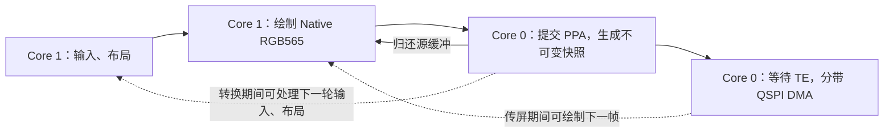

# ESP-Mosaico UI 快照流水线并行化

日期：2026-10-16。设备：ESP32-S31 rev0.0，480×480、305 DPI，CO5300 QSPI 48 MHz，
`/dev/ttyACM2`，2,000,000 baud。接续
[上一轮绘制优化与基线](ui-device-profile-20261016.zh-CN.md)。

顶部浮层的后续修正见 [性能浮层统计修正](performance-overlay-20261016.zh-CN.md)。
本文 FPS 来自独立的 LCD 完成统计，旧截图上的浮层数值不作为性能证据。

## 并行的范围

此前已经重叠：游戏光栅化与显示、下一帧 UI 绘制与上一帧传屏、SRAM 分带复制与 SPI DMA。
此前两绘制线程没有优于单线程方案，因此保留单个 LVGL 软件绘制线程。

本轮将 UI 任务持锁执行的 PPA 快照转换，移至已有 Core 0 传屏任务。输入、布局等任务
可以利用转换期间的空档。转换完成后才归还 LVGL 源缓冲，随后传屏与下一帧绘制重叠。
单个保留绘制缓冲的下一帧像素写入仍需等待转换完成。



没有新建任务、信号量、帧缓冲或 PPA 客户端。原 40 B 队列项的尾部空隙容纳类型标签，
载荷按类型存放游戏帧信息或 UI 源指针/唤醒任务，队列深度仍为 1。
`static_assert(sizeof(FlushRequest) == 40)` 在实际 32 位目标构建中验证。
原 1 B 保留画面状态改为原子枚举，记录 Current / Copying / RestoreRequired。

## 所有权与并发正确性

- 仅最终 LVGL flush 移交保留画面；中间 flush 只收集脏区域。
- 工作任务完成转换后调用 `lv_display_flush_ready`，发布所有权并唤醒生产任务。
- `RENDER_START` 与 flush 等待回调都检查 Copying，覆盖 LVGL 已看到 ready、
  但驱动尚未完成状态发布的短窗口，防止新一次提交与旧状态发布交叉。
- 通知作为唤醒提示，条件由原子状态决定。等待有 1 tick 的重查，支持 PXADB 等
  不同调用任务接管 UI 锁，也能处理其他模块的通知和旧通知。
- 游戏直出先等 UI 转换完成，再使用共用 SRM 客户端；游戏 producer/scanout 交换保持。
- 截图、亮度、开关屏继续等待完整在途帧并持有面板锁。
- 队列提交失败恢复状态与缓冲；转换失败归还源缓冲、释放提交资格并请求重绘。
- 加速客户端在 UI 任务启动前初始化。S31 的缓存维护按地址操作共享 DCache，
  PPA 驱动仍执行输入 C2M 与输出 M2C，同步边界未因换核心而省略。

## 相同工作负载的真机对比

设置首页相同字体、深色主题、分辨率、DPI、坐标和主指针 0。
每轮连续十段 650 ms 往返滑动；下拉为八段展开/收起，释放后停顿 150 ms。
每轮从确定的页面重新准备，截图放在 PERF/MEMORY 窗口外。
统计 LCD 完成帧的完整窗口，不使用 Guest 提交 FPS。

| 场景 | 串行快照完整窗口，第 1 / 2 / 3 轮 | 工作任务快照，第 1 / 2 / 3 轮 |
| --- | --- | --- |
| 设置首页 | 25.25 / 25.40 / 25.56 FPS | 25.25 / 26.61 / 26.63 FPS |
| 下拉完整流程 | 19.57 / 19.24 / 19.45 FPS | 20.34 / 19.94 / 19.95 FPS |

设置页后两轮均值提高约 **4.5%**；下拉后两轮约 **3.1%**。
首轮与后续分别列出，不混成同一缓存状态。此次下拉已被使用过，没有重测首次冷打开，
上一报告的首次长间隔仍需单独定位，不能宣称已由并行化解决。

设置页串行快照后两轮帧间隔中位数 34.39 / 34.35 ms，P95 为 51.52 / 51.60 ms；
并行版本为 34.21 / 34.24 ms，P95 为 51.27 / 51.09 ms。
收益主要体现在完整窗口，仍有跨到下一扫描周期的帧，尚未稳定 30 FPS。

`render_us` 在新路径中不再包含异步快照，也扣除源缓冲等待；`snapshot_us` 仍单独计时。
不能把该字段的下降全部归因于绘制加速，也不能把不同任务的最近采样相加当作同一帧。
最终收益以显示完成窗口为准。

## 内存

| 固定资源 | 前后容量 |
| --- | --- |
| LVGL 保留画面 / 游戏 producer / scanout | 各 460,800 B PSRAM |
| 两块 DMA 分带缓冲 | 合计 30,720 B SRAM |
| 传屏任务栈 | 4,096 B SRAM |
| 队列 | 1 × 40 B 载荷，结构容量不变 |
| `.dram0.data` / `.dram0.bss` | 39,196 / 31,320 B，不变 |
| IRAM / 静态 PSRAM | 105,806 / 36,016 B，不变 |

Flash text +280 B，rodata +16 B。未开启 PSRAM XIP，没有新增 PSRAM 代码副本。
工作任务新增 PPA 调用后的最小空闲栈约 3,008 B。

设置页后两轮的原始堆结果：

| 指标 | 串行快照 | 工作任务快照 |
| --- | --- | --- |
| SRAM 稳定空闲 | 115,175 B | 115,143 B |
| SRAM 本次最低空闲 | 114,951 B | 115,107 B |
| PSRAM 本次最低空闲 | 13,869,568 / 13,869,748 B | 13,908,960 / 13,905,796 B |

稳定 SRAM 有 32 B 差异，实际窗口的最低空闲增加 156 B；不把细小堆差异解释为
新增或节省了某个固定缓存。初始化顺序和访问历史不同，PSRAM 差额也不能全部归因于这次优化。
首次新窗口有约 4 KiB SRAM 额外瞬时占用，单独保留，不用历史低水位替代本次峰值。
相邻固件初次查询的启动历史 SRAM 最低为 32,136 / 32,156 B，也与操作窗口分别记录。

游戏两次操作窗口 SRAM 最低为 58,663 / 58,627 B，PSRAM 最低
12,204,048 / 12,202,340 B。退出后 SRAM 为 95,891 / 95,855 B，PSRAM 为
13,930,256 / 13,930,308 B，未见重复启动持续增长。
其初始化历史最低 SRAM 19,352 B，PSRAM 11,010,748 / 11,009,984 B；
与操作窗口峰值分开。游戏失败/重开后的场景可能不同，不据此声称其所有峰值精确持平或下降。

游戏内完整下拉另测：本次最低空闲 SRAM 58,627 B、PSRAM 9,836,632 B。
该窗口覆盖已有游戏缓冲和系统透明面板的同时存在，截图在窗口外；旧游戏冒烟未包含
相同完整面板场景，不能合并作峰值对比。显示改动未调整 Guest 线性内存、游戏深度缓冲
或命令队列容量。

## 画面、游戏与回归

- 原生 ASan/UBSan 测试通过。
- 真实 LVGL 30 帧滚动、圆角、透明度逐字节对照通过；延迟快照测试检查源画面不被
  提前写入，并覆盖 ready 先到、所有权尚未归还、下一轮刷新和游戏切回 UI。
- 开启真实手势识别器的点击、取消与实体触摸接管回归通过。
- 真机设置页排除时间/状态栏/FPS 的 184,320 个像素，与串行版本完全一致；
  游戏退出、完整下拉关闭后返回设置再次核对。
- Jump Jump 3D 0.1.5 两次真实主指针蓄力/释放为 26.87 / 27.31 FPS，
  与此前约 27 FPS 接近，只作为交互及生命周期冒烟，不宣称游戏加速比例。
- `PERF INPUT` 的软件采样至显示完成均值约 110.5 / 103.6 ms，
  P95 约 168.3 / 179.4 ms；没有证据表明游戏输入延迟明显下降，且未测声学或发光响应。
- 游戏内状态栏透明合成、连续两次下拉进入完整面板、Back 关闭并返回直出，以及退出到
  系统设置的截图通过。首次脚本在两次下拉之间截图，超过了短暂状态栏的有效期，
  只重复唤出状态栏；该试跑记录为 `bar-reveal-timeout*`，不作为完整面板通过证据。
- 音频非零 PCM，音乐欠载、音频恢复和写入错误均为零；没有测量声学延迟。
- SPI 错误、TE 超时为零；扩展游戏测试累计有两次 `scan_overruns`。
  截图不足以证明所有实物扫描周期都无撕裂。

应用和数据保留，存储 used=8,704,000 B、free=3,813,376 B，音量 75%、亮度配置 100%、
深色主题保持。

## 复现及构建记录

```sh
# 先解锁屏幕，保持本机设置位于第一个主页图标，测试期间不要操作实体屏幕。
python3 firmware/boards/esp-mosaico/tests/measure_device.py trial-settings \
  --page settings --pointer-id 0 --port /dev/ttyACM2 --baud 2000000 \
  --runs 3 --output local/mosaico-ui-trial
python3 firmware/boards/esp-mosaico/tests/measure_device.py trial-shade \
  --page shade --pointer-id 0 --port /dev/ttyACM2 --baud 2000000 \
  --runs 3 --output local/mosaico-ui-trial
bash firmware/boards/esp-mosaico/tests/test_host.sh
bash firmware/boards/esp-mosaico/tests/test_lvgl.sh --gestures
```

本轮原始记录：`local/mosaico-parallel-20261016/`。
`sync-settings` / `sync-shade` 是改动前，`async-settings-clean` / `async-shade` 是新版本；
`async-game` 是游戏交互，`full-shade` 是修正后的完整下拉。
`sync-before-settings` 停在锁屏、`async-settings` 混入实体触摸且起始页改变，均已排除。
工具现会在零完成帧时中止，仍应检查起始页和每轮截图。

设备已写入并通过 ROM 散列校验的镜像为 `async-snapshot.bin`，3,981,392 B，SHA-256：
`6fc3aa0b55e1f66bdb1dd7845e99a25e2ee272cc7cf1a343137c617ea170fe43`。
只更新应用分区；ROM 原生写入约 121 秒，未使用不稳定的 USB RAM stub。

后续优先定位首次下拉的长间隔、UI 绘制本身和 TE 阶段的余量；更多 LVGL 绘制线程、
并行像素写入、额外帧排队均需独立证据。当前保持单帧背压和明确的源缓冲所有权。
