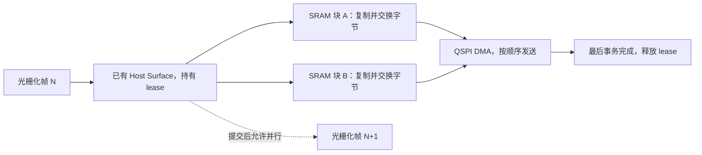

# SenseCAP Watcher 游戏优化方法与复用参考

2026-10-14。对象为本仓库 Watcher 固件、ESP32-S3、SPD2010 412×412 RGB565、40 MHz QSPI。
这份文档解释采用了哪些方法、为什么有效，以及迁移到其他板子时需要保留什么。
完整基准、逐帧数据和截图放在 **pxa-apps 仓库**：

- `jump-jump-3d/docs/sensecap-watcher-20261014.zh-CN.md`：第一阶段板级修复，约 12.2 → 18.6 FPS。
- `jump-jump-3d/docs/sensecap-watcher-pipeline-20261014.zh-CN.md` 及同名 JSON：第二阶段流水线、公平对比、峰值与验证证据。
- [板级显示历史记录](display-performance-optimization.md)：硬件参数与更早的 UI 优化。
- `voxel-craft/docs/performance/game-render-20261015.zh-CN.md`：后续扫描线优化；固定世界的 Voxel 约 9.9 → 10.1～10.3 DMA FPS，Jump 基本持平。记录原版回测、真实内存窗口和像素一致性，不能与上面的流水线收益重复相加。
- `voxel-craft/docs/performance/game-render-occlusion-20261015.zh-CN.md`：进一步用已有 R16 深度保守拒绝整行，省去不可见行的透视计算；无需新缓存。记录独立回测与未采用候选。

## 已验证的整体收益

第二阶段保持同一签名 AOT 应用、地图种子、相机、原生分辨率、画质、声音和蓄力公式。
下表取两轮范围；FPS 按**不同帧的面板 DMA 完成时间**计算，未测光学扫描速率。

| 相同流程 | 基线 FPS | 最终 FPS |
| --- | ---: | ---: |
| UI 流程后，静止 | 18.62～18.68 | 34.33～34.48 |
| UI 流程后，成功跳跃 | 17.79～17.83 | 31.60～31.92 |
| 首次冷启动，成功跳跃 | 17.79～17.90 | 29.73～29.89 |

UI 流程后的静止 / 跳跃均值提高约 84.5% / 78.3%；首次冷启动跳跃约提高 67.1%。
尚未逐帧锁定 30 FPS。成功跳跃的软件输入至关联 DMA 完成 P95，在 UI 后短测中约 110 → 78～80 ms；不含物理触摸和光学扫描。

匹配 UI 流程后四轮游戏的最坏稳定占用：SRAM **519496 → 511624 B**、PSRAM **3372160 → 3334176 B**；
游戏窗口峰值 **523856 / 3432272 → 515984 / 3392716 B**。首次初始化和独立冷启动对照也下降。
最终 SRAM heap 总容量少 80 B，按固定参考容量补回后仍下降。固件 flash 增加 16208 B，未通过缩小游戏包换性能。

这些是组合固件收益，不能拆成每项独立加速百分比。Raster 平均墙钟时间在 UI 后比较中反而从约 18～20 ms 增至 21～22 ms；
**主要收益是少复制、少串行等待，并让阶段重叠**，不是每个阶段都变快。并行争用会使单阶段墙钟变长。

## 1. 从串行送屏改为有背压的流水线

原路径先光栅化，再写整帧镜像，驱动再次复制到 SRAM，最后等待送屏。原生新路径从已持有的 Surface 直接生成 DMA 小块，
入队后返回；当前帧转换 / 发送期间，可以光栅化下一帧。下面表示数据流和可并行关系，不是等比例时序图。



| 手段 | 原因与收益 | 内存和必要约束 |
| --- | --- | --- |
| 异步呈现与背压 | 移除渲染、转换、显示间的逐帧串行等待；防止通过无限排队换取虚假的提交 FPS | 复用已有 presenter / flush 任务、单项队列和信号量；仍为三个游戏 Surface；新呈现先等待上次传输完成 |
| 原生 Surface lease | 每帧省去一次 339488 B 的整帧 PSRAM 镜像写回；驱动也不再重复弹跳复制像素 | Surface 保持只读直到 DMA 真正结束；截图、UI 切换、停止和失败清理都必须遵守所有权 |
| 两块 SRAM 交替转换 / 发送 | DMA 读取一块时，CPU 可填充另一块；固定容量取代热路径临时分配 | 每块十二行，412×12×2 = 9888 B，两块共 19776 B；重用前等对应事务完成；最后四行单独覆盖 |
| 板级 SPI transport | 用公开 SPI API 控制块的生命周期，避免再次复制；共享同一对块给 LVGL | 两个事务描述符；保留 SPD2010 QIO、CS、32 位命令及参数语义；最末 DMA 出错也检查并回收 |

这不是字面意义的零拷贝：PSRAM Surface → SRAM DMA 块的一次复制仍然需要，字节交换融合在这次复制里。
正常小块路径无逐帧分配；小块初始化失败时的兼容路径不享有这一保证。

原生路径只用于完整原生 Host RGB565、连续 stride、非 Guest 映射、无有效透明叠加的帧。
缩放、Guest 映射和透明层继续使用已有镜像合成；合成镜像在传输结束前也不可改写。
不能把这些分支删掉，或在 DMA 尚未结束时提前归还 Surface。

## 2. 只优化确实执行的像素工作

| 手段 | 原因与收益 | 内存与验证 |
| --- | --- | --- |
| 对齐像素对读写、标量尾部 | 第一阶段发现 Xtensa 将每对像素的 `memcpy` 变成两次函数调用；改为合法别名的成对访问 | 不分配；第一阶段合成拷贝抽样约 42 → 17 ms；O3 + ASan/UBSan 检查裁剪、padding、奇数尾部 |
| 小范围 alpha 合成 | RGB565 快拷贝后，只处理覆盖区域，避免小 HUD 迫使全帧走通用逐像素分支 | 无新缓存；透明顺序与通用内核逐像素一致；无 alpha 的 Jump 初始场景没有单项收益结论 |
| 局部 `-O3` | 优化 Raster 和板级像素转换热代码，避免为少量 flash 牺牲速度 | 不增加热路径分配；不改所有板子、应用和冷初始化的编译策略 |
| S3 SIMD 字节交换 | 16 字节对齐时每次处理 16 像素；同余地址先处理最多七个像素再进入向量内核 | 汇编内核 29 B，无缓存；不满足对齐 / 长度时标量回退；实际 S3 执行 640 组偏移、长度、哨兵检查 |

SIMD 处理的是送屏字节序，不改变颜色精度、材质、分辨率或游戏物理。
本轮没有隔离测出 O3 / SIMD 各自的 FPS 收益，不能把组合提升全部归给它们。
`CONFIG_PXA_PARALLEL_RASTER=y` 在本轮基线已经启用，也不计为本轮新增优化。

## 3. 把有限 SRAM 留给必须使用它的部分

| 手段 | 原因与收益 | 内存变化和验证 |
| --- | --- | --- |
| 一个 LVGL 软件 draw unit | 第一阶段移除两条 32 KiB worker 栈，恢复连续 SRAM；旧最大空闲块 8192 B，小于音频混音器需要的 8592 B | 理论栈容量不能直接当作整机净减少；音频恢复后也计入整机测量；菜单、滚动和通知栏通过 |
| 缩减备用 UI 缓冲 | 游戏直出仍保留正常 UI 回退，但不需要其原有全屏容量 | 第一阶段省 339488 B；第二阶段双缓冲 206 → 200 行再省 9888 B；双缓冲加镜像现为 669088 B PSRAM |
| 大 Raster 资源直接走已有 PSRAM 后备池 | 避免大调色板等先挤占内部 SRAM，再失败回退；实测资源分配失败累计计数 5 → 0 | `CONFIG_PXA_RASTER_INTERNAL_ALLOCATION_MAX_BYTES=4096`；其他板默认 0，保留原策略；无新池或缓存 |
| 按实测高水位调整栈 | 降低常驻内部占用，同时保留真实最深路径所需空间 | PXADB 20 → 18 KiB、flush 4 → 3 KiB；LVGL 保留 10 KiB、presenter 保留 4 KiB；覆盖签名包部署和截图 |

最小剩余栈观测：LVGL 2620 B、flush 992 B、presenter 1052 B；18 KiB PXADB 经真实部署 / 截图后剩 3856 B。
这些数值只覆盖本轮路径，迁移时应重新测量。涉及 flash 的控制栈继续放内部 SRAM。

第一阶段同时补齐 ES8311 取消静音、设备时钟驱动音频和错误诊断。
非静音 PCM 到达 I2S，已测音乐解码欠载为零；未做麦克风测量或持续长音频压力测试。
释放 SRAM 后才恢复的音频资源已经纳入内存统计，没有用无声状态当作完整游戏基线。

## 4. 让等待、截图和调试不会破坏游戏稳定性

| 手段 | 原因与收益 | 内存与验证 |
| --- | --- | --- |
| LVGL owner 等待完成 | 默认忙等曾导致冷启动第二次打开游戏触发 watchdog；等待时 `vTaskDelay(1)` 让出 CPU | 原子完成标志利用对象 padding，无新增信号量；flush 任务只发布完成，LVGL owner 清除 flushing；成功 / 失败都解除等待 |
| SHA-256 分段更新 | PSA 默认会复制输入到私有内存；整幅 JPEG / RGB565 一次 hash 会申请大量连续 SRAM | 每段最多 1024 B，摘要相同，无常驻大缓冲；37404 B 噪声 JPEG 和 339488 B 原始帧均通过 SHA 校验 |
| 截图编码工作区优先 PSRAM | 避免截图时供应商工作区随 SRAM 空闲量变化，造成不可控的内部峰值 | 可选 `CONFIG_PXADB_JPEG_PSRAM_WORKSPACE=y`；仅截图线程、≥4096 B 分配生效；无 encoder 缓存或额外任务；外部不足回退原分配器 |
| 日志保持协议分帧 | 日志槽位耗尽后回退裸 UART，会把日志插进截图 DATA，造成超时和误判 | 保持两个静态槽；订阅时满槽计数丢弃，不扩容；工具回归 71 项及日志 / 截图并发验证 |

JPEG 策略有明确维护代价：`esp_new_jpeg 1.0.2` 缺少公开的逐实例分配器，适配隔离的两个私有分配符号。
只有这项使用私有分配入口，SPI transport 使用公开 API。JPEG 库升级后必须复测线程隔离、嵌套、分配失败、释放和峰值；
其他板默认关闭。输出缓冲保留原来的两张原始帧容量，412² 时为 678976 B PSRAM，没有常驻编码器。

## 5. 正确性约束也是优化的一部分

- **先验证实际发送像素。** 临时 Surface 漏设 `visible` 曾让转换早退，只重复发送旧块中的 FPS 标签；相应 35 / 39 FPS 全部撤回。现在原生像素转换不再伪造 Surface。
- **屏幕窗口与像素数量一起对齐。** SPD2010 要求左边界和排他右边界均为四的倍数；全屏 `[0,412)` 合法。LVGL 包含式 x2 向上取至 4N+3，再在发送时加一；不能只扩大窗口而不处理 stride / 数据长度。
- **错误时先收回事务，再归还存储。** 入队失败、尾块失败、截图和前后台切换，都不能留下仍在读取的 DMA 块或提前释放的 lease。
- **截图不等于面板。** Host 截图绕过 SRAM 小块；必须结合生产 transport 整帧字节测试、真机 SIMD 自检和物理观察。用户确认八行修复版正常，最终十二行版另通过生产 transport / 真机自检，不冒充再次人工目视确认。

## 6. 尝试过但没有采用的方案

| 方案 | 未采用的原因 |
| --- | --- |
| 只让整帧镜像路径异步运行 | 约静止 22.5～22.7、跳跃 21.6 FPS；仍承担全帧写回和再次复制，收益不足 |
| SPI2 / SPI3 直接 PSRAM DMA | 两者均出现真机 DMA 下溢；保留固定 SRAM 小块，不修改 IDF 私有驱动 |
| 提高 QSPI 时钟 | 保持已验证的 40 MHz；更早 80 MHz 曾出现花屏，不以信号稳定性换吞吐 |
| 单纯增大分块 | 早期 10 / 12 行版本超出当时的稳定 SRAM 或 UI 峰值约束；最终十二行是在栈和截图峰值修复后重新通过的组合 |
| 小 JPEG 输出缓冲，失败后扩容重试 | 原生模拟通过，但实际供应商库在缓冲过小时破坏堆；撤回，保留原容量 |
| 降分辨率、减画质、额外整帧缓存 | 未采用；相同场景逻辑截图排除顶部 FPS 标签后 RMS 为零 |

Watcher 没有接 TE，不承诺零撕裂或光学锁帧。冷启动比 UI 后转换慢的具体原因尚未隔离证实，缓存布局 / 总线争用只是待验证解释。
Guest 更新、几何、编码、排队也尚无分别独立的耗时分布；不能把它们写成已经完成的单项加速。

## 7. 复用入口与验证顺序

| 要看什么 | 实现入口 |
| --- | --- |
| lease、入队、完成、LVGL 等待 | [watcher_hardware.cc](../src/watcher_hardware.cc)：`PresentDirectFrame`、`WaitDirectFrame`、`FlushTask`、`WaitFlushDisplay` |
| 原生转换、alpha 与标量回退 | [watcher_pxa_surface.cc](../src/watcher_pxa_surface.cc)：`PackNativeRgb565Band`、`SwapRgb565Pixels`、`ComposeFrame` |
| 双事务、参数与错误回收 | [watcher_lcd_io.cc](../src/watcher_lcd_io.cc)：`LcdIo::Color`、`Parameters`、`Drain` |
| S3 向量内核 | [watcher_rgb565_swap.S](../src/watcher_rgb565_swap.S) |
| 大资源分配策略 | [pxa_esp_surface.c](../../../components/pxa/src/services/pxa_esp_surface.c) 与 [PXA Kconfig](../../../components/pxa/Kconfig) |
| 截图 hash / 日志分帧 | [src_pxa_service.cc](../../../components/pxadb/src_pxa_service.cc)：`Sha256Bytes`、`PxaLogVprintf` |
| 可选 JPEG 内存适配 | [pxadb_jpeg_memory.cc](../../../components/pxadb/pxadb_jpeg_memory.cc)、[pxadb_jpeg_encode.cc](../../../components/pxadb/pxadb_jpeg_encode.cc) |
| 板级选择与 O3 | [sdkconfig.defaults](../sdkconfig.defaults)、[板级 CMake](../CMakeLists.txt)、[Host CMake](../../../components/pxa/CMakeLists.txt) |

迁移建议按下面顺序推进；分块行数、核心绑定、PSRAM 阈值和栈大小都需要该板实测，不直接复制十二行配置。

1. 固定包哈希、地图 / 相机、画质、分辨率、DPI、音量和输入流程；冷启动与 UI 后分别测量。
2. 验证整帧实际传输字节、屏幕窗口、尾块与错误清理，再考虑 FPS。
3. 找出整帧复制和串行等待，先复用现有缓冲与任务，再加入有界异步呈现；检查停止与前后台的所有权。
4. 对齐 / O3 / SIMD 放在热路径已确认后实施；用该设备执行真正的指令和 DMA 路径。
5. 分别核对 SRAM / PSRAM 稳定值、首次初始化、游戏和 UI / 截图局部峰值，以及最大连续空闲块；不要混用历史最低水位。IDF 的各 heap 最低值可能来自不同瞬间，汇总是保守高水位，不是同步总峰值。
6. 按实际 DMA 完成计帧，保留整窗口 FPS 和活跃阶段 FPS；截图放在游戏测量窗口外。结束后清理探针，别把堆遍历时间算进帧率。

在主仓库根目录执行已有回归（需要已配置的 IDF / 依赖）：

```sh
bash firmware/boards/sensecap-watcher/tests/test_host.sh
bash firmware/components/pxadb/tests/test_host.sh
PXA_TEST_SANITIZERS=1 bash firmware/components/pxa/tests/test_host.sh
python3 -m unittest discover -s tools/pxadb -p test_pxadb.py
```

设备 UI / 截图检查使用 [validate_device.py](../tests/validate_device.py)，游戏采样使用 [measure-device-gameplay.py](../../../../tools/measure-device-gameplay.py)。
完整参数与原始数据位置见 pxa-apps 第二阶段报告。真机已覆盖两组八轮游戏、两次失败跳跃、两轮冷启动 UI 共 71 次 SHA 校验截图；
模拟器用于圆屏 / DPI / UI 与游戏回归，不能模拟 S3 SIMD、QSPI 或物理触摸延迟。
